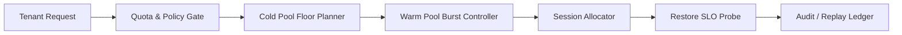

# Agent Runtime 冷池规模治理选型 FAQ（固定小冷池 vs 自适应冷温池）

## 1) 核心结论（先给负责人）
- **多租户生产默认采用“自适应冷温池 + 恢复预算”**，不建议长期固定小冷池。
- **固定小冷池在突发高峰时更易触发排队溢出与冷启动放大**，会拉高尾延迟与失败重试。
- **冷池规模治理必须与租户配额、网关策略和审计回放联动**，否则成本与可靠性无法同时优化。

## 2) Q1 / Q2 / Q3（术语先通俗解释）
- **固定小冷池**：冷池容量恒定，成本可控，但面对突发时恢复能力弱。
- **自适应冷温池**：按流量与健康信号动态调节冷池与温池比例，兼顾成本与恢复速度。

### Q1：为什么固定小冷池在生产里有风险？
第一性原理：流量和启动需求具有突发性，冷池恒定会导致瞬时排队堆积，放大冷启动链路压力。

### Q2：什么时候可以接受固定小冷池？
单租户、流量波动小、恢复目标宽松且预算极度敏感时，可作为短期策略。

### Q3：冷池规模治理的最小安全闭环是什么？
租户配额 -> 冷池下限策略 -> 温池突发预算 -> 会话分配器 -> 恢复SLO探针 -> 审计回放账本。

## 3) Mermaid（Runtime 冷池规模治理闭环）

## 4) 决策矩阵
| 维度 | 固定小冷池 | 自适应冷温池 |
|---|---|---|
| 实现复杂度 | 低 | 中-高 |
| 高峰抗压能力 | 低 | 高 |
| 溢出控制能力 | 低-中 | 高 |
| 成本弹性 | 中 | 高 |
| 生产默认建议 | 短期过渡 | 多租户长期运行 |

## 5) 数据证据与可复算算例（含 n/分母/来源）
> 本节百分比为 `synthetic_assumed` 假设算例（hypothetical），用于机制比较；生产机制认证仍为 `not_measured`。  
> 合同字段见：`workshops/azure-agent-infra/evidence/cycle-430-benchmark.json` 的 `percentage_contract`。

- 指标 A（溢出率，固定小冷池）  
  - 定义：`n_overflow_fixed_small_pool / n_sessions_observed`  
  - 值：`288/2400 = 12.0%`（`synthetic_assumed`）  
  - 路径：`percentage_contract.fixed_small_pool_overflow_rate`
- 指标 B（溢出率，自适应冷温池）  
  - 定义：`n_overflow_adaptive_pool / n_sessions_observed`  
  - 值：`86/2400 = 3.6%`（`synthetic_assumed`）  
  - 路径：`percentage_contract.adaptive_pool_overflow_rate`
- 指标 C（热恢复成功率提升，百分点）  
  - 定义：`(n_restore_success_adaptive - n_restore_success_fixed) / n_sessions_observed`  
  - 值：`(2140-1938)/2400 = 8.4` 个百分点（`synthetic_assumed`）  
  - 路径：`percentage_contract.warm_restore_gain_pts`

## 6) 生产 Checklist（上线前必须打勾）
- [ ] 冷池下限与温池突发策略含版本、灰度与回滚路径  
- [ ] 租户配额与突发门禁在网关层生效  
- [ ] 恢复预算、排队指标与审计回放可追溯  
- [ ] 指标口径标注 `synthetic_assumed` 与分母/单位，生产机制认证保持 `not_measured`  
