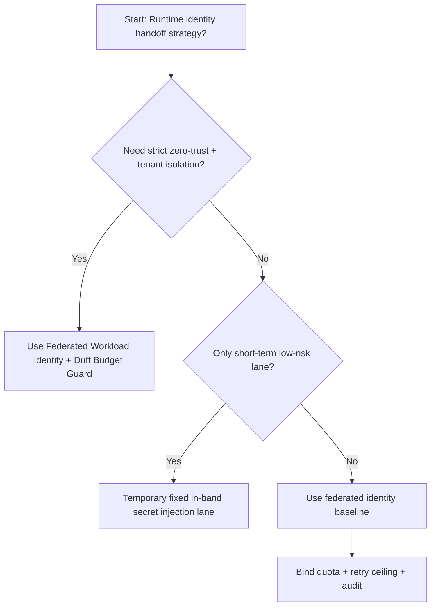
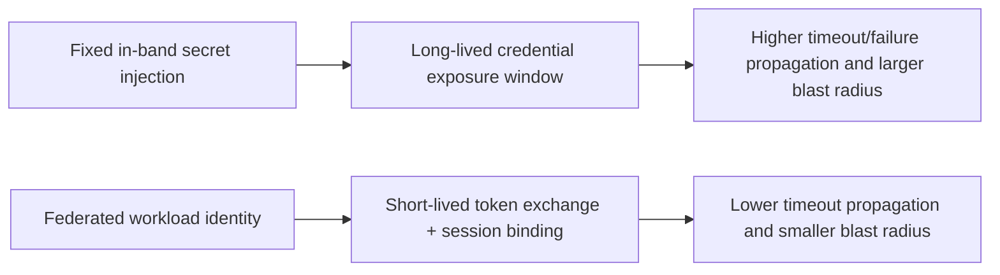
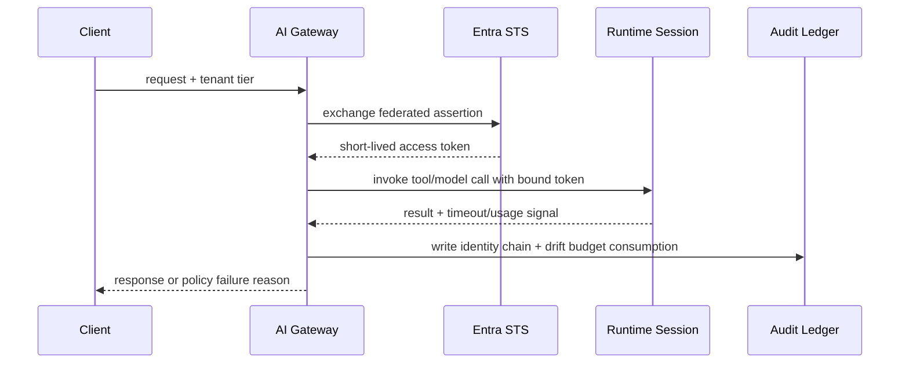

# Agent Runtime Entra Workload Identity Federation Selection FAQ (Fixed In-band Secret Injection vs Federated Workload Identity + Drift Budget Guard)

## 1) Core conclusions (for decision-makers first)
- **For multi-tenant production, default to Federated Workload Identity + Drift Budget Guard**, not long-lived in-band secret injection.
- **Fixed in-band secret injection amplifies timeout and exposure risk under burst/retry storms**, hurting both reliability and blast-radius control.
- **Federated identity must be coupled with quota tiers, retry ceilings, audit lineage, and alerts**, or “keyless” claims become weak in practice.

## 2) Q1 / Q2 / Q3 (plain-language definitions first)
- **Fixed In-band Secret Injection**: long-lived credentials are injected into env/boot parameters. Fast to start, expensive to rotate and audit.
- **Federated Workload Identity + Drift Budget Guard**: runtime exchanges short-lived Entra tokens per session and enforces drift/retry budgets.

### Q1: Why does fixed injection fail more often under high concurrency?
First principles: long-lived credentials create a larger persistence window. If logs/snapshots/replay paths leak, impact propagates faster as concurrency increases.

### Q2: When is fixed injection still acceptable?
Only as a temporary lane for low-value traffic with strict isolation, explicit rotation controls, and a clear decommission deadline.

### Q3: What is the minimum safe control loop?
Request classification -> federated token exchange -> session binding + budget gates -> timeout/failure audit -> rotation and revocation verification.

## 3) Mermaid (decision tree / path comparison / sequence)
### 3.1 Selection decision tree

### 3.2 Path comparison

### 3.3 Runtime sequence

## 4) Decision matrix
| Dimension | Fixed In-band Secret Injection | Federated Workload Identity + Drift Budget Guard |
|---|---|---|
| Implementation complexity | Low | Medium |
| Credential exposure surface | High | Low |
| Timeout risk control | Medium-Low | High |
| Multi-tenant sustainability | Medium | High |
| Default production fit | Temporary low-priority lane only | Long-term default |

## 5) Evidence contract + recomputable examples (n/denominator/source)
> Percentages in this section are `synthetic_assumed` hypothetical examples for mechanism comparison; production mechanism validation remains `not_measured`.  
> Contract fields: `workshops/azure-agent-infra/evidence/cycle-504-benchmark.json` -> `percentage_contract`.

- Metric A (fixed in-band secret injection timeout rate)  
  - Formula: `n_fixed_inband_secret_timeout / n_gateway_requests_observed`  
  - Value: `463/3900 = 11.9%` (`synthetic_assumed`)  
  - Path: `percentage_contract.fixed_inband_secret_timeout_rate`
- Metric B (federated workload identity timeout rate)  
  - Formula: `n_federated_workload_identity_timeout / n_gateway_requests_observed`  
  - Value: `226/3900 = 5.8%` (`synthetic_assumed`)  
  - Path: `percentage_contract.federated_workload_identity_timeout_rate`
- Metric C (recovery gain, percentage points)  
  - Formula: `(n_recovered_federated_identity - n_recovered_fixed_inband_secret) / n_gateway_requests_observed`  
  - Value: `(3621-3404)/3900 = 5.6 percentage points` (`synthetic_assumed`)  
  - Path: `percentage_contract.federated_identity_recovery_gain_pts`

## 6) Production checklist
- [ ] Entra federation policy has versioning, staged rollout, and rollback controls
- [ ] Token TTL, tenant quotas, retry ceilings, and drift budgets are observable and auditable
- [ ] Token-exchange failures, timeout chains, and replay paths are tenant-traceable
- [ ] All metrics are tagged `synthetic_assumed` with denominator/unit; production validation remains `not_measured`
