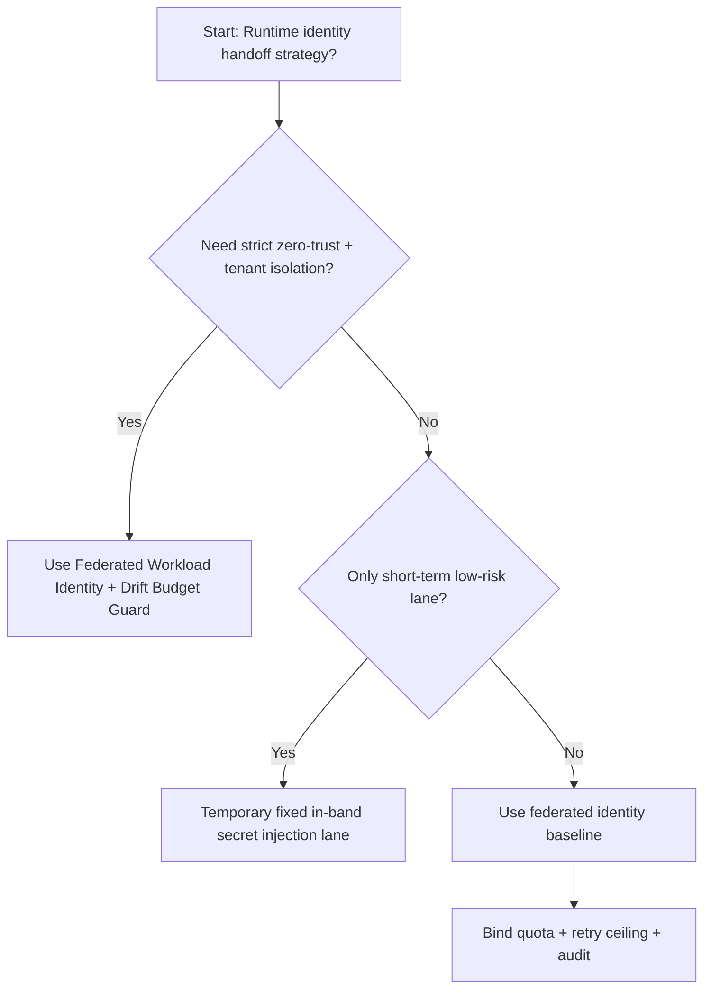
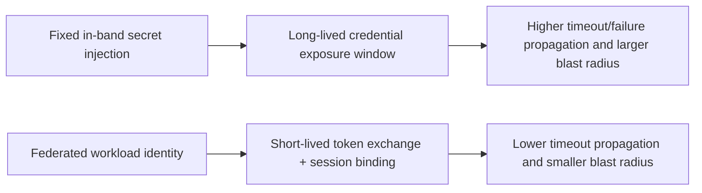
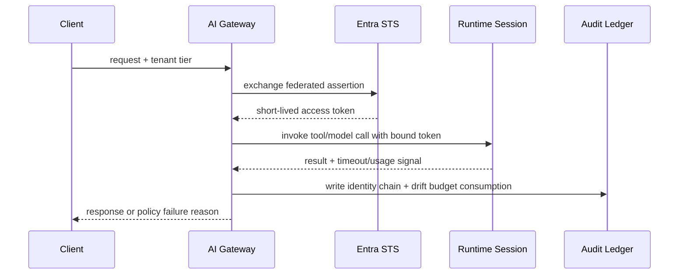

# Agent Runtime Entra Workload Identity Federation 选型 FAQ（Fixed In-band Secret Injection vs Federated Workload Identity + Drift Budget Guard）

## 1) 核心结论（先给负责人）
- **多租户 Agent Runtime 生产默认应选 Federated Workload Identity + Drift Budget Guard**，不应把固定明文注入作为长期默认。
- **Fixed In-band Secret Injection 在突发并发与重试风暴下更容易放大超时与泄露面**，会同时恶化成功率与尾延迟。
- **身份联邦方案必须联动租户配额、重试上限、审计链和告警门禁**，否则“无密钥”会退化成不可控的软边界。

## 2) Q1 / Q2 / Q3（术语先通俗解释）
- **Fixed In-band Secret Injection**：把固定密钥/令牌注入容器环境变量或启动参数，接入快但轮换与审计压力大。
- **Federated Workload Identity + Drift Budget Guard**：运行时通过 Entra 联邦身份按会话临时换取短时令牌，并用预算门禁约束漂移与重试。

### Q1：为什么固定注入在高并发更容易出问题？
第一性原理：固定密钥是“长期凭证”，一旦日志泄漏、快照误暴露或重放链路失控，影响范围天然更大；并发越高，故障传播越快。

### Q2：什么时候可以短期保留固定注入？
仅在低价值、短生命周期、隔离边界清晰且已有强轮换制度的临时通道中短期使用，且必须有明确退场日期。

### Q3：最小安全闭环是什么？
请求分级 -> 联邦令牌签发 -> 会话绑定与预算门禁 -> 超时/失败审计 -> 轮换与回收验证。

## 3) Mermaid（决策树 / 路径对比 / 时序）
### 3.1 选型决策树

### 3.2 路径对比图

### 3.3 运行时序图

## 4) 选型决策矩阵
| 维度 | Fixed In-band Secret Injection | Federated Workload Identity + Drift Budget Guard |
|---|---|---|
| 实现复杂度 | 低 | 中 |
| 身份暴露面 | 高 | 低 |
| 超时风险控制 | 中-低 | 高 |
| 多租户可持续性 | 中 | 高 |
| 生产默认建议 | 仅临时低优先级通道 | 长期默认 |

## 5) 数据证据与可复算算例（含 n/分母/来源）
> 本节百分比为 `synthetic_assumed` 假设算例（hypothetical），用于机制比较；生产机制认证保持 `not_measured`。  
> 合同字段见：`workshops/azure-agent-infra/evidence/cycle-504-benchmark.json` 的 `percentage_contract`。

- 指标 A（Fixed In-band Secret Injection 超时率）  
  - 定义：`n_fixed_inband_secret_timeout / n_gateway_requests_observed`  
  - 值：`463/3900 = 11.9%`（`synthetic_assumed`）  
  - 路径：`percentage_contract.fixed_inband_secret_timeout_rate`
- 指标 B（Federated Workload Identity 超时率）  
  - 定义：`n_federated_workload_identity_timeout / n_gateway_requests_observed`  
  - 值：`226/3900 = 5.8%`（`synthetic_assumed`）  
  - 路径：`percentage_contract.federated_workload_identity_timeout_rate`
- 指标 C（恢复增益，百分点）  
  - 定义：`(n_recovered_federated_identity - n_recovered_fixed_inband_secret) / n_gateway_requests_observed`  
  - 值：`(3621-3404)/3900 = 5.6` 个百分点（`synthetic_assumed`）  
  - 路径：`percentage_contract.federated_identity_recovery_gain_pts`

## 6) 生产 Checklist（上线前必须打勾）
- [ ] Entra 联邦身份策略具备版本、灰度和回滚路径
- [ ] 令牌 TTL、租户配额、重试上限和漂移预算均可观测可审计
- [ ] 身份换票失败、超时事件与回放链路可按租户追踪
- [ ] 指标全部标注 `synthetic_assumed`、分母与单位；生产机制认证保持 `not_measured`
