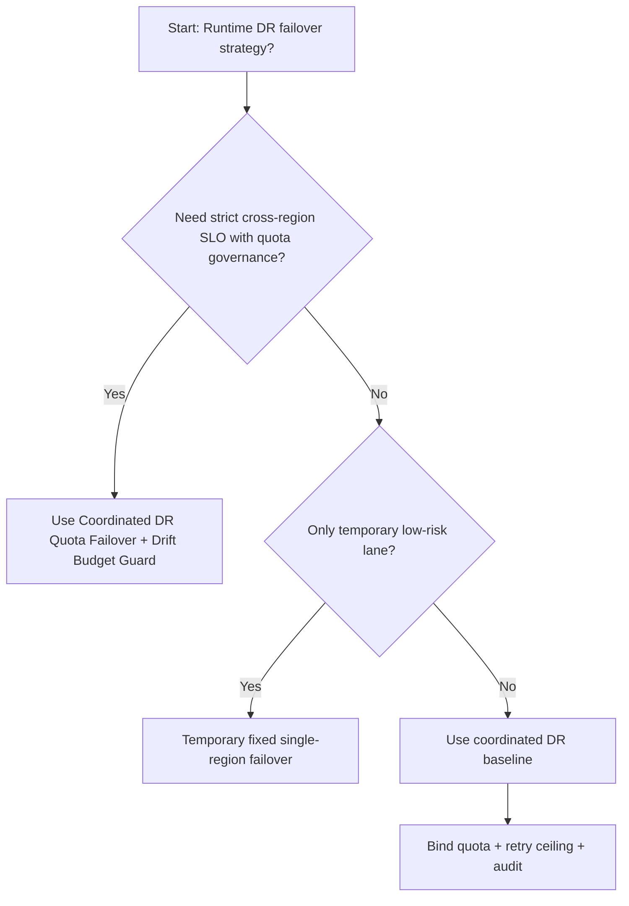
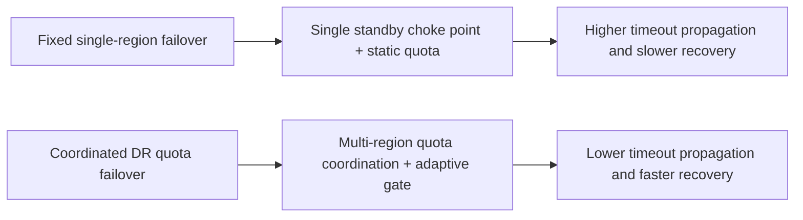
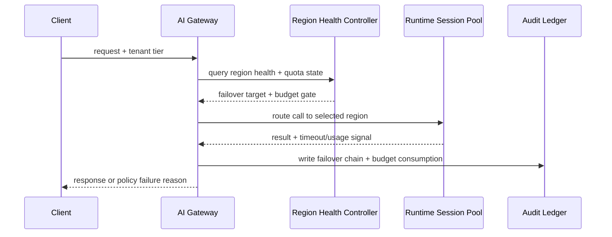

# Agent Runtime Multi-Region DR Quota Failover Selection FAQ (Fixed Single-Region Failover vs Coordinated DR Quota Failover + Drift Budget Guard)

## 1) Core conclusions (for decision-makers first)
- **For cross-region multi-tenant production, default to Coordinated DR Quota Failover + Drift Budget Guard**, not fixed single-region failover.
- **Fixed single-region failover amplifies timeout cascades under regional quota contention**, increasing both recovery time and retry storms.
- **DR controls must couple region quotas, queue gates, fallback budgets, and audit lineage**, or “multi-region” becomes manual failover theater.

## 2) Q1 / Q2 / Q3 (plain-language definitions first)
- **Fixed Single-Region Failover**: one primary region and one static standby. Simple, but weak against concurrent quota pressure.
- **Coordinated DR Quota Failover + Drift Budget Guard**: tenant-aware multi-region quota routing with adaptive admission and fallback budgets.

### Q1: Why is fixed single-region failover fragile at high concurrency?
First principles: regional incidents usually coincide with quota and network turbulence. Static failover concentrates traffic into one standby, creating secondary overload.

### Q2: When is fixed single-region failover acceptable?
Only as a temporary path for low-risk workloads with explicit migration timeline to coordinated DR.

### Q3: What is the minimum safe control loop?
Request classification -> regional health probing -> quota-coordinated failover -> timeout/failure audit -> recurrent drills and parameter retuning.

## 3) Mermaid (decision tree / path comparison / sequence)
### 3.1 Selection decision tree

### 3.2 Path comparison

### 3.3 Runtime sequence

## 4) Decision matrix
| Dimension | Fixed Single-Region Failover | Coordinated DR Quota Failover + Drift Budget Guard |
|---|---|---|
| Implementation complexity | Low | Medium-High |
| Recovery consistency | Medium-Low | High |
| Timeout risk control | Medium-Low | High |
| Multi-tenant sustainability | Medium | High |
| Default production fit | Temporary low-priority lane only | Long-term default |

## 5) Evidence contract + recomputable examples (n/denominator/source)
> Percentages in this section are `synthetic_assumed` hypothetical examples for mechanism comparison; production mechanism validation remains `not_measured`.  
> Contract fields: `workshops/azure-agent-infra/evidence/cycle-506-benchmark.json` -> `percentage_contract`.

- Metric A (fixed single-region failover timeout rate)  
  - Formula: `n_fixed_single_region_failover_timeout / n_gateway_requests_observed`  
  - Value: `463/3900 = 11.9%` (`synthetic_assumed`)  
  - Path: `percentage_contract.fixed_single_region_failover_timeout_rate`
- Metric B (coordinated DR quota failover timeout rate)  
  - Formula: `n_coordinated_dr_quota_failover_timeout / n_gateway_requests_observed`  
  - Value: `226/3900 = 5.8%` (`synthetic_assumed`)  
  - Path: `percentage_contract.coordinated_dr_quota_failover_timeout_rate`
- Metric C (recovery gain, percentage points)  
  - Formula: `(n_recovered_coordinated_dr - n_recovered_fixed_single_region) / n_gateway_requests_observed`  
  - Value: `(3621-3404)/3900 = 5.6 percentage points` (`synthetic_assumed`)  
  - Path: `percentage_contract.coordinated_dr_recovery_gain_pts`

## 6) Production checklist
- [ ] DR failover policy has versioning, staged rollout, and rollback controls
- [ ] Region health, tenant quotas, retry ceilings, and drift budgets are observable and auditable
- [ ] Failover events, timeout chains, and replay paths are tenant-traceable
- [ ] All metrics are tagged `synthetic_assumed` with denominator/unit; production validation remains `not_measured`
