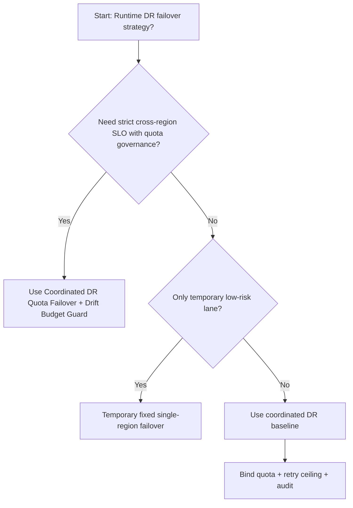
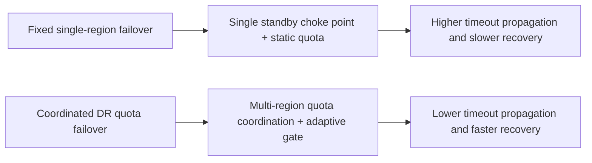
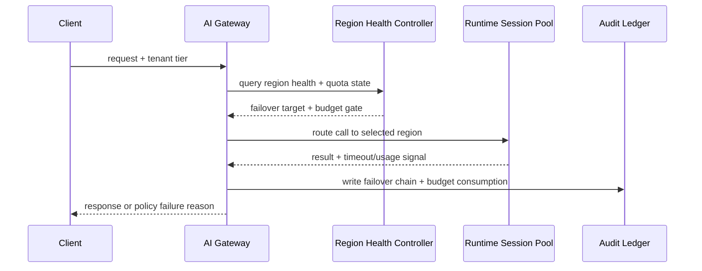

# Agent Runtime Multi-Region DR Quota Failover 选型 FAQ（Fixed Single-Region Failover vs Coordinated DR Quota Failover + Drift Budget Guard）

## 1) 核心结论（先给负责人）
- **跨区域多租户 Agent Runtime 生产默认应选 Coordinated DR Quota Failover + Drift Budget Guard**，不应长期依赖单区域固定故障切换。
- **Fixed Single-Region Failover 在区域抖动或配额争用时更容易触发级联超时**，会同时放大恢复时间与失败重试。
- **DR 策略必须与区域配额、排队门禁、回退预算和审计链联动**，否则“跨区域”会退化为不可控的手工切换。

## 2) Q1 / Q2 / Q3（术语先通俗解释）
- **Fixed Single-Region Failover**：默认单区域主站，故障后固定切到备站，规则简单但抗配额争用能力弱。
- **Coordinated DR Quota Failover + Drift Budget Guard**：按租户/场景协调多区域配额与切换预算，超预算自动限流或降级。

### Q1：为什么单区域固定切换在高并发更脆弱？
第一性原理：区域故障常伴随配额和网络抖动，固定切换会把所有流量集中到同一备站，造成“恢复时再雪崩”。

### Q2：什么时候可短期采用单区域固定切换？
仅在流量低、容错要求低且有明确跨区域改造计划的临时业务中短期使用。

### Q3：最小安全闭环是什么？
请求分级 -> 区域健康探测 -> 配额协调切换 -> 超时/失败审计 -> 演练回归与参数校准。

## 3) Mermaid（决策树 / 路径对比 / 时序）
### 3.1 选型决策树

### 3.2 路径对比图

### 3.3 运行时序图

## 4) 选型决策矩阵
| 维度 | Fixed Single-Region Failover | Coordinated DR Quota Failover + Drift Budget Guard |
|---|---|---|
| 实现复杂度 | 低 | 中-高 |
| 恢复一致性 | 中-低 | 高 |
| 超时风险控制 | 中-低 | 高 |
| 多租户可持续性 | 中 | 高 |
| 生产默认建议 | 仅临时低优先级通道 | 长期默认 |

## 5) 数据证据与可复算算例（含 n/分母/来源）
> 本节百分比为 `synthetic_assumed` 假设算例（hypothetical），用于机制比较；生产机制认证保持 `not_measured`。  
> 合同字段见：`workshops/azure-agent-infra/evidence/cycle-506-benchmark.json` 的 `percentage_contract`。

- 指标 A（Fixed Single-Region Failover 超时率）  
  - 定义：`n_fixed_single_region_failover_timeout / n_gateway_requests_observed`  
  - 值：`463/3900 = 11.9%`（`synthetic_assumed`）  
  - 路径：`percentage_contract.fixed_single_region_failover_timeout_rate`
- 指标 B（Coordinated DR Quota Failover 超时率）  
  - 定义：`n_coordinated_dr_quota_failover_timeout / n_gateway_requests_observed`  
  - 值：`226/3900 = 5.8%`（`synthetic_assumed`）  
  - 路径：`percentage_contract.coordinated_dr_quota_failover_timeout_rate`
- 指标 C（恢复增益，百分点）  
  - 定义：`(n_recovered_coordinated_dr - n_recovered_fixed_single_region) / n_gateway_requests_observed`  
  - 值：`(3621-3404)/3900 = 5.6` 个百分点（`synthetic_assumed`）  
  - 路径：`percentage_contract.coordinated_dr_recovery_gain_pts`

## 6) 生产 Checklist（上线前必须打勾）
- [ ] DR 区域切换策略具备版本、灰度和回滚路径
- [ ] 区域健康、租户配额、重试上限和漂移预算均可观测可审计
- [ ] 切换事件、超时链路与回放审计可按租户追踪
- [ ] 指标全部标注 `synthetic_assumed`、分母与单位；生产机制认证保持 `not_measured`
