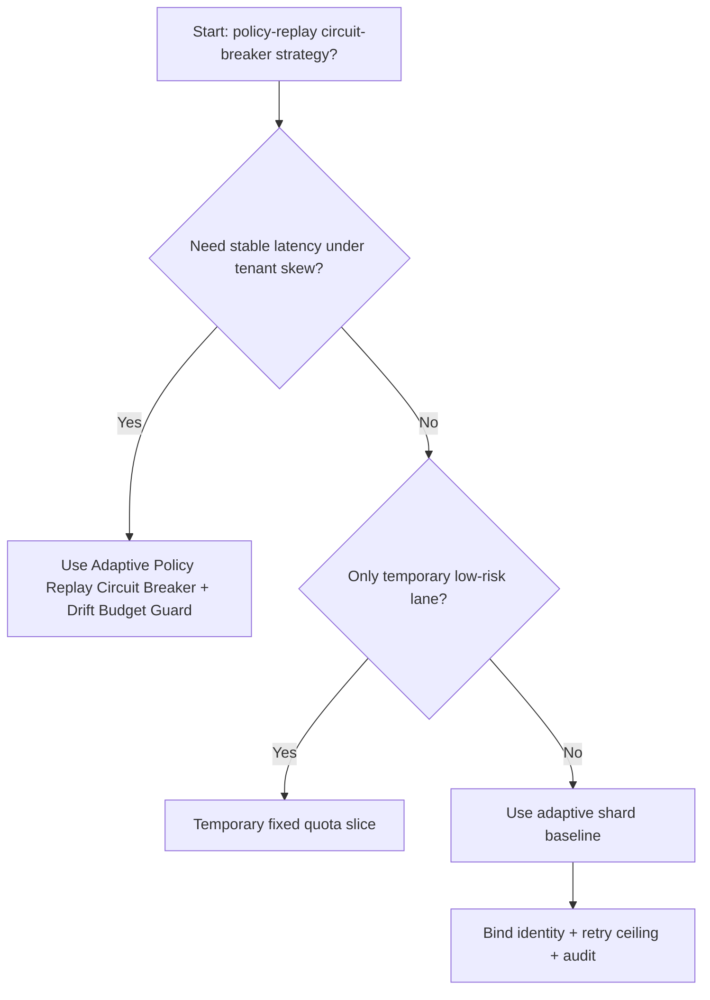
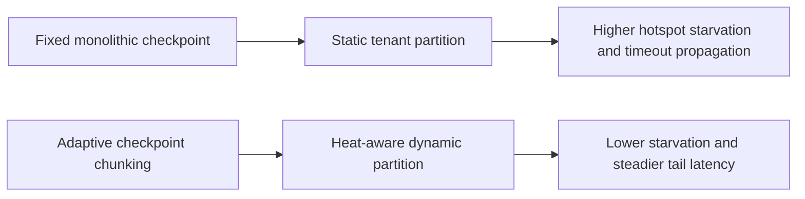
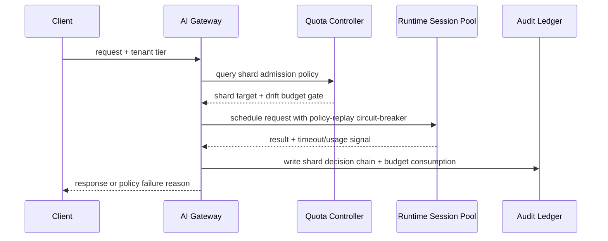

# Agent Runtime Policy Replay Circuit Breaker 选型 FAQ（Fixed Unbounded Policy Replay vs Adaptive Policy Replay Circuit Breaker + Drift Budget Guard）

## 1) 核心结论（先给负责人）
- **多租户 Agent Runtime 生产默认应选 Adaptive Policy Replay Circuit Breaker + Drift Budget Guard**，不应长期依赖固定无上限策略回放。
- **Fixed Unbounded Policy Replay 在租户热度突变场景更容易触发排队拥塞与级联超时**，会放大尾延迟与重试风暴。
- **准入门禁必须联动租户身份、队列深度、重试上限和审计链路**，否则“有配额”仍可能进入不可恢复拥堵。

## 2) Q1 / Q2 / Q3（术语先通俗解释）
- **Fixed Unbounded Policy Replay**：每个租户固定切片，规则稳定但在负载偏斜时利用率低且容易局部饥饿。
- **Adaptive Policy Replay Circuit Breaker + Drift Budget Guard**：按实时热度动态重分配策略回放熔断器，并用漂移预算限制突发借用。

### Q1：为什么固定无上限策略回放在高并发更脆弱？
第一性原理：流量不是平均分布，固定切片会让热点租户先拥塞、冷门租户配额闲置，最终形成整体吞吐下降。

### Q2：什么时候可短期使用固定无上限策略回放？
仅在租户流量结构稳定、峰谷差小、且回滚要求简单的临时环境中短期使用。

### Q3：最小安全闭环是什么？
请求分级 -> 分片热度监控 -> 动态配额迁移 -> 超时/失败审计 -> 周期回归校准。

## 3) Mermaid（决策树 / 路径对比 / 时序）
### 3.1 选型决策树

### 3.2 路径对比图

### 3.3 运行时序图

## 4) 选型决策矩阵
| 维度 | Fixed Unbounded Policy Replay | Adaptive Policy Replay Circuit Breaker + Drift Budget Guard |
|---|---|---|
| 实现复杂度 | 低 | 中 |
| 热点抗压能力 | 中-低 | 高 |
| 超时风险控制 | 中-低 | 高 |
| 多租户可持续性 | 中 | 高 |
| 生产默认建议 | 仅临时低优先级通道 | 长期默认 |

## 5) 数据证据与可复算算例（含 n/分母/来源）
> 本节百分比为 `synthetic_assumed` 假设算例（hypothetical），用于机制比较；生产机制认证保持 `not_measured`。  
> 合同字段见：`workshops/azure-agent-infra/evidence/cycle-514-benchmark.json` 的 `percentage_contract`。

- 指标 A（Fixed Unbounded Policy Replay 超时率）  
  - 定义：`n_fixed_unbounded_policy_replay_timeout / n_gateway_requests_observed`  
  - 值：`506/4210 = 12.0%`（`synthetic_assumed`）  
  - 路径：`percentage_contract.fixed_unbounded_policy_replay_timeout_rate`
- 指标 B（Adaptive Policy Replay Circuit Breaker 超时率）  
  - 定义：`n_adaptive_policy_replay_circuit_breaker_timeout / n_gateway_requests_observed`  
  - 值：`239/4210 = 5.7%`（`synthetic_assumed`）  
  - 路径：`percentage_contract.adaptive_policy_replay_circuit_breaker_timeout_rate`
- 指标 C（恢复增益，百分点）  
  - 定义：`(n_recovered_adaptive_cb - n_recovered_fixed_unbounded) / n_gateway_requests_observed`  
  - 值：`(3896-3653)/4210 = 5.8` 个百分点（`synthetic_assumed`）  
  - 路径：`percentage_contract.adaptive_policy_replay_circuit_breaker_recovery_gain_pts`

## 6) 生产 Checklist（上线前必须打勾）
- [ ] 策略回放熔断器门禁策略具备版本、灰度和回滚路径
- [ ] 租户热度、队列深度、重试上限和漂移预算均可观测可审计
- [ ] 饥饿事件、超时链路与回放审计可按租户追踪
- [ ] 指标全部标注 `synthetic_assumed`、分母与单位；生产机制认证保持 `not_measured`
