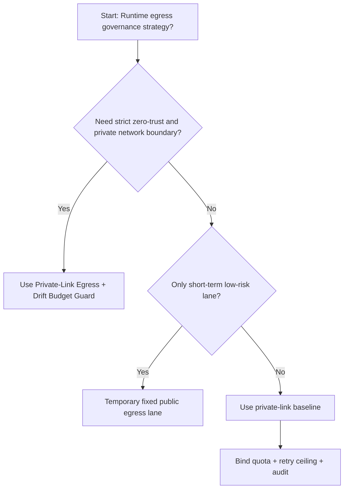
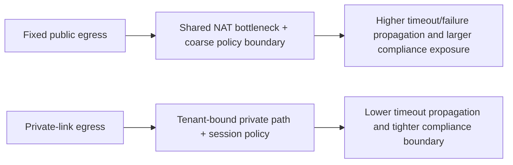
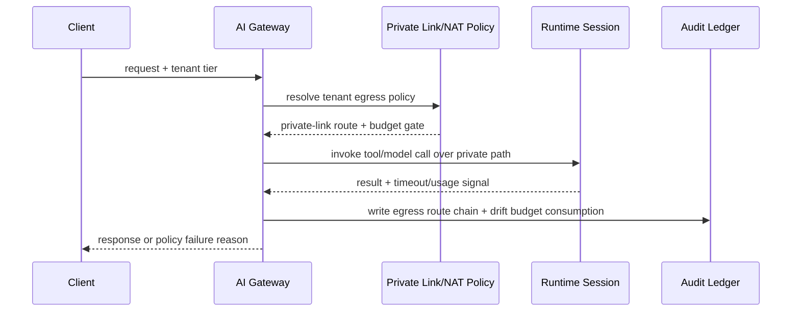

# Agent Runtime Private-Link Egress Governance Selection FAQ (Fixed Public Egress vs Private-Link Egress + Drift Budget Guard)

## 1) Core conclusions (for decision-makers first)
- **For multi-tenant production, default to Private-Link Egress + Drift Budget Guard**, not long-term fixed public egress.
- **Fixed public egress amplifies timeout propagation and exposure risk under burst load**, increasing both retries and compliance pressure.
- **Private egress controls must be coupled with quota tiers, retry ceilings, audit lineage, and alerts**, or emergency bypasses will erode zero-trust boundaries.

## 2) Q1 / Q2 / Q3 (plain-language definitions first)
- **Fixed Public Egress**: shared NAT/public egress lane. Fast to enable, but coarse boundary and weaker tenant isolation.
- **Private-Link Egress + Drift Budget Guard**: tenant-bound private route with per-session budget gates and deterministic fallback policy.

### Q1: Why is fixed public egress riskier at high concurrency?
First principles: shared egress is a contention hotspot. Congestion and retries reinforce each other, while broad egress policy exceptions expand blast radius.

### Q2: When is fixed public egress still acceptable?
Only as a temporary lane for low-value traffic with explicit migration deadline to private-link controls.

### Q3: What is the minimum safe control loop?
Request classification -> private egress binding -> session budget gate -> timeout/failure audit -> recurrent chaos drills.

## 3) Mermaid (decision tree / path comparison / sequence)
### 3.1 Selection decision tree

### 3.2 Path comparison

### 3.3 Runtime sequence

## 4) Decision matrix
| Dimension | Fixed Public Egress | Private-Link Egress + Drift Budget Guard |
|---|---|---|
| Implementation complexity | Low | Medium |
| Egress exposure surface | High | Low |
| Timeout risk control | Medium-Low | High |
| Multi-tenant sustainability | Medium | High |
| Default production fit | Temporary low-priority lane only | Long-term default |

## 5) Evidence contract + recomputable examples (n/denominator/source)
> Percentages in this section are `synthetic_assumed` hypothetical examples for mechanism comparison; production mechanism validation remains `not_measured`.  
> Contract fields: `workshops/azure-agent-infra/evidence/cycle-505-benchmark.json` -> `percentage_contract`.

- Metric A (fixed public egress timeout rate)  
  - Formula: `n_fixed_public_egress_timeout / n_gateway_requests_observed`  
  - Value: `463/3900 = 11.9%` (`synthetic_assumed`)  
  - Path: `percentage_contract.fixed_public_egress_timeout_rate`
- Metric B (private-link egress timeout rate)  
  - Formula: `n_private_link_egress_timeout / n_gateway_requests_observed`  
  - Value: `226/3900 = 5.8%` (`synthetic_assumed`)  
  - Path: `percentage_contract.private_link_egress_timeout_rate`
- Metric C (recovery gain, percentage points)  
  - Formula: `(n_recovered_private_link - n_recovered_public_egress) / n_gateway_requests_observed`  
  - Value: `(3621-3404)/3900 = 5.6 percentage points` (`synthetic_assumed`)  
  - Path: `percentage_contract.private_link_recovery_gain_pts`

## 6) Production checklist
- [ ] Private-link egress policy has versioning, staged rollout, and rollback controls
- [ ] Route binding, tenant quotas, retry ceilings, and drift budgets are observable and auditable
- [ ] Egress bypasses, timeout chains, and replay paths are tenant-traceable
- [ ] All metrics are tagged `synthetic_assumed` with denominator/unit; production validation remains `not_measured`
