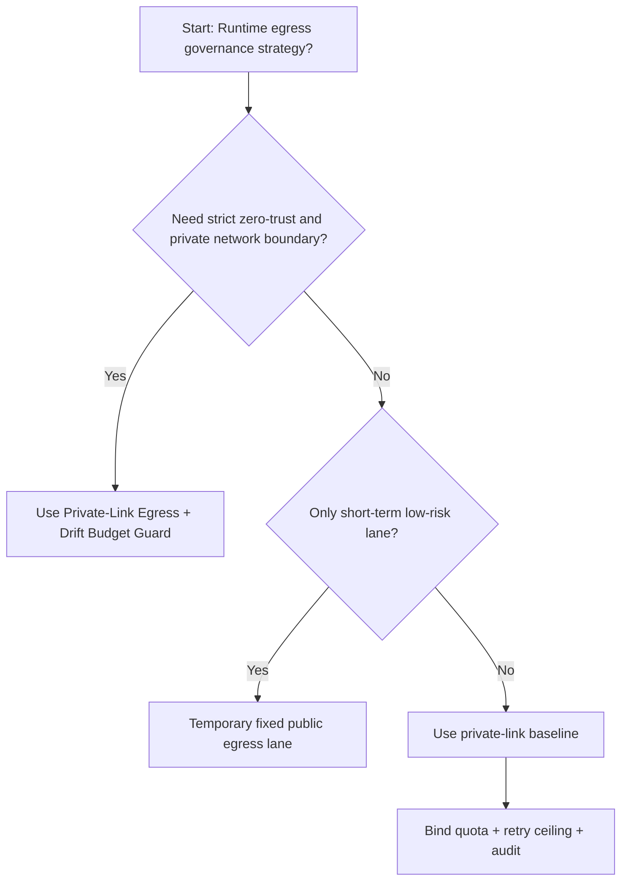
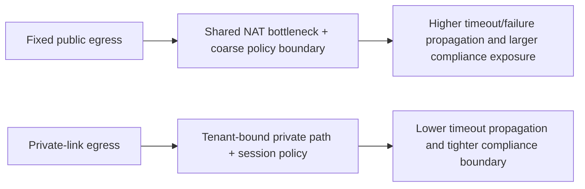
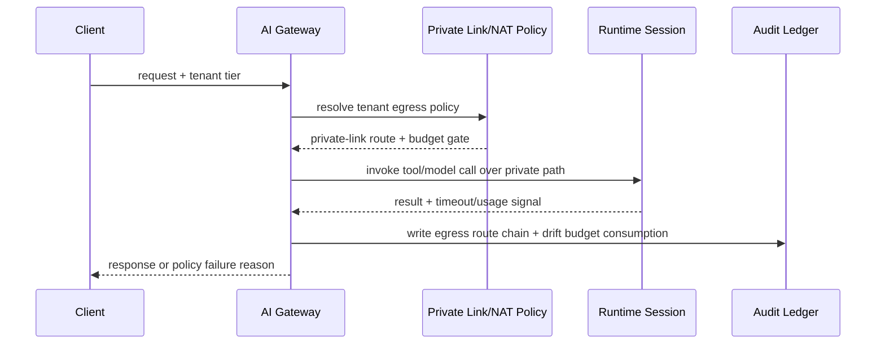

# Agent Runtime Private-Link Egress Governance 选型 FAQ（Fixed Public Egress vs Private-Link Egress + Drift Budget Guard）

## 1) 核心结论（先给负责人）
- **多租户 Agent Runtime 生产默认应选 Private-Link Egress + Drift Budget Guard**，不应长期依赖固定公网出口。
- **Fixed Public Egress 在突发并发下更容易触发超时传播与出口暴露面扩大**，会放大失败重试与合规风险。
- **私网出口治理必须联动租户配额、重试上限、审计链和告警门禁**，否则私网边界会被“应急绕路”逐步削弱。

## 2) Q1 / Q2 / Q3（术语先通俗解释）
- **Fixed Public Egress**：统一走公网 NAT/固定出口，接入快但策略粒度粗，跨租户隔离与取证难度高。
- **Private-Link Egress + Drift Budget Guard**：按租户/会话强制私网出口与短路由预算，超预算即降级或熔断。

### Q1：为什么固定公网出口在高并发更危险？
第一性原理：单一公网出口是共享瓶颈，拥塞和重试会互相放大；同时出口策略一旦放宽，跨租户影响范围更大。

### Q2：什么时候可短期使用固定公网出口？
仅在低价值、短生命周期、无强监管要求的临时通道中短期使用，并要求明确的私网迁移截止时间。

### Q3：最小安全闭环是什么？
请求分级 -> 私网出口绑定 -> 会话预算门禁 -> 超时/失败审计 -> 周期性回归演练。

## 3) Mermaid（决策树 / 路径对比 / 时序）
### 3.1 选型决策树

### 3.2 路径对比图

### 3.3 运行时序图

## 4) 选型决策矩阵
| 维度 | Fixed Public Egress | Private-Link Egress + Drift Budget Guard |
|---|---|---|
| 实现复杂度 | 低 | 中 |
| 出口暴露面 | 高 | 低 |
| 超时风险控制 | 中-低 | 高 |
| 多租户可持续性 | 中 | 高 |
| 生产默认建议 | 仅临时低优先级通道 | 长期默认 |

## 5) 数据证据与可复算算例（含 n/分母/来源）
> 本节百分比为 `synthetic_assumed` 假设算例（hypothetical），用于机制比较；生产机制认证保持 `not_measured`。  
> 合同字段见：`workshops/azure-agent-infra/evidence/cycle-505-benchmark.json` 的 `percentage_contract`。

- 指标 A（Fixed Public Egress 超时率）  
  - 定义：`n_fixed_public_egress_timeout / n_gateway_requests_observed`  
  - 值：`463/3900 = 11.9%`（`synthetic_assumed`）  
  - 路径：`percentage_contract.fixed_public_egress_timeout_rate`
- 指标 B（Private-Link Egress 超时率）  
  - 定义：`n_private_link_egress_timeout / n_gateway_requests_observed`  
  - 值：`226/3900 = 5.8%`（`synthetic_assumed`）  
  - 路径：`percentage_contract.private_link_egress_timeout_rate`
- 指标 C（恢复增益，百分点）  
  - 定义：`(n_recovered_private_link - n_recovered_public_egress) / n_gateway_requests_observed`  
  - 值：`(3621-3404)/3900 = 5.6` 个百分点（`synthetic_assumed`）  
  - 路径：`percentage_contract.private_link_recovery_gain_pts`

## 6) 生产 Checklist（上线前必须打勾）
- [ ] 私网出口策略具备版本、灰度和回滚路径
- [ ] 出口路由、租户配额、重试上限和漂移预算均可观测可审计
- [ ] 出口绕路、超时事件与回放链路可按租户追踪
- [ ] 指标全部标注 `synthetic_assumed`、分母与单位；生产机制认证保持 `not_measured`
