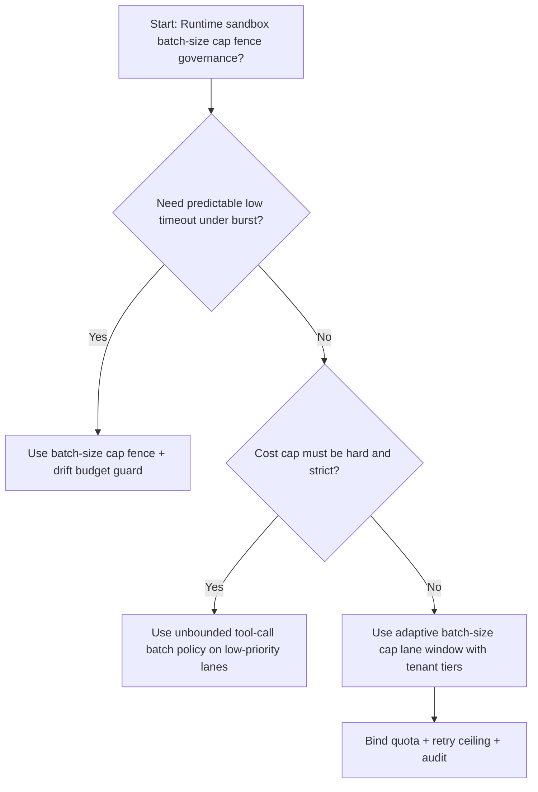
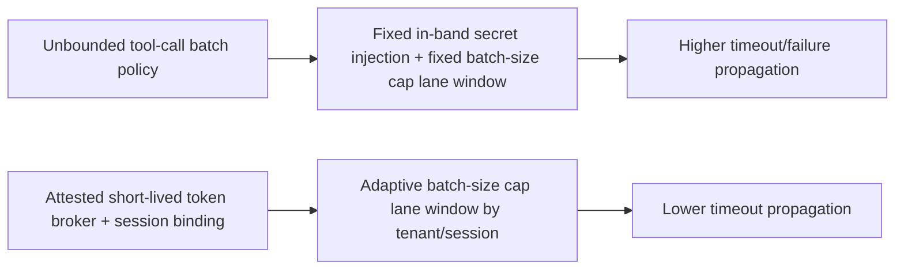
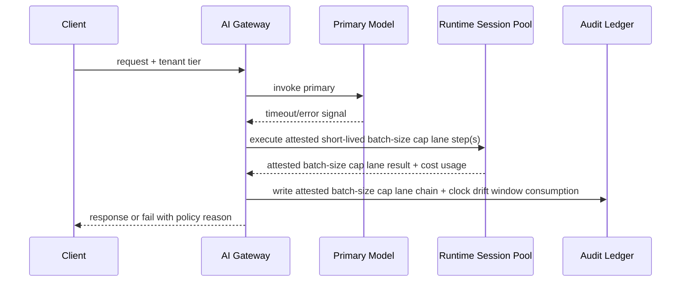

# Agent Runtime Tool-Call Batch-Size Cap Selection FAQ (Unbounded Tool-Call Batch vs Batch-Size Cap Fence + Drift Budget Guard)

## 1) Core conclusions (for decision-makers first)
- **For multi-tenant Agent Runtime production, default to batch-size cap fence + drift budget guard**, not unbounded tool-call batch policy as the baseline.
- **Unbounded tool-call batch policy propagates burst pressure into user-visible failures/timeouts** during peak traffic windows.
- **Ephemeral batch-size cap lane control loops must be coupled with tenant quota tiers, retry ceilings, and replay audit**, or the runtime path becomes an uncontrolled cost amplifier.

## 2) Q1 / Q2 / Q3 (plain-language definitions first)
- **Unbounded tool-call batch policy**: use fixed in-band injection and fixed batch-size cap lane windows; easy to reason about but more brittle under uneven load.
- **Attested short-lived token broker + session binding**: dynamically allocate batch-size cap lane budgets per tenant/session while preserving auditable policy boundaries.

### Q1: Why does unbounded tool-call batch policy increase timeout propagation at scale?
First principles: retries and network jitter are inevitable. Without monotonic-clock fences, duplicate write calls are executed as new operations, amplifying timeout and side-effect risk.

### Q2: When is unbounded tool-call batch policy acceptable?
Low-value traffic lanes with hard cost caps and lower availability requirements.

### Q3: What is the minimum safe control loop?
Request classification -> batch-size cap lane budget assignment -> admission gate -> replay audit -> handoff-window retuning.

## 3) Mermaid (decision tree / path comparison / sequence)
### 3.1 Selection decision tree

### 3.2 Path comparison

### 3.3 Runtime sequence

## 4) Decision matrix
| Dimension | Unbounded tool-call batch policy | Attested short-lived token broker + session binding |
|---|---|---|
| Implementation complexity | Low | Medium |
| Timeout risk control | Medium-Low | High |
| Cost predictability | High (static) | Medium-High (dynamic) |
| Multi-tenant sustainability | Medium | High |
| Default production fit | Low-priority lane only | Long-term default |

## 5) Evidence contract + recomputable examples (n/denominator/source)
> Percentages in this section are `synthetic_assumed` hypothetical examples for mechanism comparison; production mechanism validation remains `not_measured`.  
> Contract fields: `workshops/azure-agent-infra/evidence/cycle-496-benchmark.json` -> `percentage_contract`.

- Metric A (unbounded tool-call batch policy timeout rate)  
  - Formula: `n_fixed_batch_overflow_timeout / n_gateway_requests_observed`  
  - Value: `348/3200 = 10.9%` (`synthetic_assumed`)  
  - Path: `percentage_contract.fixed_batch_overflow_timeout_rate`
- Metric B (attested short-lived token broker timeout rate)  
  - Formula: `n_batch_size_cap_timeout / n_gateway_requests_observed`  
  - Value: `169/3200 = 5.3%` (`synthetic_assumed`)  
  - Path: `percentage_contract.bounded_batch_size_cap_timeout_rate`
- Metric C (recovery gain, percentage points)  
  - Formula: `(n_recovered_batch_size_cap - n_recovered_fixed_batch_overflow) / n_gateway_requests_observed`  
  - Value: `(3031-2852)/3200 = 5.6 percentage points` (`synthetic_assumed`)  
  - Path: `percentage_contract.bounded_batch_size_cap_recovery_gain_pts`

## 6) Production checklist
- [ ] Credential handoff policy has versioning, rollout, and rollback controls
- [ ] Tenant tiers, clock drift window usage, and retry ceilings are observable and auditable
- [ ] Timeout events, recovery chains, and replay audits are tenant-traceable
- [ ] All metrics are tagged `synthetic_assumed` with denominator/unit; production validation remains `not_measured`
