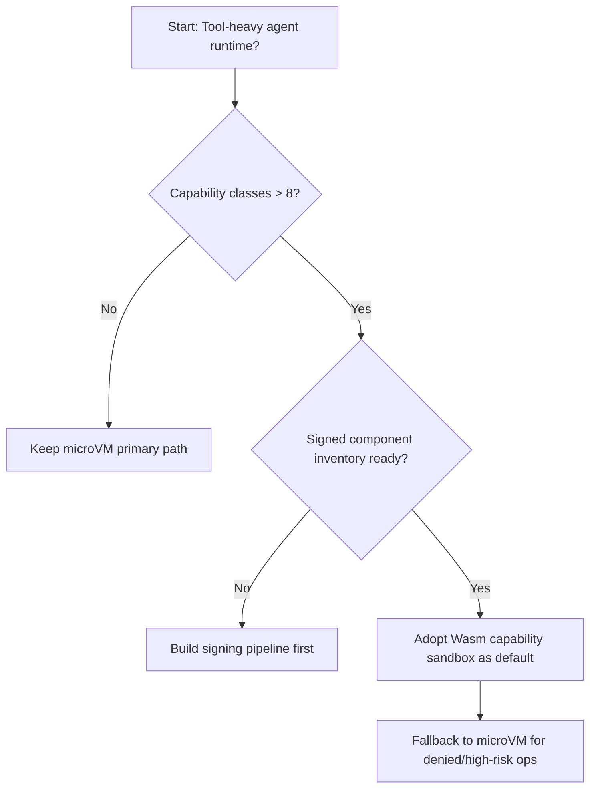
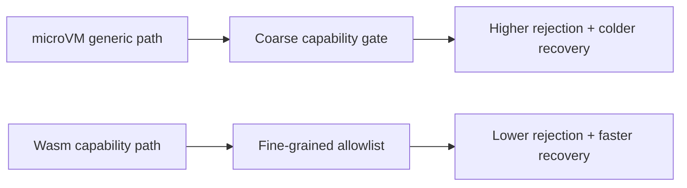
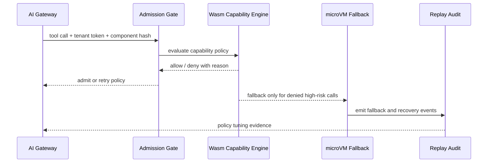

# Agent Runtime Wasm Capability Sandbox Selection FAQ (microVM Generic Sandbox vs Wasm Capability-Policy Sandbox)

## 1) Core conclusions (for decision-makers first)
- **For tool-call-heavy agent production, default to a Wasm capability-policy sandbox with a microVM fallback lane**, not a pure generic microVM allow model.
- **Generic microVM-only execution shows coarser capability rejection and colder recovery under high-concurrency tool orchestration**, hurting success rate and tail latency.
- **Wasm capability sandboxing must be tied to gateway budget tokens, component-signature verification, and replay audit**, or capability boundaries will not hold consistently.

## 2) Q1 / Q2 / Q3 (plain-language definitions first)
- **microVM generic sandbox**: run each task in a small VM; strong isolation boundary, but capability control granularity is often coarse.
- **Wasm capability-policy sandbox**: authorize file/network/tool capabilities as explicit allowlists per component, like door-access cards for specific rooms.

### Q1: Why add Wasm capability policy for complex tool chains?
First principles: risk and performance are both shaped by least privilege + shortest scheduling path. Coarse isolation forces many calls into expensive paths unnecessarily.

### Q2: When is a microVM-primary path still acceptable?
Small capability surface, no mature component-signing pipeline yet, and an audit team currently optimized for VM-level forensics.

### Q3: What is the minimum safe loop?
Component signature + capability declaration -> admission gate -> Wasm capability verdict -> microVM fallback on failure -> replay audit and policy retuning.

## 3) Mermaid (decision tree / path comparison / sequence)
### 3.1 Selection decision tree

### 3.2 Path comparison

### 3.3 Runtime sequence

## 4) Decision matrix
| Dimension | microVM generic sandbox | Wasm capability-policy sandbox |
|---|---|---|
| Implementation complexity | Medium | Medium-High |
| Permission granularity | Medium | High |
| Rejection-rate control at scale | Medium | High |
| Recovery + fallback efficiency | Medium | High |
| Recommended production default | Transitional / high-risk fallback | Primary path for tool-heavy agents |

## 5) Quant evidence and reproducible examples (with n/denominator/source)
> Percentages in this section are `synthetic_assumed` hypothetical examples for mechanism comparison; production mechanism certification remains `not_measured`.  
> Contract fields are in `workshops/azure-agent-infra/evidence/cycle-442-benchmark.json` under `percentage_contract`.

- Metric A (microVM capability rejection rate)  
  - Definition: `n_capability_reject_microvm / n_runtime_requests_observed`  
  - Value: `279/2400 = 11.6%` (`synthetic_assumed`)  
  - Path: `percentage_contract.microvm_capability_reject_rate`
- Metric B (Wasm capability rejection rate)  
  - Definition: `n_capability_reject_wasm / n_runtime_requests_observed`  
  - Value: `101/2400 = 4.2%` (`synthetic_assumed`)  
  - Path: `percentage_contract.wasm_capability_reject_rate`
- Metric C (recovery-success uplift, percentage points)  
  - Definition: `(n_recovery_success_wasm - n_recovery_success_microvm) / n_runtime_requests_observed`  
  - Value: `(2162-1984)/2400 = 7.4` percentage points (`synthetic_assumed`)  
  - Path: `percentage_contract.wasm_recovery_gain_pts`

### Daily-hot source references (with fetch timestamps)
- APIM / AI Gateway overview (Microsoft Learn): `fetched_at_utc=2026-11-09T15:39:58Z`, `source_label=measured`
- Azure API Management changelog (Unified model API / MCP / A2A): `fetched_at_utc=2026-11-09T15:39:58Z`, `source_label=measured`
- Azure Container Apps Dynamic Sessions: `fetched_at_utc=2026-11-09T15:39:58Z`, `source_label=measured`
- Wasmtime / Firecracker / Kata / E2B releases: `fetched_at_utc=2026-11-09T15:39:58Z`, `source_label=measured`

## 6) Production validation checklist
- [ ] Wasm component signing, capability declarations, and policy versions support canary and rollback
- [ ] Admission gate, gateway budgets, and microVM fallback path are consistently metered
- [ ] Rejection rate, fallback rate, recovery-success rate, and audit chain are traceable
- [ ] Every metric explicitly labels `synthetic_assumed` / `not_measured` with denominator, unit, and source path
