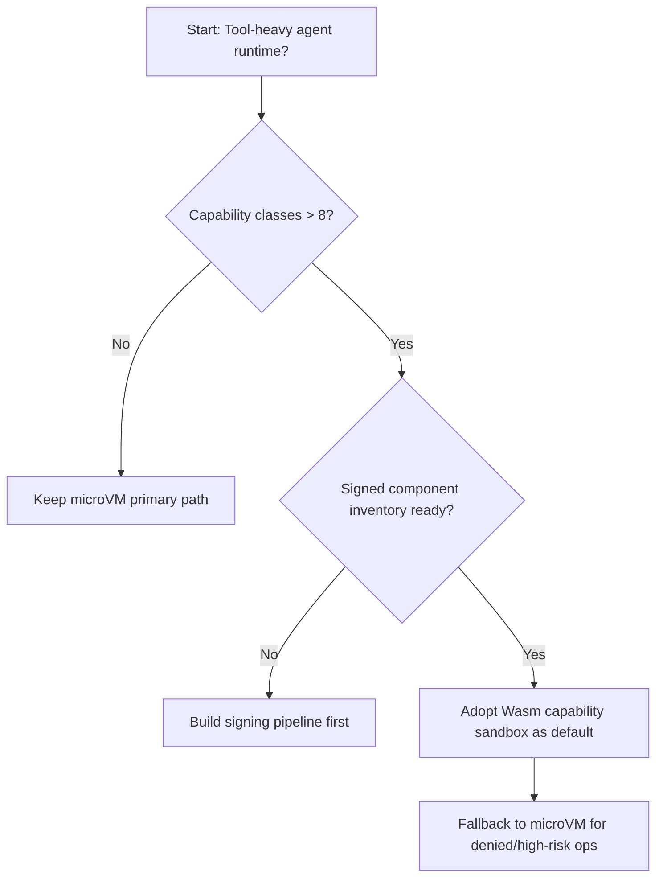
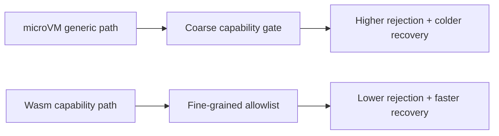
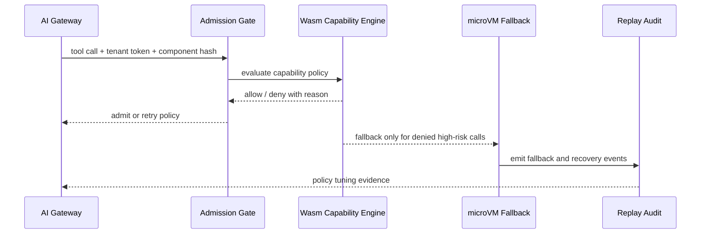

# Agent Runtime Wasm 能力沙箱选型 FAQ（microVM 通用沙箱 vs Wasm 能力策略沙箱）

## 1) 核心结论（先给负责人）
- **工具调用密集型 Agent 生产默认优先 Wasm 能力策略沙箱 + 微隔离后备通道**，不建议长期只靠通用 microVM 全放行模型。
- **microVM 纯通用执行在高并发工具编排下更容易出现“能力拒绝过粗”与冷恢复抖动**，影响成功率和尾延迟。
- **Wasm 能力沙箱必须绑定 API 网关令牌预算、组件签名校验与回放审计**，否则能力边界无法稳定落地。

## 2) Q1 / Q2 / Q3（术语先通俗解释）
- **microVM 通用沙箱**：每次把任务放进一台小虚机隔离，安全边界强，但能力控制粒度通常偏粗。
- **Wasm 能力策略沙箱**：把可调用能力（文件、网络、工具）当白名单按组件授权，像“按门禁卡开放房间”。

### Q1：为什么在工具链路复杂时要引入 Wasm 能力策略？
第一性原理：风险和性能都来自“权限最小化 + 调度最短路径”，粗粒度隔离会把大量本可快速通过的调用变成昂贵通道。

### Q2：什么时候仍可先用 microVM 为主？
工具能力面很小、组件签名体系尚未建立、审计团队暂时只支持 VM 粒度取证时，可短期过渡。

### Q3：最小安全闭环是什么？
组件签名与能力声明 -> Admission Gate -> Wasm 能力裁决 -> 失败回退 microVM -> 回放审计与策略复盘。

## 3) Mermaid（决策树 / 路径对比 / 时序）
### 3.1 选型决策树

### 3.2 路径对比图

### 3.3 运行时序图

## 4) 选型决策矩阵
| 维度 | microVM 通用沙箱 | Wasm 能力策略沙箱 |
|---|---|---|
| 实现复杂度 | 中 | 中-高 |
| 权限控制粒度 | 中 | 高 |
| 高并发拒绝控制 | 中 | 高 |
| 恢复与回退效率 | 中 | 高 |
| 生产默认建议 | 过渡/高风险后备 | 工具密集主路径 |

## 5) 数据证据与可复算算例（含 n/分母/来源）
> 本节百分比为 `synthetic_assumed` 假设算例（hypothetical），用于机制比较；生产机制认证保持 `not_measured`。  
> 合同字段见：`workshops/azure-agent-infra/evidence/cycle-442-benchmark.json` 的 `percentage_contract`。

- 指标 A（microVM 能力拒绝率）  
  - 定义：`n_capability_reject_microvm / n_runtime_requests_observed`  
  - 值：`279/2400 = 11.6%`（`synthetic_assumed`）  
  - 路径：`percentage_contract.microvm_capability_reject_rate`
- 指标 B（Wasm 能力拒绝率）  
  - 定义：`n_capability_reject_wasm / n_runtime_requests_observed`  
  - 值：`101/2400 = 4.2%`（`synthetic_assumed`）  
  - 路径：`percentage_contract.wasm_capability_reject_rate`
- 指标 C（恢复成功率提升，百分点）  
  - 定义：`(n_recovery_success_wasm - n_recovery_success_microvm) / n_runtime_requests_observed`  
  - 值：`(2162-1984)/2400 = 7.4` 个百分点（`synthetic_assumed`）  
  - 路径：`percentage_contract.wasm_recovery_gain_pts`

### 当日热点来源（抓取时间）
- APIM / AI Gateway 概览（Microsoft Learn）：`fetched_at_utc=2026-11-09T15:39:58Z`，`source_label=measured`
- Azure API Management changelog（Unified model API / MCP / A2A）：`fetched_at_utc=2026-11-09T15:39:58Z`，`source_label=measured`
- Azure Container Apps Dynamic Sessions：`fetched_at_utc=2026-11-09T15:39:58Z`，`source_label=measured`
- Wasmtime / Firecracker / Kata / E2B releases：`fetched_at_utc=2026-11-09T15:39:58Z`，`source_label=measured`

## 6) 生产核验 Checklist（上线前必须打勾）
- [ ] Wasm 组件签名、能力声明、策略版本具备灰度与回滚
- [ ] Admission Gate、Gateway 预算、Fallback microVM 路径一致记账
- [ ] 拒绝率、回退率、恢复成功率与审计链可追溯
- [ ] 指标全部标注 `synthetic_assumed` / `not_measured` 与分母、单位、source_path
