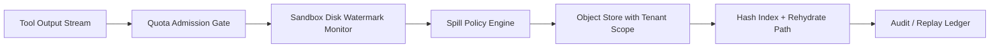

# Agent Sandbox Ephemeral Disk Quota Selection FAQ (Fixed Quota vs Adaptive Quota + Object Spill)

## 1) Core conclusions (for decision-makers first)
- **For multi-tenant production, default to adaptive ephemeral-disk quota + object-store spill**, not fixed small quotas.
- **Fixed quotas fail more often during bursty tool output** (logs, screenshots, traces, intermediate artifacts), which amplifies retries and tail latency.
- **Quota governance must be bound to tenant identity, gateway budgets, and spill-store permissions**, otherwise high concurrency will create cross-tenant contamination and audit gaps.

## 2) Q1 / Q2 / Q3 (plain-language definitions first)
- **Ephemeral disk quota**: the local per-session “working drawer” size limit inside sandbox runtime.
- **Spill**: when local disk nears threshold, move colder large artifacts to object storage and rehydrate on demand.

### Q1: Why does fixed quota break in production?
First-principles view: tool-output sizes follow a heavy-tail distribution (many small files, few very large files). A fixed cap turns long-tail events directly into failures.

### Q2: When is fixed quota still acceptable?
Single-tenant, short-lived sessions, predictable tool output, and acceptable occasional manual reruns.

### Q3: What is the minimum safe production loop?
Tenant identity binding -> quota-policy versioning -> watermark monitoring -> spill authorization + hash index -> replay/audit closure.

## 3) Mermaid (quota governance + spill loop)

## 4) Decision matrix
| Dimension | Fixed quota | Adaptive quota + spill |
|---|---|---|
| Implementation complexity | Low | Medium |
| Burst-output resilience | Low-Medium | High |
| Failure-rate control | Low-Medium | High |
| Multi-tenant governance | Medium | High |
| Recommended production default | Short-term transition | Long-term multi-tenant |

## 5) Quant evidence and reproducible examples (with n/denominator/source)
> Percentages in this section are `synthetic_assumed` hypothetical examples for mechanism comparison; production mechanism certification remains `not_measured`.  
> Contract fields are in `workshops/azure-agent-infra/evidence/cycle-438-benchmark.json` under `percentage_contract`.

- Metric A (overflow/drop failure rate, fixed quota)  
  - Definition: `n_disk_overflow_fixed_quota / n_runtime_requests_observed`  
  - Value: `228/2400 = 9.5%` (`synthetic_assumed`)  
  - Path: `percentage_contract.fixed_disk_quota_overflow_rate`
- Metric B (overflow/drop failure rate, adaptive quota)  
  - Definition: `n_disk_overflow_adaptive_quota / n_runtime_requests_observed`  
  - Value: `74/2400 = 3.1%` (`synthetic_assumed`)  
  - Path: `percentage_contract.adaptive_quota_overflow_rate`
- Metric C (recovery-success uplift, percentage points)  
  - Definition: `(n_recovery_success_adaptive - n_recovery_success_fixed) / n_runtime_requests_observed`  
  - Value: `(2070-1916)/2400 = 6.4` percentage points (`synthetic_assumed`)  
  - Path: `percentage_contract.quota_recovery_gain_pts`

## 6) Production checklist
- [ ] Quota policy (thresholds/watermarks/spill conditions) has versioning, canary, and rollback paths
- [ ] Spill object storage enforces tenant scope and least privilege
- [ ] Overflow failure rate, recovery-success rate, and replay chain are traceable
- [ ] Metrics explicitly label `synthetic_assumed` and denominator/unit; production mechanism certification remains `not_measured`

