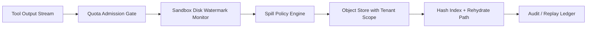

# Agent Sandbox 临时磁盘配额治理选型 FAQ（固定配额 vs 自适应配额+对象外溢）

## 1) 核心结论（先给负责人）
- **多租户生产默认优先“自适应临时磁盘配额 + 对象存储外溢”**，不建议长期仅用固定小配额。
- **固定配额在工具输出爆发（日志、截图、trace、模型中间文件）时更容易触发写满与任务失败**，会放大重试成本与尾延迟。
- **配额治理必须绑定租户身份、网关预算和外溢存储权限边界**，否则容易在高并发下出现跨租户污染与审计缺口。

## 2) Q1 / Q2 / Q3（术语先通俗解释）
- **临时磁盘配额**：每个沙盒会话可用的本地“工作盘”上限，类似“每个工位的抽屉容量”。
- **对象外溢（spill）**：当本地盘接近上限时，把低热度大文件转存到对象存储，只在需要时拉回。

### Q1：为什么固定配额在生产容易出问题？
第一性原理：工具输出大小分布是重尾的（大多数小文件，少数极大文件），固定上限会把长尾直接变成失败点。

### Q2：什么时候可以接受固定配额？
单租户、短会话、工具链输出稳定且可以接受偶发人工重跑时，固定配额可以作为短期过渡。

### Q3：最小安全闭环应该包含什么？
租户身份绑定 -> 配额策略版本化 -> 写入水位预警 -> 外溢授权与哈希索引 -> 审计回放与回收策略。

## 3) Mermaid（配额治理与外溢闭环）

## 4) 决策矩阵
| 维度 | 固定配额 | 自适应配额 + 外溢 |
|---|---|---|
| 实现复杂度 | 低 | 中 |
| 爆发输出韧性 | 低-中 | 高 |
| 失败率控制 | 低-中 | 高 |
| 多租户治理能力 | 中 | 高 |
| 生产默认建议 | 短期过渡 | 多租户长期运行 |

## 5) 数据证据与可复算算例（含 n/分母/来源）
> 本节百分比为 `synthetic_assumed` 假设算例（hypothetical），用于机制比较；生产机制认证仍为 `not_measured`。  
> 合同字段见：`workshops/azure-agent-infra/evidence/cycle-438-benchmark.json` 的 `percentage_contract`。

- 指标 A（写满/溢出失败率，固定配额）  
  - 定义：`n_disk_overflow_fixed_quota / n_runtime_requests_observed`  
  - 值：`228/2400 = 9.5%`（`synthetic_assumed`）  
  - 路径：`percentage_contract.fixed_disk_quota_overflow_rate`
- 指标 B（写满/溢出失败率，自适应配额）  
  - 定义：`n_disk_overflow_adaptive_quota / n_runtime_requests_observed`  
  - 值：`74/2400 = 3.1%`（`synthetic_assumed`）  
  - 路径：`percentage_contract.adaptive_quota_overflow_rate`
- 指标 C（恢复成功率提升，百分点）  
  - 定义：`(n_recovery_success_adaptive - n_recovery_success_fixed) / n_runtime_requests_observed`  
  - 值：`(2070-1916)/2400 = 6.4` 个百分点（`synthetic_assumed`）  
  - 路径：`percentage_contract.quota_recovery_gain_pts`

## 6) 生产 Checklist（上线前必须打勾）
- [ ] 配额策略（阈值、水位、外溢条件）有版本、灰度和回滚路径  
- [ ] 外溢对象存储启用租户作用域权限与最小授权  
- [ ] 溢出失败率、恢复成功率、回放链路可追溯  
- [ ] 指标口径标注 `synthetic_assumed` 与分母/单位，生产机制认证保持 `not_measured`

