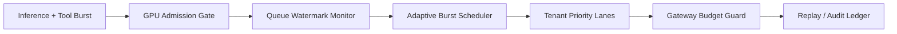

# Agent Sandbox GPU Burst Scheduling Selection FAQ (Fixed Queue Quota vs Adaptive Burst Scheduling)

## 1) Core conclusions (for decision-makers first)
- **For multi-tenant production, default to adaptive GPU burst scheduling with tenant budgets**, instead of fixed queue slots.
- **Fixed queue quotas fail under simultaneous inference + tool spikes**, causing queue collapse and retry amplification.
- **GPU scheduling governance must bind tenant priority, gateway budgets, and replay audit**, or both cost and SLOs will drift under peak load.

## 2) Q1 / Q2 / Q3 (plain-language definitions first)
- **Fixed queue quota**: each tenant gets a static number of GPU job slots; simple but blind to live congestion.
- **Adaptive burst scheduling**: dynamically adjusts concurrency, backoff, and lane priority from realtime queue telemetry and tenant budgets.

### Q1: Why does fixed queue quota fail in production?
First-principles: GPU job arrivals are non-stationary bursts. Static thresholds cannot absorb wave peaks, so local congestion quickly propagates globally.

### Q2: When is fixed quota still acceptable?
Low concurrency, stable job durations, few tenants, and tolerance for occasional queue-timeout incidents.

### Q3: What is the minimum safe loop?
Tenant budget + priority -> policy versioning -> queue-watermark telemetry -> adaptive concurrency/backoff -> replay audit + threshold tuning.

## 3) Mermaid (GPU burst scheduling loop)

## 4) Decision matrix
| Dimension | Fixed queue quota | Adaptive burst scheduling |
|---|---|---|
| Implementation complexity | Low | Medium |
| Peak anti-jitter resilience | Low-Medium | High |
| Drop-rate control | Low-Medium | High |
| Multi-tenant governance | Medium | High |
| Recommended production default | Short-term transition | Long-term multi-tenant |

## 5) Quant evidence and reproducible examples (with n/denominator/source)
> Percentages in this section are `synthetic_assumed` hypothetical examples for mechanism comparison; production mechanism certification remains `not_measured`.  
> Contract fields are in `workshops/azure-agent-infra/evidence/cycle-440-benchmark.json` under `percentage_contract`.

- Metric A (queue drop rate, fixed quota)  
  - Definition: `n_gpu_drop_fixed_queue / n_runtime_requests_observed`  
  - Value: `268/2400 = 11.2%` (`synthetic_assumed`)  
  - Path: `percentage_contract.fixed_gpu_queue_drop_rate`
- Metric B (queue drop rate, adaptive scheduling)  
  - Definition: `n_gpu_drop_adaptive_burst / n_runtime_requests_observed`  
  - Value: `102/2400 = 4.2%` (`synthetic_assumed`)  
  - Path: `percentage_contract.adaptive_gpu_burst_drop_rate`
- Metric C (recovery-success uplift, percentage points)  
  - Definition: `(n_recovery_success_adaptive - n_recovery_success_fixed) / n_runtime_requests_observed`  
  - Value: `(2126-1960)/2400 = 6.9` percentage points (`synthetic_assumed`)  
  - Path: `percentage_contract.gpu_recovery_gain_pts`

## 6) Production checklist
- [ ] GPU scheduling policy (concurrency/backoff/priority lanes) has versioning, canary, and rollback paths
- [ ] Tenant budgets and gateway quotas are consistently enforced in scheduling and traffic planes
- [ ] Drop rate, recovery-success rate, and replay audit chain are traceable
- [ ] Metrics explicitly label `synthetic_assumed` and denominator/unit; production mechanism certification remains `not_measured`

