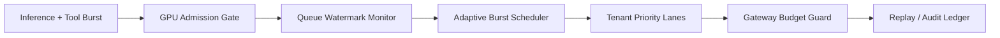

# Agent Sandbox GPU 突发调度选型 FAQ（固定队列配额 vs 自适应突发调度）

## 1) 核心结论（先给负责人）
- **多租户生产默认优先“自适应 GPU 突发调度 + 租户预算配额”**，不建议长期仅固定队列阈值。
- **固定队列配额在并发推理与工具峰值同发时更容易丢任务与排队雪崩**，放大重试与尾延迟。
- **GPU 调度治理必须绑定租户优先级、网关预算和回放审计**，否则成本与SLO会在高峰下同时失控。

## 2) Q1 / Q2 / Q3（术语先通俗解释）
- **固定队列配额**：每个租户只能占固定数量 GPU 作业槽位，简单但不看实时拥塞。
- **自适应突发调度**：根据实时队列水位和租户预算动态调节并发、退避和优先级。

### Q1：为什么固定队列配额在生产容易失效？
第一性原理：GPU 作业到达是非平稳突发流，固定阈值无法吸收峰值波动，局部拥塞会快速传导到全局。

### Q2：什么时候固定配额仍可接受？
低并发、作业时长稳定、租户数量少且可接受偶发排队超时时，可作为过渡方案。

### Q3：最小安全闭环是什么？
租户预算与优先级 -> 调度策略版本 -> 队列水位观测 -> 自适应并发/退避 -> 回放审计与阈值复盘。

## 3) Mermaid（GPU 突发调度闭环）

## 4) 决策矩阵
| 维度 | 固定队列配额 | 自适应突发调度 |
|---|---|---|
| 实现复杂度 | 低 | 中 |
| 峰值抗抖动能力 | 低-中 | 高 |
| 丢任务率控制 | 低-中 | 高 |
| 多租户治理能力 | 中 | 高 |
| 生产默认建议 | 短期过渡 | 多租户长期运行 |

## 5) 数据证据与可复算算例（含 n/分母/来源）
> 本节百分比为 `synthetic_assumed` 假设算例（hypothetical），用于机制比较；生产机制认证仍为 `not_measured`。  
> 合同字段见：`workshops/azure-agent-infra/evidence/cycle-440-benchmark.json` 的 `percentage_contract`。

- 指标 A（队列丢任务率，固定配额）  
  - 定义：`n_gpu_drop_fixed_queue / n_runtime_requests_observed`  
  - 值：`268/2400 = 11.2%`（`synthetic_assumed`）  
  - 路径：`percentage_contract.fixed_gpu_queue_drop_rate`
- 指标 B（队列丢任务率，自适应调度）  
  - 定义：`n_gpu_drop_adaptive_burst / n_runtime_requests_observed`  
  - 值：`102/2400 = 4.2%`（`synthetic_assumed`）  
  - 路径：`percentage_contract.adaptive_gpu_burst_drop_rate`
- 指标 C（恢复成功率提升，百分点）  
  - 定义：`(n_recovery_success_adaptive - n_recovery_success_fixed) / n_runtime_requests_observed`  
  - 值：`(2126-1960)/2400 = 6.9` 个百分点（`synthetic_assumed`）  
  - 路径：`percentage_contract.gpu_recovery_gain_pts`

## 6) 生产 Checklist（上线前必须打勾）
- [ ] GPU 调度策略（并发、退避、优先级）含版本、灰度与回滚路径  
- [ ] 租户预算与网关配额在调度平面与流量平面一致生效  
- [ ] 丢任务率、恢复成功率、回放审计链路可追溯  
- [ ] 指标口径标注 `synthetic_assumed` 与分母/单位，生产机制认证保持 `not_measured`

