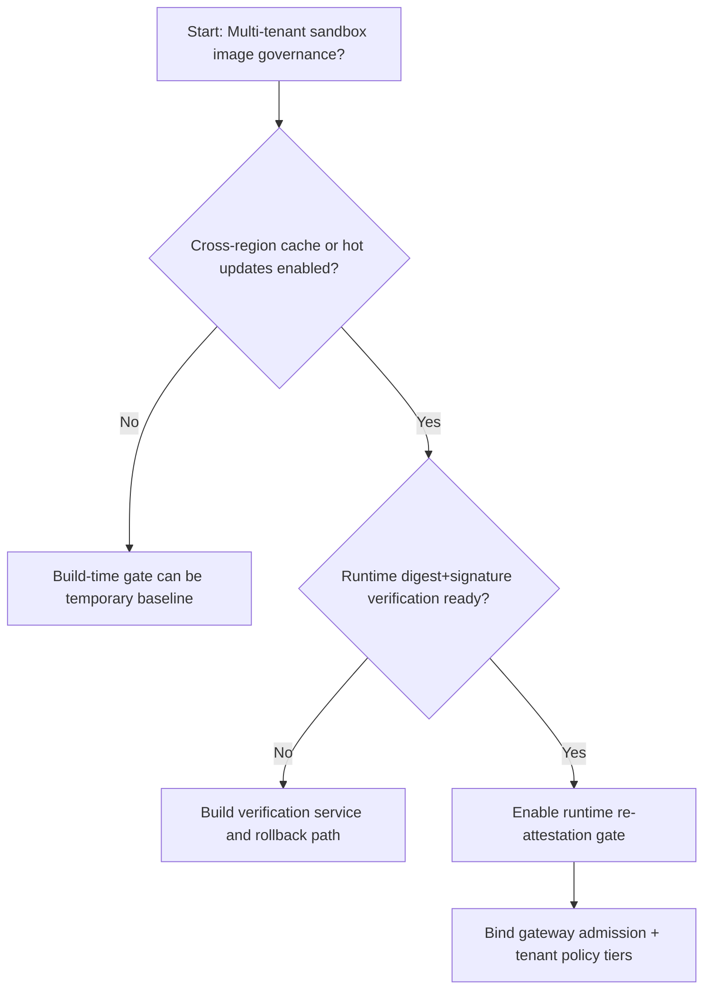
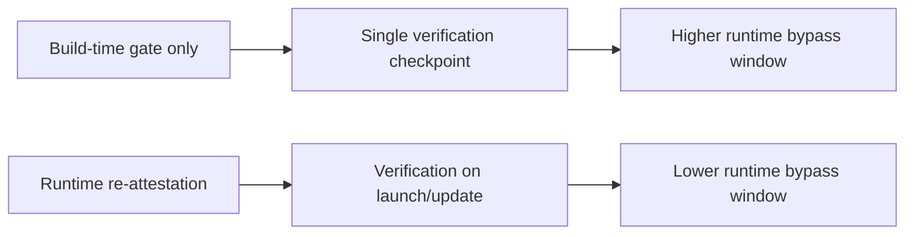
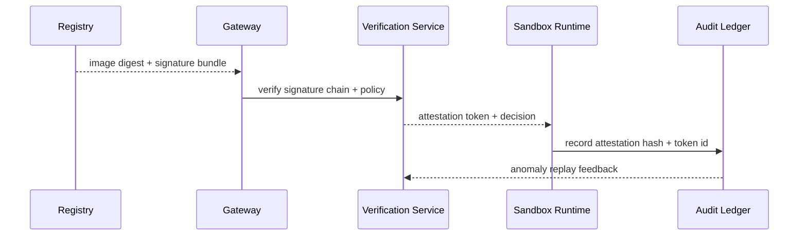

# Agent Sandbox Image Attestation Enforcement Selection FAQ (Build-Time Signature Gate vs Runtime Re-attestation Gate)

## 1) Core conclusions (for decision-makers first)
- **For multi-tenant Agent Sandbox production, default to runtime re-attestation gates**, not build-time-only signature checks.
- **Build-time-only enforcement leaves a larger runtime bypass window** during image pull cache hops and hot-update paths.
- **Image attestation strategy must be coupled with gateway admission, tenant policy tiers, and replay audit**, or compliance evidence is incomplete.

## 2) Q1 / Q2 / Q3 (plain-language definitions first)
- **Build-time signature gate**: signatures are checked during CI/CD image build and publish, then trusted at runtime.
- **Runtime re-attestation gate**: signature chain + digest are re-verified when sandbox instances start or update.

### Q1: Why is build-time-only verification risky in production?
First principles: delivery paths cross registries, caches, and regions. Runtime drift can occur after build; without runtime re-attestation, drift is invisible at admission time.

### Q2: When is build-time-only still acceptable?
Single-tenant, single-region, no hot updates, and tightly controlled cache path with active human operations.

### Q3: What is the minimum safe control loop?
Build signature -> pre-launch re-attestation -> admission gate -> anomaly replay audit -> signing key rotation.

## 3) Mermaid (decision tree / path comparison / sequence)
### 3.1 Selection decision tree

### 3.2 Path comparison

### 3.3 Runtime sequence

## 4) Decision matrix
| Dimension | Build-time signature gate | Runtime re-attestation gate |
|---|---|---|
| Implementation complexity | Low | Medium-High |
| Runtime bypass risk control | Medium-Low | High |
| Compliance traceability | Medium | High |
| Multi-tenant sustainability | Medium | High |
| Default production fit | Short-term or tightly closed single-tenant loop | Long-term default |

## 5) Evidence contract + recomputable examples (n/denominator/source)
> Percentages in this section are `synthetic_assumed` hypothetical examples for mechanism comparison; production mechanism validation remains `not_measured`.  
> Contract fields: `workshops/azure-agent-infra/evidence/cycle-459-benchmark.json` -> `percentage_contract`.

- Metric A (build-time-only bypass rate)  
  - Formula: `n_build_time_only_bypass / n_runtime_requests_observed`  
  - Value: `247/2400 = 10.3%` (`synthetic_assumed`)  
  - Path: `percentage_contract.build_time_only_bypass_rate`
- Metric B (runtime re-attestation bypass rate)  
  - Formula: `n_runtime_reattest_bypass / n_runtime_requests_observed`  
  - Value: `118/2400 = 4.9%` (`synthetic_assumed`)  
  - Path: `percentage_contract.runtime_reattest_bypass_rate`
- Metric C (risk reduction, percentage points)  
  - Formula: `(n_blocked_runtime_reattest - n_blocked_build_time_only) / n_runtime_requests_observed`  
  - Value: `(2282-2154)/2400 = 5.3 percentage points` (`synthetic_assumed`)  
  - Path: `percentage_contract.attestation_risk_reduction_pts`

## 6) Production checklist
- [ ] Runtime re-attestation policy has versioning, rollout, and rollback controls
- [ ] Attestation token lineage, digest chain, and tenant policy mapping are observable and auditable
- [ ] Runtime bypass events, admission blocks, and replay audits are tenant-traceable
- [ ] All metrics are tagged `synthetic_assumed` with denominator/unit; production validation remains `not_measured`
