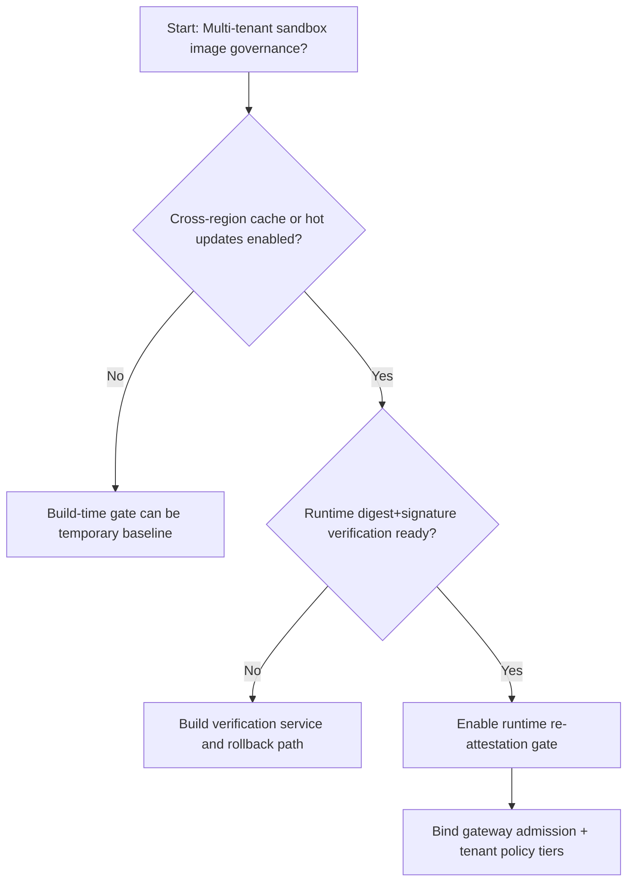
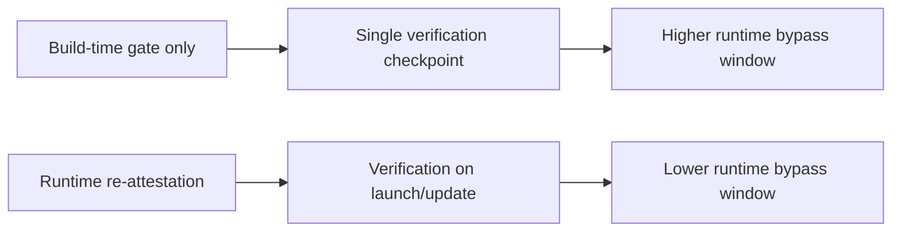
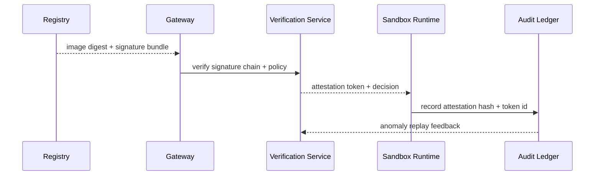

# Agent Sandbox 镜像验签门禁选型 FAQ（Build-Time Signature Gate 策略 vs Runtime Re-attestation Gate 策略）

## 1) 核心结论（先给负责人）
- **多租户 Agent Sandbox 生产默认应选 Runtime Re-attestation Gate 策略**，不建议只依赖构建阶段一次性验签。
- **仅 Build-Time Signature Gate 在镜像拉取链路和运行时热更新场景更容易出现“签过名但被替换”窗口**。
- **镜像验签策略必须联动网关准入、租户策略分层和审计回放**，否则难以在合规审计中自证链路完整性。

## 2) Q1 / Q2 / Q3（术语先通俗解释）
- **Build-Time Signature Gate 策略**：只在 CI/CD 构建产物阶段验签，运行时默认信任已发布镜像。
- **Runtime Re-attestation Gate 策略**：在沙箱实例拉起或热更新时再次校验镜像摘要与签名链。

### Q1：为什么只做构建期验签在生产会有风险？
第一性原理：交付链路跨仓库、跨缓存、跨区域，任何中间环节都可能造成镜像漂移；不在运行时复验就无法及时发现偏差。

### Q2：什么时候可以短期只做 Build-Time Gate？
单区域、单租户、无热更新、镜像缓存路径可严格封闭且有人工巡检时可以短期采用。

### Q3：最小安全闭环是什么？
构建签名 -> 拉取前复验 -> 准入门禁 -> 异常回放审计 -> 签名链滚动轮换。

## 3) Mermaid（决策树 / 路径对比 / 时序）
### 3.1 选型决策树

### 3.2 路径对比图

### 3.3 运行时序图

## 4) 选型决策矩阵
| 维度 | Build-Time Signature Gate 策略 | Runtime Re-attestation Gate 策略 |
|---|---|---|
| 实现复杂度 | 低 | 中-高 |
| 运行时绕过风险控制 | 中-低 | 高 |
| 合规审计可追溯性 | 中 | 高 |
| 多租户可持续性 | 中 | 高 |
| 生产默认建议 | 仅短期或单租户闭环 | 长期默认 |

## 5) 数据证据与可复算算例（含 n/分母/来源）
> 本节百分比为 `synthetic_assumed` 假设算例（hypothetical），用于机制比较；生产机制认证保持 `not_measured`。  
> 合同字段见：`workshops/azure-agent-infra/evidence/cycle-459-benchmark.json` 的 `percentage_contract`。

- 指标 A（仅 Build-Time 策略绕过率）  
  - 定义：`n_build_time_only_bypass / n_runtime_requests_observed`  
  - 值：`247/2400 = 10.3%`（`synthetic_assumed`）  
  - 路径：`percentage_contract.build_time_only_bypass_rate`
- 指标 B（Runtime Re-attestation 策略绕过率）  
  - 定义：`n_runtime_reattest_bypass / n_runtime_requests_observed`  
  - 值：`118/2400 = 4.9%`（`synthetic_assumed`）  
  - 路径：`percentage_contract.runtime_reattest_bypass_rate`
- 指标 C（风险降低，百分点）  
  - 定义：`(n_blocked_runtime_reattest - n_blocked_build_time_only) / n_runtime_requests_observed`  
  - 值：`(2282-2154)/2400 = 5.3` 个百分点（`synthetic_assumed`）  
  - 路径：`percentage_contract.attestation_risk_reduction_pts`

## 6) 生产 Checklist（上线前必须打勾）
- [ ] Runtime Re-attestation 策略具备版本、灰度和回滚路径
- [ ] 验签 token、摘要链和租户策略映射可观测可审计
- [ ] 运行时绕过事件、准入拦截与审计回放可按租户追踪
- [ ] 指标全部标注 `synthetic_assumed`、分母与单位；生产机制认证保持 `not_measured`
