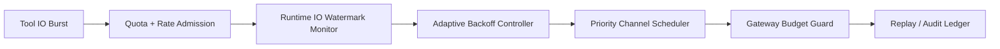

# Agent Sandbox I/O Throttle Governance Selection FAQ (Fixed Throttle vs Adaptive Backoff)

## 1) Core conclusions (for decision-makers first)
- **For multi-tenant production, default to adaptive I/O throttle with graded backoff**, rather than fixed static limits.
- **Fixed throttle limits fail more often during bursty tool writes**, causing cascading timeouts and retry amplification.
- **Throttle governance must bind tenant budgets, gateway quotas, and replay audit chains**, or you cannot keep both performance and compliance stable.

## 2) Q1 / Q2 / Q3 (plain-language definitions first)
- **I/O throttle**: cap the per-session read/write rate so one noisy task cannot saturate the shared channel.
- **Adaptive backoff**: dynamically reduce write pace and batch output under pressure, then recover when pressure drops.

### Q1: Why is fixed throttle risky in production?
First-principles: tool I/O traffic is bursty and uneven. Static thresholds do not adapt to load waves, so local peaks quickly become global congestion.

### Q2: When is fixed throttle acceptable?
Low concurrency, homogeneous tasks, predictable output size, and tolerance for occasional slow requests.

### Q3: What is the minimum safe loop?
Tenant budget -> policy versioning -> realtime watermark telemetry -> adaptive backoff/priority channels -> replay audit and threshold tuning.

## 3) Mermaid (I/O throttle governance loop)

## 4) Decision matrix
| Dimension | Fixed throttle | Adaptive backoff |
|---|---|---|
| Implementation complexity | Low | Medium |
| Peak-time anti-jitter resilience | Low-Medium | High |
| Violation-rate control | Low-Medium | High |
| Multi-tenant governance | Medium | High |
| Recommended production default | Short-term transition | Long-term multi-tenant |

## 5) Quant evidence and reproducible examples (with n/denominator/source)
> Percentages in this section are `synthetic_assumed` hypothetical examples for mechanism comparison; production mechanism certification remains `not_measured`.  
> Contract fields are in `workshops/azure-agent-infra/evidence/cycle-439-benchmark.json` under `percentage_contract`.

- Metric A (throttle violation rate, fixed)  
  - Definition: `n_io_violation_fixed / n_runtime_requests_observed`  
  - Value: `244/2400 = 10.2%` (`synthetic_assumed`)  
  - Path: `percentage_contract.fixed_io_throttle_violation_rate`
- Metric B (throttle violation rate, adaptive)  
  - Definition: `n_io_violation_adaptive / n_runtime_requests_observed`  
  - Value: `86/2400 = 3.6%` (`synthetic_assumed`)  
  - Path: `percentage_contract.adaptive_io_throttle_violation_rate`
- Metric C (recovery-success uplift, percentage points)  
  - Definition: `(n_recovery_success_adaptive - n_recovery_success_fixed) / n_runtime_requests_observed`  
  - Value: `(2098-1940)/2400 = 6.6` percentage points (`synthetic_assumed`)  
  - Path: `percentage_contract.io_recovery_gain_pts`

## 6) Production checklist
- [ ] I/O throttle policy (rate/backoff/priority lanes) has versioning, canary, and rollback paths
- [ ] Tenant budgets and gateway quotas are consistently enforced in runtime and gateway planes
- [ ] Violation rate, recovery-success rate, and replay audit chain are traceable
- [ ] Metrics explicitly label `synthetic_assumed` and denominator/unit; production mechanism certification remains `not_measured`

