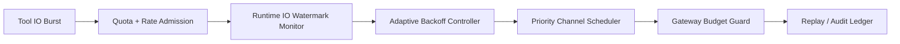

# Agent Sandbox I/O 节流治理选型 FAQ（固定限流 vs 自适应节流回退）

## 1) 核心结论（先给负责人）
- **多租户生产默认优先“自适应 I/O 节流 + 分级回退”**，不建议长期仅用固定限流阈值。
- **固定限流在高并发工具突发写入时更容易触发节流违约与级联超时**，放大重试与排队抖动。
- **节流治理必须绑定租户预算、网关配额和回放审计链路**，否则很难在性能与合规之间稳定平衡。

## 2) Q1 / Q2 / Q3（术语先通俗解释）
- **I/O 节流**：限制每个会话在单位时间内可写入/读取的数据量，避免“单个任务挤爆整条通道”。
- **自适应回退**：当水位升高时动态降速、分批写入并优先关键输出，类似“高峰时分流车道”。

### Q1：为什么固定限流在生产有风险？
第一性原理：工具 I/O 峰值是突发且不均匀的，固定阈值无法随流量波动自调节，容易把局部峰值放大成全局拥塞。

### Q2：什么时候可以接受固定限流？
低并发、任务同质、输出规模可预测且允许偶发慢请求时，固定限流可作为过渡方案。

### Q3：最小安全闭环是什么？
租户预算 -> 节流策略版本 -> 实时水位观测 -> 自适应回退/优先级通道 -> 回放审计与阈值复盘。

## 3) Mermaid（I/O 节流治理闭环）

## 4) 决策矩阵
| 维度 | 固定限流 | 自适应节流回退 |
|---|---|---|
| 实现复杂度 | 低 | 中 |
| 高峰抗抖动能力 | 低-中 | 高 |
| 节流违约控制 | 低-中 | 高 |
| 多租户治理能力 | 中 | 高 |
| 生产默认建议 | 短期过渡 | 多租户长期运行 |

## 5) 数据证据与可复算算例（含 n/分母/来源）
> 本节百分比为 `synthetic_assumed` 假设算例（hypothetical），用于机制比较；生产机制认证仍为 `not_measured`。  
> 合同字段见：`workshops/azure-agent-infra/evidence/cycle-439-benchmark.json` 的 `percentage_contract`。

- 指标 A（节流违约率，固定限流）  
  - 定义：`n_io_violation_fixed / n_runtime_requests_observed`  
  - 值：`244/2400 = 10.2%`（`synthetic_assumed`）  
  - 路径：`percentage_contract.fixed_io_throttle_violation_rate`
- 指标 B（节流违约率，自适应回退）  
  - 定义：`n_io_violation_adaptive / n_runtime_requests_observed`  
  - 值：`86/2400 = 3.6%`（`synthetic_assumed`）  
  - 路径：`percentage_contract.adaptive_io_throttle_violation_rate`
- 指标 C（恢复成功率提升，百分点）  
  - 定义：`(n_recovery_success_adaptive - n_recovery_success_fixed) / n_runtime_requests_observed`  
  - 值：`(2098-1940)/2400 = 6.6` 个百分点（`synthetic_assumed`）  
  - 路径：`percentage_contract.io_recovery_gain_pts`

## 6) 生产 Checklist（上线前必须打勾）
- [ ] I/O 节流策略（速率、回退、优先级）含版本、灰度与回滚路径  
- [ ] 租户预算与网关配额在运行时和网关层一致生效  
- [ ] 节流违约率、恢复成功率与审计回放链路可追溯  
- [ ] 指标口径标注 `synthetic_assumed` 与分母/单位，生产机制认证保持 `not_measured`

