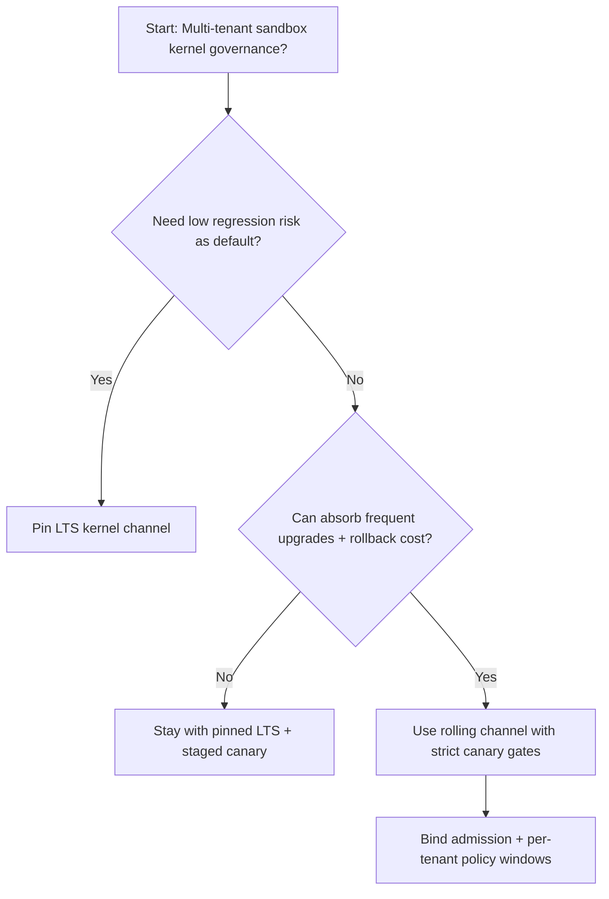
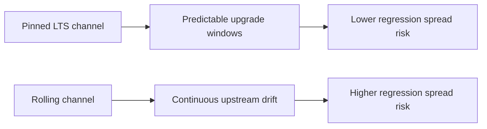
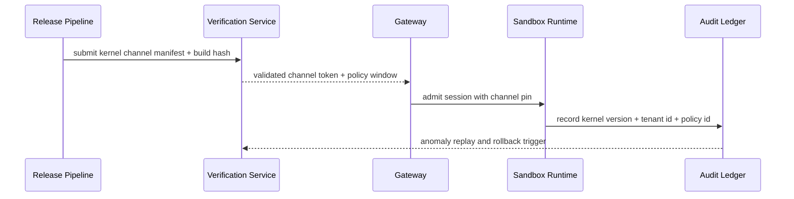

# Agent Sandbox Kernel Channel Pinning Selection FAQ (Pinned LTS Kernel Channel vs Rolling Kernel Channel)

## 1) Core conclusions (for decision-makers first)
- **For multi-tenant Agent Sandbox production, default to pinned LTS kernel channels**, not rolling channels as the baseline.
- **Rolling kernel channels introduce higher regression drift risk** under mixed tenant workloads and frequent runtime updates.
- **Kernel-channel selection must be tied to gateway admission, tenant policy tiers, and replay audit**, or failure domains remain hard to bound.

## 2) Q1 / Q2 / Q3 (plain-language definitions first)
- **Pinned LTS kernel channel**: runtime stays on validated long-term-support kernel versions with scheduled upgrades.
- **Rolling kernel channel**: runtime tracks frequent upstream kernel updates for faster feature uptake.

### Q1: Why is rolling channel riskier at scale?
First principles: kernel behavior is shared substrate for all sandbox workloads. Frequent low-level changes propagate quickly across tenants and amplify regression impact.

### Q2: When is rolling channel acceptable?
Short-lived experimentation, lower-risk tenants, and environments that can absorb frequent rollback operations.

### Q3: What is the minimum safe control loop?
Version pinning -> shadow validation -> admission gates -> anomaly replay audit -> staged upgrade/rollback.

## 3) Mermaid (decision tree / path comparison / sequence)
### 3.1 Selection decision tree

### 3.2 Path comparison

### 3.3 Runtime sequence

## 4) Decision matrix
| Dimension | Pinned LTS kernel channel | Rolling kernel channel |
|---|---|---|
| Implementation complexity | Medium | Medium |
| Regression risk control | High | Medium-Low |
| Change velocity | Medium | High |
| Multi-tenant sustainability | High | Medium |
| Default production fit | Long-term default | Canary/experimental lane only |

## 5) Evidence contract + recomputable examples (n/denominator/source)
> Percentages in this section are `synthetic_assumed` hypothetical examples for mechanism comparison; production mechanism validation remains `not_measured`.  
> Contract fields: `workshops/azure-agent-infra/evidence/cycle-460-benchmark.json` -> `percentage_contract`.

- Metric A (rolling-channel regression rate)  
  - Formula: `n_rolling_channel_regression / n_runtime_requests_observed`  
  - Value: `245/2500 = 9.8%` (`synthetic_assumed`)  
  - Path: `percentage_contract.rolling_channel_regression_rate`
- Metric B (pinned-LTS regression rate)  
  - Formula: `n_pinned_lts_regression / n_runtime_requests_observed`  
  - Value: `115/2500 = 4.6%` (`synthetic_assumed`)  
  - Path: `percentage_contract.pinned_lts_regression_rate`
- Metric C (stability gain, percentage points)  
  - Formula: `(n_recovered_pinned_lts - n_recovered_rolling_channel) / n_runtime_requests_observed`  
  - Value: `(2385-2255)/2500 = 5.2 percentage points` (`synthetic_assumed`)  
  - Path: `percentage_contract.kernel_stability_gain_pts`

## 6) Production checklist
- [ ] Pinned LTS kernel policy has versioning, rollout, and rollback controls
- [ ] Kernel version lineage, tenant policy mapping, and admission windows are observable and auditable
- [ ] Regression events, replay traces, and upgrade windows are tenant-traceable
- [ ] All metrics are tagged `synthetic_assumed` with denominator/unit; production validation remains `not_measured`
