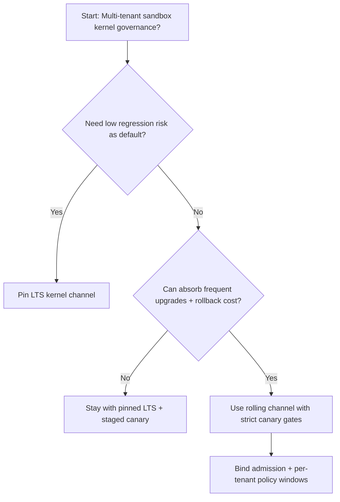
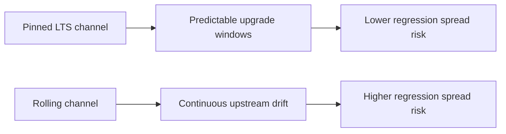
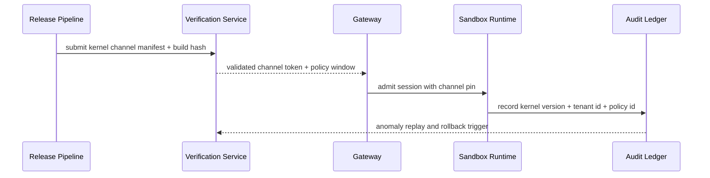

# Agent Sandbox 内核通道固定选型 FAQ（Pinned LTS Kernel Channel 策略 vs Rolling Kernel Channel 策略）

## 1) 核心结论（先给负责人）
- **多租户 Agent Sandbox 生产默认应选 Pinned LTS Kernel Channel 策略**，不建议直接使用 Rolling 通道作为长期默认。
- **Rolling Kernel Channel 在驱动与 syscall 行为变化频繁时更容易引入回归抖动**，会放大会话失败重试和尾延迟。
- **内核通道选型必须联动网关准入、租户分层与回放审计**，否则无法稳定收敛故障域和合规变更窗口。

## 2) Q1 / Q2 / Q3（术语先通俗解释）
- **Pinned LTS Kernel Channel 策略**：生产沙箱统一固定在经过验证的 LTS 内核版本窗口，按计划滚动升级。
- **Rolling Kernel Channel 策略**：跟随上游滚动版本持续更新，功能新但变更频率高。

### Q1：为什么 Rolling 通道在高并发多租户更容易出回归？
第一性原理：内核是所有容器/沙箱共享的最低层执行面，任何小变动都会被并发放大；变更频率越高，回归暴露概率越高。

### Q2：什么时候可以短期采用 Rolling 通道？
低风险 PoC、单租户实验环境、并且能接受更高变更频率与回滚成本时可短期采用。

### Q3：最小安全闭环是什么？
版本固定 -> 影子验证 -> 准入门禁 -> 异常回放审计 -> 分批升级与回滚。

## 3) Mermaid（决策树 / 路径对比 / 时序）
### 3.1 选型决策树

### 3.2 路径对比图

### 3.3 运行时序图

## 4) 选型决策矩阵
| 维度 | Pinned LTS Kernel Channel 策略 | Rolling Kernel Channel 策略 |
|---|---|---|
| 实现复杂度 | 中 | 中 |
| 回归风险控制 | 高 | 中-低 |
| 变更速度 | 中 | 高 |
| 多租户可持续性 | 高 | 中 |
| 生产默认建议 | 长期默认 | 仅灰度/实验通道 |

## 5) 数据证据与可复算算例（含 n/分母/来源）
> 本节百分比为 `synthetic_assumed` 假设算例（hypothetical），用于机制比较；生产机制认证保持 `not_measured`。  
> 合同字段见：`workshops/azure-agent-infra/evidence/cycle-460-benchmark.json` 的 `percentage_contract`。

- 指标 A（Rolling 通道回归率）  
  - 定义：`n_rolling_channel_regression / n_runtime_requests_observed`  
  - 值：`245/2500 = 9.8%`（`synthetic_assumed`）  
  - 路径：`percentage_contract.rolling_channel_regression_rate`
- 指标 B（Pinned LTS 通道回归率）  
  - 定义：`n_pinned_lts_regression / n_runtime_requests_observed`  
  - 值：`115/2500 = 4.6%`（`synthetic_assumed`）  
  - 路径：`percentage_contract.pinned_lts_regression_rate`
- 指标 C（稳定性改善，百分点）  
  - 定义：`(n_recovered_pinned_lts - n_recovered_rolling_channel) / n_runtime_requests_observed`  
  - 值：`(2385-2255)/2500 = 5.2` 个百分点（`synthetic_assumed`）  
  - 路径：`percentage_contract.kernel_stability_gain_pts`

## 6) 生产 Checklist（上线前必须打勾）
- [ ] Pinned LTS 通道具备版本、灰度和回滚路径
- [ ] 内核版本、租户策略和准入窗口映射可观测可审计
- [ ] 回归事件、回放审计与升级窗口可按租户追踪
- [ ] 指标全部标注 `synthetic_assumed`、分母与单位；生产机制认证保持 `not_measured`
