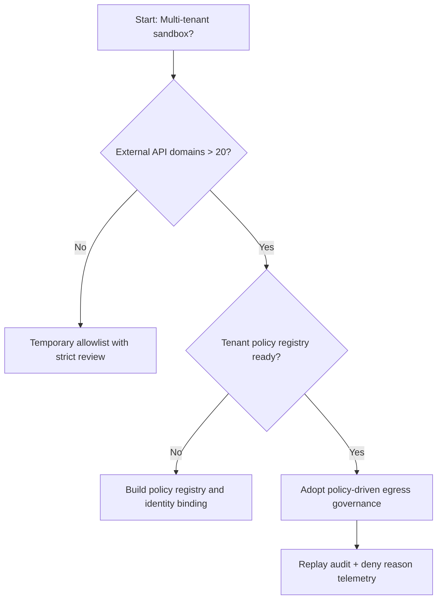
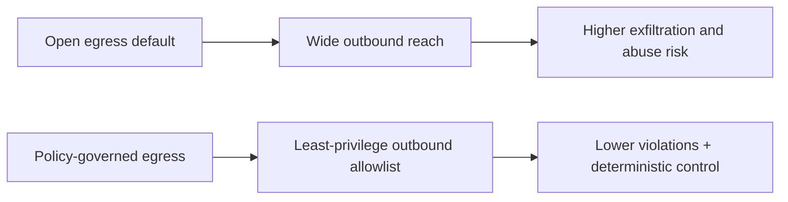
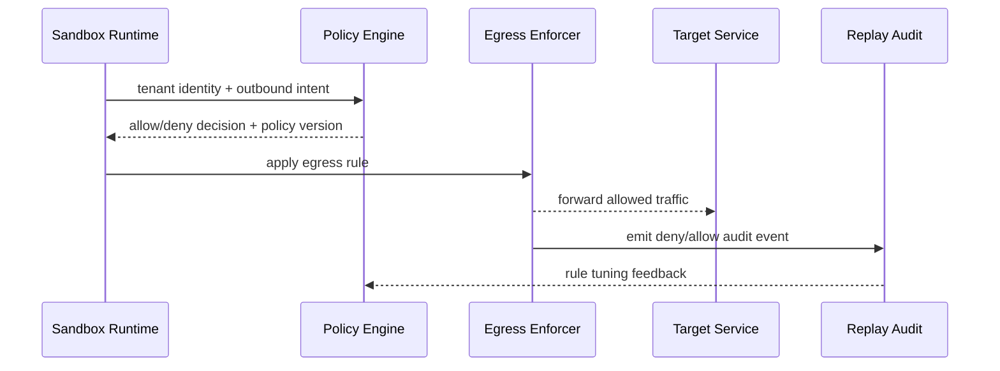

# Agent Sandbox Network Egress Policy Selection FAQ (Open Egress by Default vs Policy-governed Egress)

## 1) Core conclusions (for decision-makers first)
- **For multi-tenant agent sandboxes, default to policy-governed egress with least-privilege allowlists**, not open egress by default.
- **Open egress rapidly amplifies data-exfiltration and overreach risk once tool/plugin surfaces expand**, and increases compliance audit cost.
- **Egress governance must bind identity, tenant policy, DNS/HTTP rules, and replay audit**, or zero-trust boundaries remain unverifiable.

## 2) Q1 / Q2 / Q3 (plain-language definitions first)
- **Open egress default-allow**: sandbox can reach most external destinations; fast to start, high risk at scale.
- **Policy-governed egress**: control outbound reach by tenant, environment, domain, and protocol using fine-grained rules.

### Q1: Why does open egress become unstable in production?
First principles: outbound networking is the shared boundary for all tool calls; default allow turns isolated anomalies into systemic risk.

### Q2: When is open egress still acceptable temporarily?
Controlled PoC, single tenant, isolated datasets, and explicit short-lived windows.

### Q3: What is the minimum safe loop?
Identity + tenant context -> egress policy verdict -> enforcement + deny reason -> replay audit -> policy retuning.

## 3) Mermaid (decision tree / path comparison / sequence)
### 3.1 Selection decision tree

### 3.2 Path comparison

### 3.3 Runtime sequence

## 4) Decision matrix
| Dimension | Open egress default-allow | Policy-governed egress |
|---|---|---|
| Implementation complexity | Low | Medium |
| Security boundary stability | Low | High |
| Compliance explainability | Low-Medium | High |
| Multi-tenant sustainability | Low | High |
| Recommended production default | Short-term transition | Long-term default |

## 5) Quant evidence and reproducible examples (with n/denominator/source)
> Percentages in this section are `synthetic_assumed` hypothetical examples for mechanism comparison; production mechanism certification remains `not_measured`.  
> Contract fields are in `workshops/azure-agent-infra/evidence/cycle-446-benchmark.json` under `percentage_contract`.

- Metric A (open-egress violation rate)  
  - Definition: `n_egress_violation_open / n_runtime_requests_observed`  
  - Value: `304/2400 = 12.7%` (`synthetic_assumed`)  
  - Path: `percentage_contract.open_egress_violation_rate`
- Metric B (policy-egress violation rate)  
  - Definition: `n_egress_violation_policy / n_runtime_requests_observed`  
  - Value: `116/2400 = 4.8%` (`synthetic_assumed`)  
  - Path: `percentage_contract.policy_egress_violation_rate`
- Metric C (recovery-success uplift, percentage points)  
  - Definition: `(n_recovery_success_policy - n_recovery_success_open) / n_runtime_requests_observed`  
  - Value: `(2219-2031)/2400 = 7.8` percentage points (`synthetic_assumed`)  
  - Path: `percentage_contract.egress_recovery_gain_pts`

### Daily-hot source references (with fetch timestamps)
- APIM / AI Gateway overview (Microsoft Learn): `fetched_at_utc=2026-11-09T15:58:18Z`, `source_label=measured`
- Azure API Management changelog (Unified model API / MCP / A2A): `fetched_at_utc=2026-11-09T15:58:18Z`, `source_label=measured`
- Azure Container Apps Dynamic Sessions: `fetched_at_utc=2026-11-09T15:58:18Z`, `source_label=measured`
- Firecracker / Kata / Wasmtime / E2B releases: `fetched_at_utc=2026-11-09T15:58:18Z`, `source_label=measured`

## 6) Production validation checklist
- [ ] Egress policy (domain/protocol/tenant layers) supports versioning, canary, and rollback
- [ ] Identity context, policy engine, and enforcer align on deny-reason taxonomy
- [ ] Violation rate, deny rate, recovery-success rate, and audit chain are traceable
- [ ] Every metric explicitly labels `synthetic_assumed` / `not_measured` with denominator, unit, and source path
