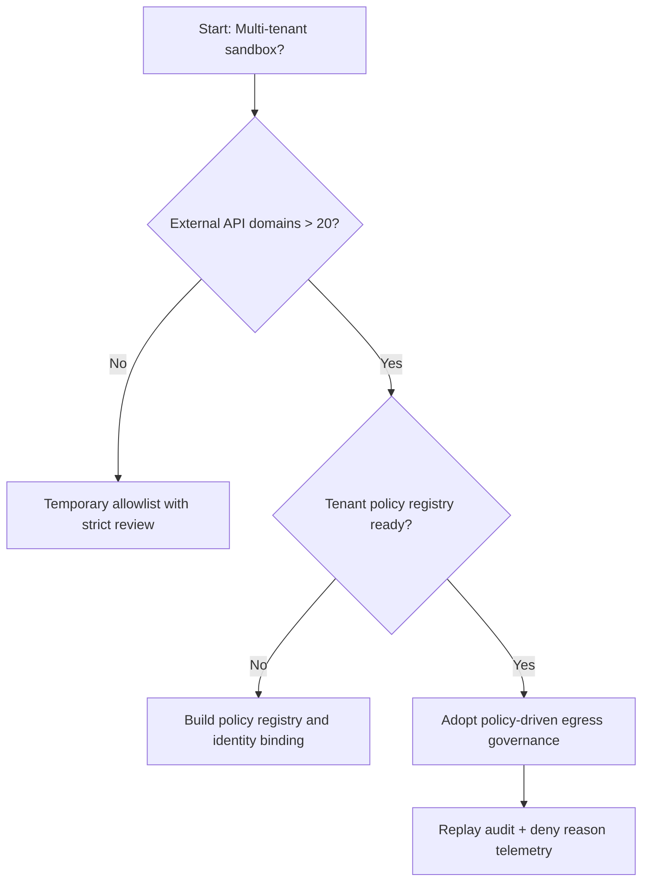
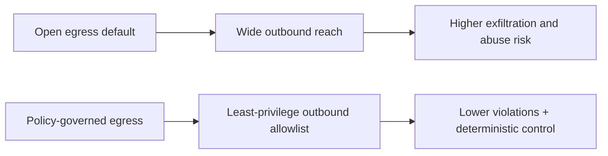
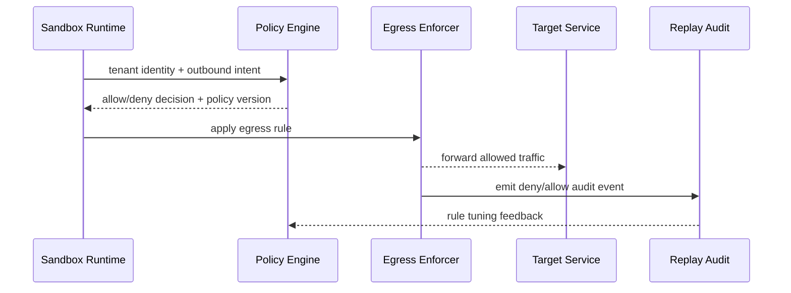

# Agent Sandbox 网络出口策略选型 FAQ（开放出口默认放行 vs 策略化出口治理）

## 1) 核心结论（先给负责人）
- **多租户 Agent Sandbox 生产默认优先“策略化出口治理 + 最小权限白名单”**，不建议长期开放出口默认放行。
- **开放出口在工具链/插件扩展后会快速放大数据外流与越权调用风险**，并增加合规审计成本。
- **出口治理必须联动身份、租户策略、DNS/HTTP 规则与回放审计**，否则难以形成可验证零信任边界。

## 2) Q1 / Q2 / Q3（术语先通俗解释）
- **开放出口默认放行**：沙箱默认可访问大部分外网目标，开发快但风险高。
- **策略化出口治理**：按租户、环境、目标域名/协议细粒度控制可访问范围。

### Q1：为什么开放出口在生产会快速失控？
第一性原理：网络出口是所有工具调用的公共边界，默认放行会把少数异常请求扩散成系统性风险。

### Q2：什么时候开放出口仍可短期接受？
受控 PoC、单租户、隔离数据集且有短期时间窗时，可临时采用。

### Q3：最小安全闭环是什么？
身份与租户上下文 -> 出口策略裁决 -> 规则执行与拒绝回执 -> 回放审计 -> 规则复盘。

## 3) Mermaid（决策树 / 路径对比 / 时序）
### 3.1 选型决策树

### 3.2 路径对比图

### 3.3 运行时序图

## 4) 选型决策矩阵
| 维度 | 开放出口默认放行 | 策略化出口治理 |
|---|---|---|
| 实现复杂度 | 低 | 中 |
| 安全边界稳定性 | 低 | 高 |
| 合规审计可解释性 | 低-中 | 高 |
| 多租户可持续性 | 低 | 高 |
| 生产默认建议 | 短期过渡 | 长期默认 |

## 5) 数据证据与可复算算例（含 n/分母/来源）
> 本节百分比为 `synthetic_assumed` 假设算例（hypothetical），用于机制比较；生产机制认证保持 `not_measured`。  
> 合同字段见：`workshops/azure-agent-infra/evidence/cycle-446-benchmark.json` 的 `percentage_contract`。

- 指标 A（开放出口违规率）  
  - 定义：`n_egress_violation_open / n_runtime_requests_observed`  
  - 值：`304/2400 = 12.7%`（`synthetic_assumed`）  
  - 路径：`percentage_contract.open_egress_violation_rate`
- 指标 B（策略化出口违规率）  
  - 定义：`n_egress_violation_policy / n_runtime_requests_observed`  
  - 值：`116/2400 = 4.8%`（`synthetic_assumed`）  
  - 路径：`percentage_contract.policy_egress_violation_rate`
- 指标 C（恢复成功率提升，百分点）  
  - 定义：`(n_recovery_success_policy - n_recovery_success_open) / n_runtime_requests_observed`  
  - 值：`(2219-2031)/2400 = 7.8` 个百分点（`synthetic_assumed`）  
  - 路径：`percentage_contract.egress_recovery_gain_pts`

### 当日热点来源（抓取时间）
- APIM / AI Gateway 概览（Microsoft Learn）：`fetched_at_utc=2026-11-09T15:58:18Z`，`source_label=measured`
- Azure API Management changelog（Unified model API / MCP / A2A）：`fetched_at_utc=2026-11-09T15:58:18Z`，`source_label=measured`
- Azure Container Apps Dynamic Sessions：`fetched_at_utc=2026-11-09T15:58:18Z`，`source_label=measured`
- Firecracker / Kata / Wasmtime / E2B releases：`fetched_at_utc=2026-11-09T15:58:18Z`，`source_label=measured`

## 6) 生产核验 Checklist（上线前必须打勾）
- [ ] 出口策略（域名/协议/租户层级）具备版本、灰度、回滚
- [ ] 身份上下文、策略引擎、执行器对 deny reason 口径一致
- [ ] 违规率、拒绝率、恢复成功率和审计链可追溯
- [ ] 指标全部标注 `synthetic_assumed` / `not_measured` 与分母、单位、source_path
