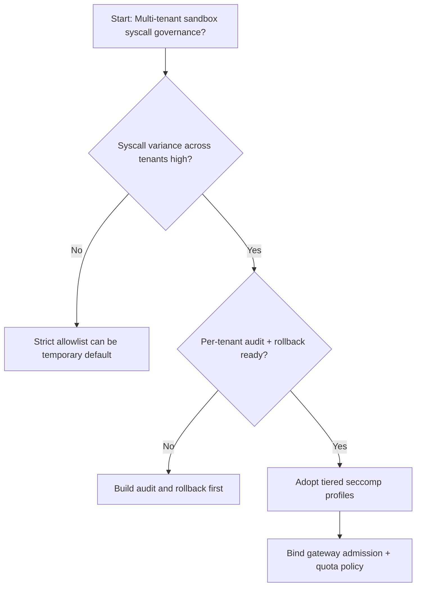
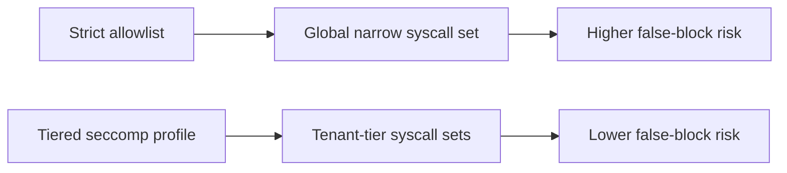
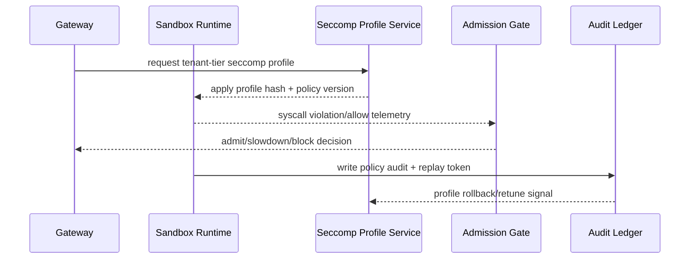

# Agent Sandbox seccomp Profile Selection FAQ (Strict Allowlist Policy vs Tiered Profile Policy)

## 1) Core conclusions (for decision-makers first)
- **For multi-tenant Agent Sandbox production, default to tiered seccomp profiles**, not one strict global allowlist for all tenants.
- **Strict allowlist policy increases false blocks in complex toolchains**, which amplifies retry pressure and queue jitter.
- **seccomp policy selection must be tied to tenant tiering, gateway admission, and replay audit**, or reliability losses will offset security gains.

## 2) Q1 / Q2 / Q3 (plain-language definitions first)
- **Strict allowlist policy**: all tenants share one narrow syscall allowlist; fast to harden, but more prone to false blocks.
- **Tiered profile policy**: different seccomp syscall sets are assigned per tenant risk tier.

### Q1: Why does strict allowlist stall sessions at peak?
First principles: as toolchains evolve, legal syscall combinations expand. A single narrow allowlist misclassifies legal syscalls as violations, triggering retries and queue buildup.

### Q2: When is strict allowlist still acceptable?
Single-tenant PoC, stable syscall footprint, and an on-call team ready to hot-fix false blocks.

### Q3: What is the minimum safe control loop?
Tenant classification -> seccomp profile assignment -> violation audit -> replay review -> allowlist tuning.

## 3) Mermaid (decision tree / path comparison / sequence)
### 3.1 Selection decision tree

### 3.2 Path comparison

### 3.3 Runtime sequence

## 4) Decision matrix
| Dimension | Strict allowlist policy | Tiered profile policy |
|---|---|---|
| Implementation complexity | Low | Medium |
| False-block control | Low-Medium | High |
| Isolation boundary clarity | Medium | High |
| Multi-tenant sustainability | Medium-Low | High |
| Default production fit | Short-term or single-tenant only | Long-term default |

## 5) Evidence contract + recomputable examples (n/denominator/source)
> Percentages in this section are `synthetic_assumed` hypothetical examples for mechanism comparison; production mechanism validation remains `not_measured`.  
> Contract fields: `workshops/azure-agent-infra/evidence/cycle-458-benchmark.json` -> `percentage_contract`.

- Metric A (strict-policy false-block rate)  
  - Formula: `n_strict_seccomp_false_block / n_runtime_requests_observed`  
  - Value: `278/2400 = 11.6%` (`synthetic_assumed`)  
  - Path: `percentage_contract.strict_seccomp_false_block_rate`
- Metric B (tiered-policy false-block rate)  
  - Formula: `n_tiered_seccomp_false_block / n_runtime_requests_observed`  
  - Value: `131/2400 = 5.5%` (`synthetic_assumed`)  
  - Path: `percentage_contract.tiered_seccomp_false_block_rate`
- Metric C (safe-pass gain, percentage points)  
  - Formula: `(n_safe_pass_tiered_seccomp - n_safe_pass_strict_seccomp) / n_runtime_requests_observed`  
  - Value: `(2269-2122)/2400 = 6.1 percentage points` (`synthetic_assumed`)  
  - Path: `percentage_contract.seccomp_safe_pass_gain_pts`

## 6) Production checklist
- [ ] Tiered seccomp profile policy has versioning, rollout, and rollback controls
- [ ] Tenant tiers, gateway admission, and quota policy are observable and auditable
- [ ] Syscall violation rates, false-block replay traces, and policy version lineage are tenant-traceable
- [ ] All metrics are tagged `synthetic_assumed` with denominator/unit; production validation remains `not_measured`
