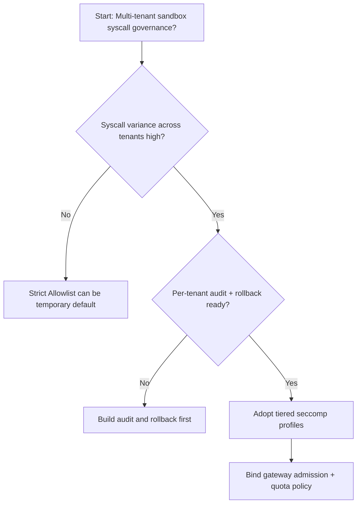
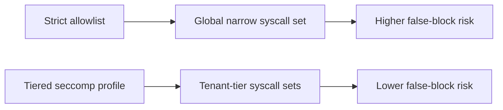
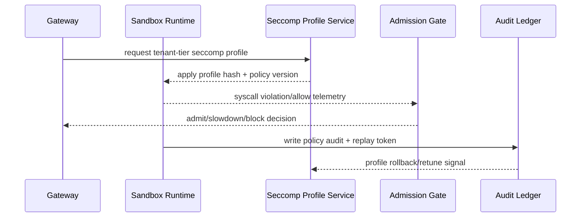

# Agent Sandbox seccomp 策略选型 FAQ（Strict Allowlist 策略 vs Tiered Profile 策略）

## 1) 核心结论（先给负责人）
- **多租户 Agent Sandbox 生产默认应选 Tiered seccomp Profile 策略**，不建议长期全租户统一使用 Strict Allowlist。
- **Strict Allowlist 在复杂工具链场景更容易误拦截合法系统调用**，会放大会话重试与排队抖动。
- **seccomp 选型必须与租户分层、网关准入与审计回放联动**，否则安全收益会被稳定性损失抵消。

## 2) Q1 / Q2 / Q3（术语先通俗解释）
- **Strict Allowlist 策略**：所有租户共用一份很窄的系统调用白名单，安全收敛快但误伤概率高。
- **Tiered Profile 策略**：按租户风险等级下发不同 seccomp 白名单，低风险租户更宽，高风险租户更严。

### Q1：为什么 Strict Allowlist 在生产峰值期容易“卡住”会话？
第一性原理：调用链越复杂，合法 syscall 组合越多；一刀切白名单会把“未知但合法”的调用判成违规，触发重复重试和队列堆积。

### Q2：什么时候可以短期采用 Strict Allowlist？
单租户 PoC、调用链稳定且接口很少变更、并且有人工值守可快速放行误拦截时可以短期使用。

### Q3：最小安全闭环是什么？
租户分级 -> seccomp Profile 下发 -> 违规拦截审计 -> 回放复核 -> 白名单迭代。

## 3) Mermaid（决策树 / 路径对比 / 时序）
### 3.1 选型决策树

### 3.2 路径对比图

### 3.3 运行时序图

## 4) 选型决策矩阵
| 维度 | Strict Allowlist 策略 | Tiered Profile 策略 |
|---|---|---|
| 实现复杂度 | 低 | 中 |
| 误拦截控制能力 | 低-中 | 高 |
| 隔离边界清晰度 | 中 | 高 |
| 多租户可持续性 | 中-低 | 高 |
| 生产默认建议 | 仅短期或单租户 | 长期默认 |

## 5) 数据证据与可复算算例（含 n/分母/来源）
> 本节百分比为 `synthetic_assumed` 假设算例（hypothetical），用于机制比较；生产机制认证保持 `not_measured`。  
> 合同字段见：`workshops/azure-agent-infra/evidence/cycle-458-benchmark.json` 的 `percentage_contract`。

- 指标 A（Strict 策略误拦截率）  
  - 定义：`n_strict_seccomp_false_block / n_runtime_requests_observed`  
  - 值：`278/2400 = 11.6%`（`synthetic_assumed`）  
  - 路径：`percentage_contract.strict_seccomp_false_block_rate`
- 指标 B（Tiered 策略误拦截率）  
  - 定义：`n_tiered_seccomp_false_block / n_runtime_requests_observed`  
  - 值：`131/2400 = 5.5%`（`synthetic_assumed`）  
  - 路径：`percentage_contract.tiered_seccomp_false_block_rate`
- 指标 C（安全放行提升，百分点）  
  - 定义：`(n_safe_pass_tiered_seccomp - n_safe_pass_strict_seccomp) / n_runtime_requests_observed`  
  - 值：`(2269-2122)/2400 = 6.1` 个百分点（`synthetic_assumed`）  
  - 路径：`percentage_contract.seccomp_safe_pass_gain_pts`

## 6) 生产 Checklist（上线前必须打勾）
- [ ] Tiered seccomp Profile 具备版本、灰度和回滚路径
- [ ] 租户分层、网关准入和 quota 策略可观测可审计
- [ ] syscall 拦截率、误拦截回放与策略版本可按租户追踪
- [ ] 指标全部标注 `synthetic_assumed`、分母与单位；生产机制认证保持 `not_measured`
