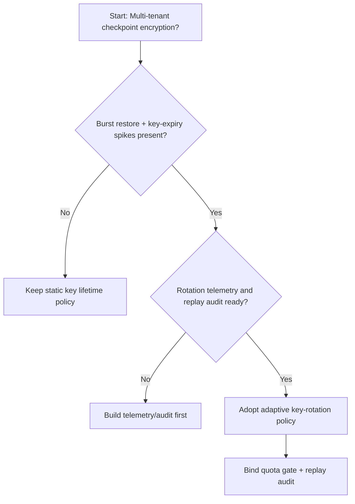
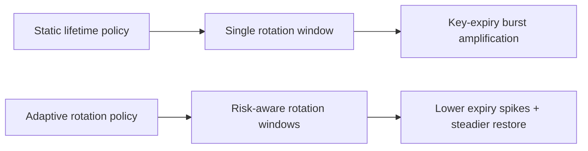
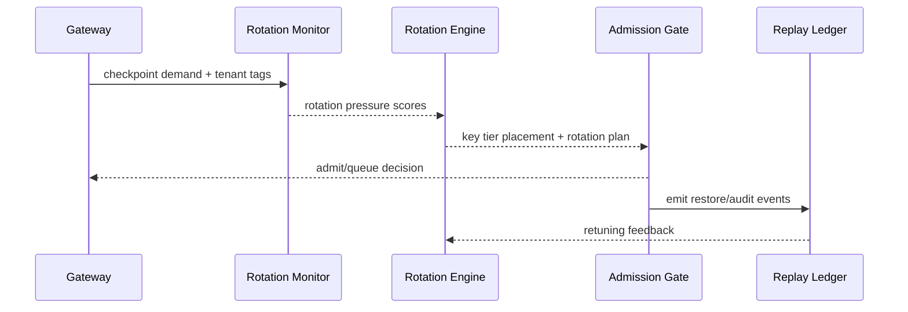

# Agent Session Checkpoint-key Rotation Selection FAQ (Static Key Lifetime Policy vs Adaptive Key-rotation Policy)

## 1) Core conclusions (for decision-makers first)
- **For multi-tenant session production, default to adaptive key-rotation policy**, not a long-lived static key lifetime policy.
- **Static lifetime policies are more likely to trigger key-expiry jitter and resume-failure spikes** under long sessions and high-concurrency restore windows.
- **Rotation policy must couple tenant quota, gateway admission, and replay audit**, or security compliance and recovery reliability will diverge.

## 2) Q1 / Q2 / Q3 (plain-language definitions first)
- **Static key lifetime policy**: all checkpoints use one fixed rotation period; simple but inflexible.
- **Adaptive key-rotation policy**: rotation windows adjust by tenant risk, session duration, and restore pressure.

### Q1: Why is static lifetime more fragile at peak?
First principles: when session and restore concurrency rise together, fixed windows cause clustered key expiry and amplify rebuild/queue pressure.

### Q2: When is static lifetime still acceptable?
Transitional phases with single tenant, short sessions, low restore frequency, and lighter compliance controls.

### Q3: What is the minimum safe loop?
Tenant classification -> key-rotation policy -> burst-budget gate -> replay audit -> rotation rollback retuning.

## 3) Mermaid (decision tree / path comparison / sequence)
### 3.1 Selection decision tree

### 3.2 Path comparison

### 3.3 Runtime sequence

## 4) Decision matrix
| Dimension | Static key lifetime policy | Adaptive key-rotation policy |
|---|---|---|
| Implementation complexity | Low | Medium |
| Peak restore stability | Medium-Low | High |
| Expiry-jitter control | Low-Medium | High |
| Multi-tenant sustainability | Medium | High |
| Default production fit | Transitional only | Long-term default |

## 5) Evidence contract + recomputable examples (n/denominator/source)
> Percentages in this section are `synthetic_assumed` hypothetical examples for mechanism comparison; production mechanism validation remains `not_measured`.  
> Contract fields: `workshops/azure-agent-infra/evidence/cycle-451-benchmark.json` -> `percentage_contract`.

- Metric A (static lifetime resume-failure rate)  
  - Formula: `n_static_rotation_fail / n_runtime_requests_observed`  
  - Value: `322/2400 = 13.4%` (`synthetic_assumed`)  
  - Path: `percentage_contract.static_key_rotation_failure_rate`
- Metric B (adaptive rotation resume-failure rate)  
  - Formula: `n_adaptive_rotation_fail / n_runtime_requests_observed`  
  - Value: `133/2400 = 5.5%` (`synthetic_assumed`)  
  - Path: `percentage_contract.adaptive_key_rotation_failure_rate`
- Metric C (resume success gain, percentage points)  
  - Formula: `(n_resume_success_adaptive - n_resume_success_static) / n_runtime_requests_observed`  
  - Value: `(2240-2047)/2400 = 8.0 percentage points` (`synthetic_assumed`)  
  - Path: `percentage_contract.rotation_recovery_gain_pts`

## 6) Production checklist
- [ ] Rotation policy is versioned with rollout and rollback paths
- [ ] Tenant quota and burst-budget admission gates are enforced at gateway level
- [ ] Resume failures, resume success, and replay audit are traceable
- [ ] Metrics are tagged `synthetic_assumed` with denominator/unit; production validation remains `not_measured`

