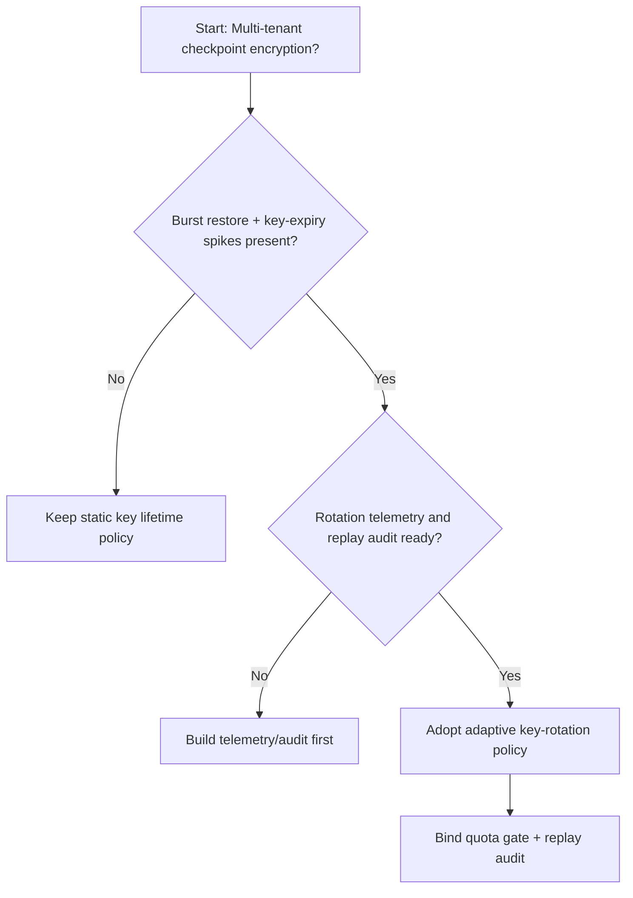
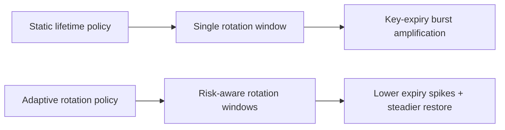
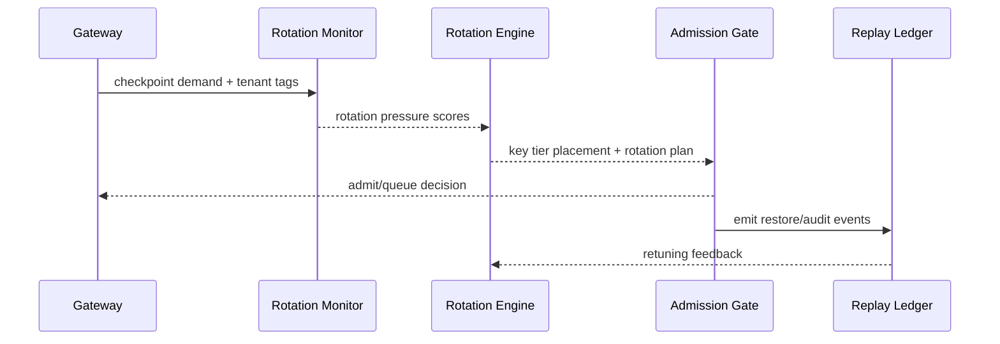

# Agent Session 检查点密钥轮换选型 FAQ（静态密钥寿命策略 vs 自适应密钥轮换策略）

## 1) 核心结论（先给负责人）
- **多租户 Session 生产默认应选“自适应密钥轮换策略”**，不建议长期静态密钥寿命策略。
- **静态寿命在长会话与高并发恢复场景下更易出现密钥过期抖动与恢复失败抬升**。
- **密钥轮换策略必须与租户配额、网关准入、回放审计联动**，否则会出现安全合规与可恢复性割裂。

## 2) Q1 / Q2 / Q3（术语先通俗解释）
- **静态密钥寿命策略**：所有检查点使用固定轮换周期，规则简单但弹性不足。
- **自适应密钥轮换策略**：按租户风险、会话时长与恢复压力动态调整轮换窗口。

### Q1：为什么静态寿命在峰值期更脆弱？
第一性原理：会话并发与恢复并发上升时，固定周期容易导致密钥集中到期，放大重建与排队压力。

### Q2：什么时候还能接受静态寿命？
单租户、短会话、恢复频次低且合规要求较弱的过渡阶段。

### Q3：最小安全闭环是什么？
租户分级 -> 密钥轮换策略 -> 峰值预算门禁 -> 回放审计 -> 密钥策略回滚校准。

## 3) Mermaid（决策树 / 路径对比 / 时序）
### 3.1 选型决策树

### 3.2 路径对比图

### 3.3 运行时序图

## 4) 选型决策矩阵
| 维度 | 静态密钥寿命策略 | 自适应密钥轮换策略 |
|---|---|---|
| 实现复杂度 | 低 | 中 |
| 峰值恢复稳定性 | 中-低 | 高 |
| 过期抖动控制 | 低-中 | 高 |
| 多租户可持续性 | 中 | 高 |
| 生产默认建议 | 过渡方案 | 长期默认 |

## 5) 数据证据与可复算算例（含 n/分母/来源）
> 本节百分比为 `synthetic_assumed` 假设算例（hypothetical），用于机制比较；生产机制认证保持 `not_measured`。  
> 合同字段见：`workshops/azure-agent-infra/evidence/cycle-451-benchmark.json` 的 `percentage_contract`。

- 指标 A（静态寿命恢复失败率）  
  - 定义：`n_static_rotation_fail / n_runtime_requests_observed`  
  - 值：`322/2400 = 13.4%`（`synthetic_assumed`）  
  - 路径：`percentage_contract.static_key_rotation_failure_rate`
- 指标 B（自适应轮换恢复失败率）  
  - 定义：`n_adaptive_rotation_fail / n_runtime_requests_observed`  
  - 值：`133/2400 = 5.5%`（`synthetic_assumed`）  
  - 路径：`percentage_contract.adaptive_key_rotation_failure_rate`
- 指标 C（恢复成功率提升，百分点）  
  - 定义：`(n_resume_success_adaptive - n_resume_success_static) / n_runtime_requests_observed`  
  - 值：`(2240-2047)/2400 = 8.0` 个百分点（`synthetic_assumed`）  
  - 路径：`percentage_contract.rotation_recovery_gain_pts`

## 6) 生产 Checklist（上线前必须打勾）
- [ ] 密钥轮换策略含版本、灰度与回滚路径
- [ ] 租户配额与峰值预算门禁在网关层生效
- [ ] 恢复失败率、恢复成功率与回放审计可追溯
- [ ] 指标口径标注 `synthetic_assumed`、分母与单位；生产机制认证保持 `not_measured`

