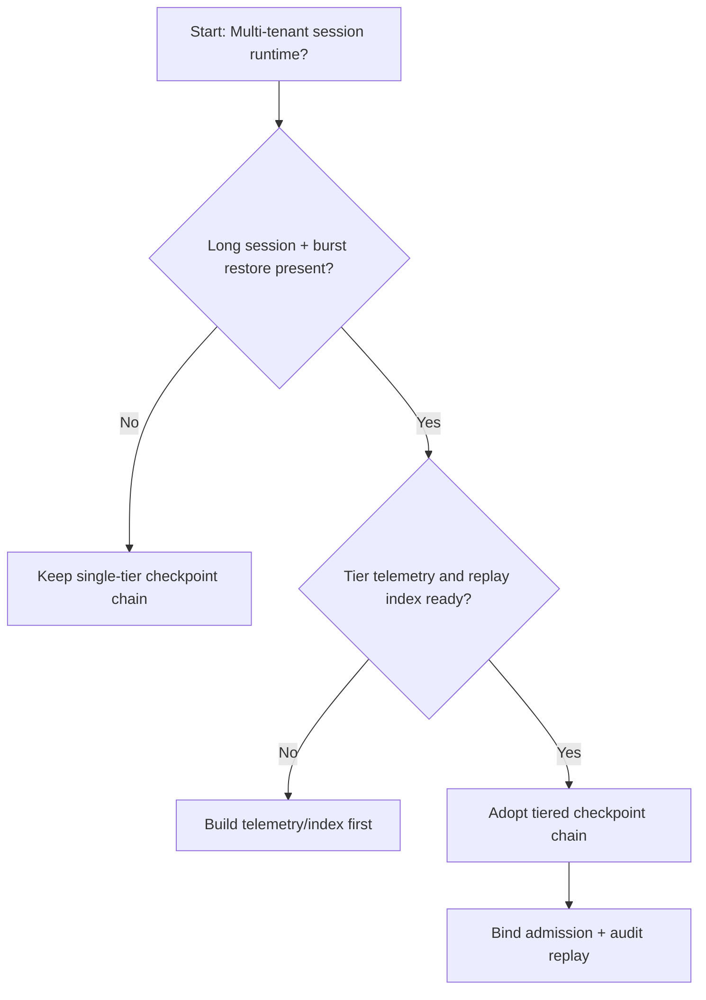
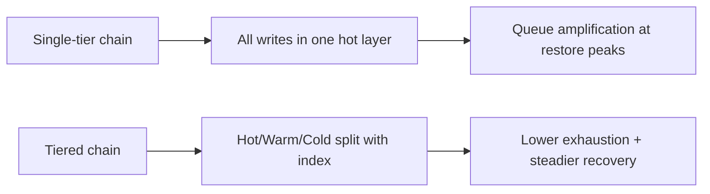
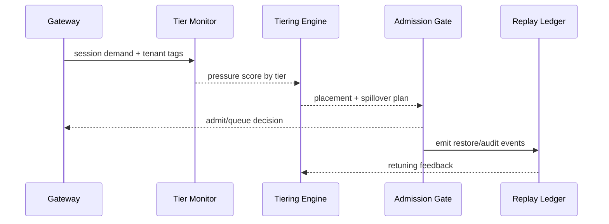

# Agent Session Checkpoint Tiering Selection FAQ (Single-tier Hot Chain vs Tiered Checkpoint Chain)

## 1) Core conclusions (for decision-makers first)
- **For multi-tenant session production, default to a tiered checkpoint chain (Hot+Warm+Cold)** instead of a long-term single-tier hot chain.
- **Single-tier chains are more likely to amplify restore-queue congestion and tail-latency spikes** under long sessions and cross-zone recovery bursts.
- **Tiering policy must couple tenant quota, gateway admission, and replay audit**; otherwise, control-plane governance will diverge from runtime recovery reality.

## 2) Q1 / Q2 / Q3 (plain-language definitions first)
- **Single-tier hot chain**: all checkpoints are persisted in one high-performance tier; fast reads, but high contention/cost risk.
- **Tiered checkpoint chain**: hot state stays in hot tier while historical fragments spill to warm/cold tiers with indexed replay.

### Q1: Why does a single-tier chain become “faster but more blocked” at peak?
First principles: all write and restore pressure targets the same tier; when state size and concurrency rise together, I/O amplification and queue depth rise together.

### Q2: When is a single-tier chain still acceptable?
As a short transitional strategy for single-tenant, short sessions with small state and low restore frequency.

### Q3: What is the minimum safe governance loop?
Tenant classification -> checkpoint tiering policy -> burst-budget gate -> restore replay audit -> rollback parameter retuning.

## 3) Mermaid (decision tree / path comparison / sequence)
### 3.1 Selection decision tree

### 3.2 Path comparison

### 3.3 Runtime sequence

## 4) Decision matrix
| Dimension | Single-tier hot chain | Tiered checkpoint chain |
|---|---|---|
| Implementation complexity | Low | Medium |
| Peak restore stability | Medium-Low | High |
| Exhaustion control | Low-Medium | High |
| Multi-tenant sustainability | Medium | High |
| Default production fit | Transitional only | Long-term default |

## 5) Evidence contract + recomputable examples (n/denominator/source)
> Percentages in this section are `synthetic_assumed` hypothetical examples for mechanism comparison; production mechanism validation remains `not_measured`.  
> Contract fields: `workshops/azure-agent-infra/evidence/cycle-448-benchmark.json` -> `percentage_contract`.

- Metric A (single-tier exhaustion rate)  
  - Formula: `n_single_tier_exhaust / n_runtime_requests_observed`  
  - Value: `322/2400 = 13.4%` (`synthetic_assumed`)  
  - Path: `percentage_contract.single_tier_exhaust_rate`
- Metric B (tiered-chain exhaustion rate)  
  - Formula: `n_multi_tier_exhaust / n_runtime_requests_observed`  
  - Value: `133/2400 = 5.5%` (`synthetic_assumed`)  
  - Path: `percentage_contract.multi_tier_exhaust_rate`
- Metric C (resume success gain, percentage points)  
  - Formula: `(n_resume_success_tiered - n_resume_success_single) / n_runtime_requests_observed`  
  - Value: `(2240-2047)/2400 = 8.0 percentage points` (`synthetic_assumed`)  
  - Path: `percentage_contract.tiered_recovery_gain_pts`

## 6) Production checklist
- [ ] Tiered checkpoint policy is versioned with rollout and rollback paths
- [ ] Tenant quota and burst-budget admission gates are enforced at gateway level
- [ ] Resume failures, resume success, and replay audit are traceable
- [ ] Metrics are tagged `synthetic_assumed` with denominator/unit; production mechanism validation remains `not_measured`

