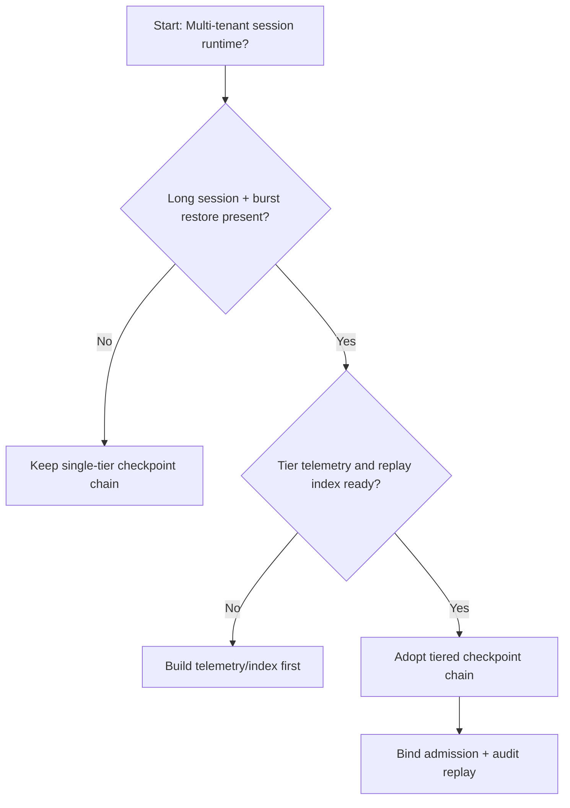
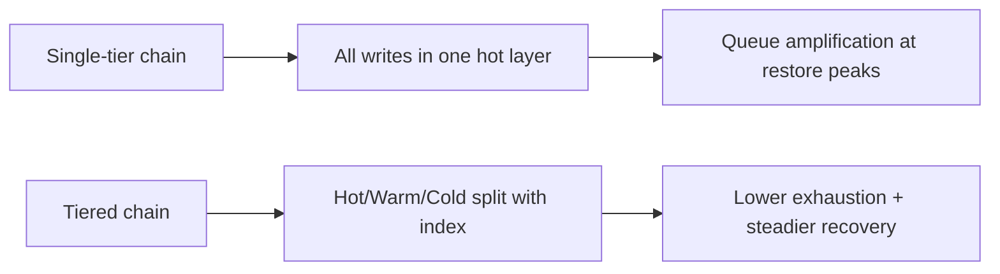
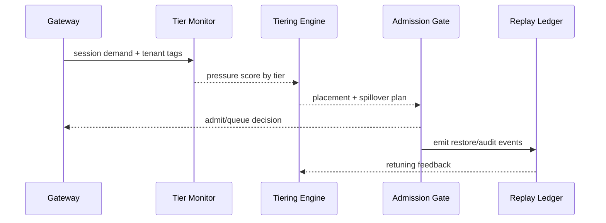

# Agent Session 检查点分层选型 FAQ（单层热存储链 vs 分层检查点链）

## 1) 核心结论（先给负责人）
- **多租户 Session 生产默认应选“分层检查点链（Hot+Warm+Cold）”**，不建议长期单层热存储链。
- **单层链在长会话和跨区恢复高峰下更易出现恢复队列拥塞与尾延迟放大**。
- **分层策略必须与租户配额、网关准入、审计回放联动**，否则会出现“有容量但恢复不可用”的治理断层。

## 2) Q1 / Q2 / Q3（术语先通俗解释）
- **单层热存储链**：全部检查点都写入同一高性能层，读取快但成本和拥塞风险高。
- **分层检查点链**：热点状态保留在热层，历史片段下沉到温/冷层，通过索引回放恢复。

### Q1：为什么单层链会在峰值期“越快越堵”？
第一性原理：所有写入和恢复都挤在同一层，状态体积和并发同时上升时，I/O 放大与排队会同步恶化。

### Q2：什么时候还能接受单层链？
单租户、短会话、状态体积小且恢复频次低的阶段，可作为短期过渡方案。

### Q3：最小安全闭环是什么？
租户分级 -> 检查点分层策略 -> 峰值预算门禁 -> 恢复回放审计 -> 回滚参数校准。

## 3) Mermaid（决策树 / 路径对比 / 时序）
### 3.1 选型决策树

### 3.2 路径对比图

### 3.3 运行时序图

## 4) 选型决策矩阵
| 维度 | 单层热存储链 | 分层检查点链 |
|---|---|---|
| 实现复杂度 | 低 | 中 |
| 峰值恢复稳定性 | 中-低 | 高 |
| 资源耗尽控制 | 低-中 | 高 |
| 多租户可持续性 | 中 | 高 |
| 生产默认建议 | 过渡方案 | 长期默认 |

## 5) 数据证据与可复算算例（含 n/分母/来源）
> 本节百分比为 `synthetic_assumed` 假设算例（hypothetical），用于机制比较；生产机制认证保持 `not_measured`。  
> 合同字段见：`workshops/azure-agent-infra/evidence/cycle-448-benchmark.json` 的 `percentage_contract`。

- 指标 A（单层链耗尽率）  
  - 定义：`n_single_tier_exhaust / n_runtime_requests_observed`  
  - 值：`322/2400 = 13.4%`（`synthetic_assumed`）  
  - 路径：`percentage_contract.single_tier_exhaust_rate`
- 指标 B（分层链耗尽率）  
  - 定义：`n_multi_tier_exhaust / n_runtime_requests_observed`  
  - 值：`133/2400 = 5.5%`（`synthetic_assumed`）  
  - 路径：`percentage_contract.multi_tier_exhaust_rate`
- 指标 C（恢复成功率提升，百分点）  
  - 定义：`(n_resume_success_tiered - n_resume_success_single) / n_runtime_requests_observed`  
  - 值：`(2240-2047)/2400 = 8.0` 个百分点（`synthetic_assumed`）  
  - 路径：`percentage_contract.tiered_recovery_gain_pts`

## 6) 生产 Checklist（上线前必须打勾）
- [ ] 分层检查点策略包含版本、灰度与回滚路径
- [ ] 租户配额与峰值预算门禁在网关层生效
- [ ] 恢复失败率、恢复成功率与回放审计可追溯
- [ ] 指标口径标注 `synthetic_assumed`、分母与单位；生产机制认证保持 `not_measured`

