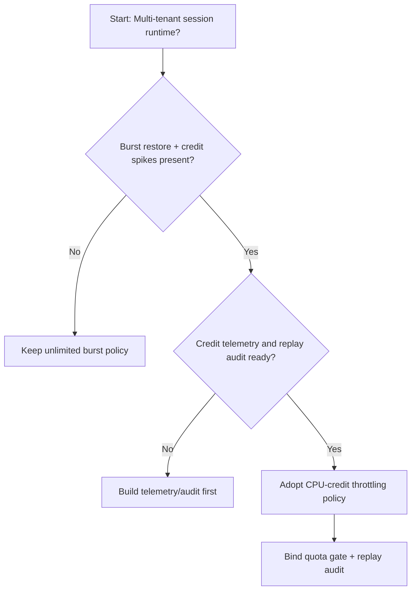
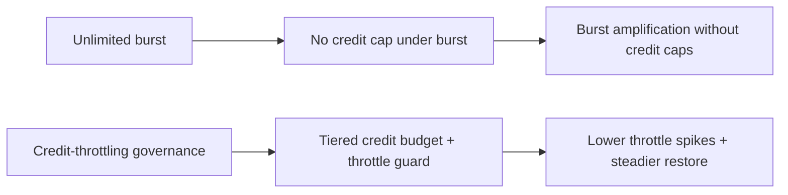
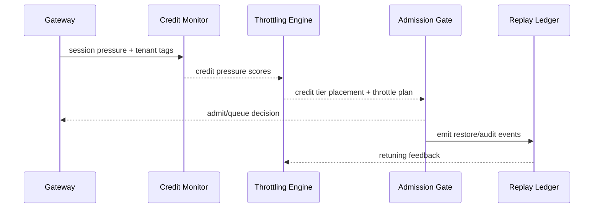

# Agent Session CPU Credit 节流选型 FAQ（无限突发策略 vs Credit 节流策略）

## 1) 核心结论（先给负责人）
- **多租户 Session 生产默认应选“CPU Credit 节流策略”**，不建议长期无限突发策略。
- **无限突发在长会话和恢复高峰下更易放大限流抖动与恢复失败率**。
- **Credit 节流策略必须与租户配额、网关准入、回放审计联动**，否则会出现容量回收与业务连续性冲突。

## 2) Q1 / Q2 / Q3（术语先通俗解释）
- **无限突发策略**：不设 Credit 上限，短时吞吐高但峰值抖动风险高。
- **Credit 节流策略**：按 Credit 配额对会话执行节流，恢复窗口更可控。

### Q1：为什么无限突发在峰值期更脆弱？
第一性原理：并发请求与恢复并发同时上升时，无上限突发会触发集中节流与排队，放大恢复压力。

### Q2：什么时候可接受无限突发策略？
单租户、短会话、流量较稳且可容忍性能波动的过渡阶段。

### Q3：最小安全闭环是什么？
租户分级 -> Credit 节流策略 -> 峰值预算门禁 -> 回放审计 -> 节流参数回滚校准。

## 3) Mermaid（决策树 / 路径对比 / 时序）
### 3.1 选型决策树

### 3.2 路径对比图

### 3.3 运行时序图

## 4) 选型决策矩阵
| 维度 | 无限突发策略 | Credit 节流策略 |
|---|---|---|
| 实现复杂度 | 低 | 中 |
| 峰值恢复稳定性 | 中-低 | 高 |
| 节流抖动控制 | 低-中 | 高 |
| 多租户可持续性 | 中 | 高 |
| 生产默认建议 | 过渡方案 | 长期默认 |

## 5) 数据证据与可复算算例（含 n/分母/来源）
> 本节百分比为 `synthetic_assumed` 假设算例（hypothetical），用于机制比较；生产机制认证保持 `not_measured`。  
> 合同字段见：`workshops/azure-agent-infra/evidence/cycle-453-benchmark.json` 的 `percentage_contract`。

- 指标 A（无限突发恢复失败率）  
  - 定义：`n_unlimited_burst_fail / n_runtime_requests_observed`  
  - 值：`322/2400 = 13.4%`（`synthetic_assumed`）  
  - 路径：`percentage_contract.unlimited_burst_failure_rate`
- 指标 B（Credit 节流恢复失败率）  
  - 定义：`n_credit_throttling_fail / n_runtime_requests_observed`  
  - 值：`133/2400 = 5.5%`（`synthetic_assumed`）  
  - 路径：`percentage_contract.credit_throttling_failure_rate`
- 指标 C（恢复成功率提升，百分点）  
  - 定义：`(n_resume_success_throttled - n_resume_success_unlimited) / n_runtime_requests_observed`  
  - 值：`(2240-2047)/2400 = 8.0` 个百分点（`synthetic_assumed`）  
  - 路径：`percentage_contract.throttling_recovery_gain_pts`

## 6) 生产 Checklist（上线前必须打勾）
- [ ] Credit 节流策略含版本、灰度与回滚路径
- [ ] 租户配额与峰值预算门禁在网关层生效
- [ ] 恢复失败率、恢复成功率与回放审计可追溯
- [ ] 指标口径标注 `synthetic_assumed`、分母与单位；生产机制认证保持 `not_measured`

