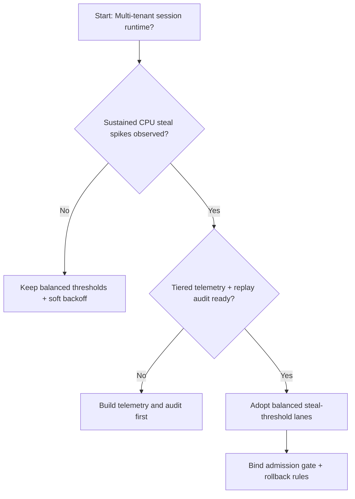
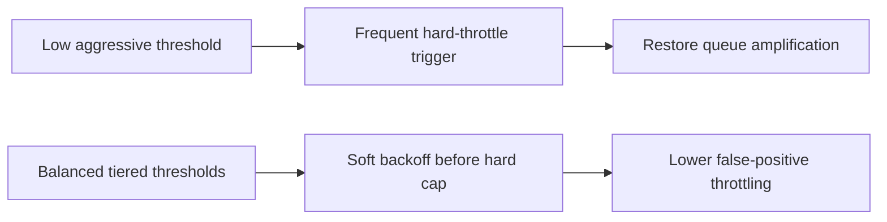
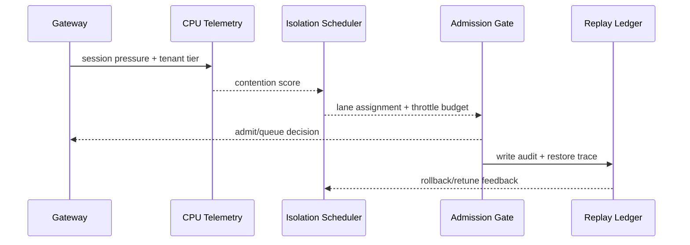

# Agent Session CPU Steal-threshold Governance Selection FAQ (Low-threshold Aggressive Policy vs Balanced-tiered Threshold Policy)

## 1) Core conclusions (for decision-makers first)
- **For multi-tenant Agent Session production, default to balanced tiered steal-threshold governance**, not long-term low-threshold aggressive throttling.
- **Low threshold policies tend to overreact to transient steal jitter during restore peaks**, causing avoidable queue amplification.
- **Steal-threshold governance must couple tenant quotas, admission gates, and replay audit**, otherwise reliability and utilization goals conflict.

## 2) Q1 / Q2 / Q3 (plain-language definitions first)
- **Low-threshold aggressive policy**: trigger hard throttling on minor steal spikes; safer by default, but high false-positive risk.
- **Balanced-tiered threshold policy**: apply tenant-tier threshold bands with soft-backoff before hard throttling.

### Q1: Why does an aggressive low threshold backfire at peak?
First principles: steal metrics fluctuate under short bursts; too-low thresholds classify transient jitter as sustained contention and trigger early hard throttles.

### Q2: When is a low-threshold policy still acceptable?
High-compliance conservative environments with lower throughput targets and explicit tolerance for higher restore latency.

### Q3: What is the minimum safe control loop?
Threshold tiering -> soft/hard throttle gates -> admission rollback guard -> replay audit -> parameter retuning.

## 3) Mermaid (decision tree / path comparison / sequence)
### 3.1 Selection decision tree

### 3.2 Path comparison

### 3.3 Runtime sequence

## 4) Decision matrix
| Dimension | Low-threshold aggressive policy | Balanced-tiered threshold policy |
|---|---|---|
| Implementation complexity | Low | Medium |
| Peak restore stability | Medium-Low | High |
| Tail-latency control | Low-Medium | High |
| False-positive control | Low | High |
| Default production fit | Short-term conservative only | Long-term default |

## 5) Evidence contract + recomputable examples (n/denominator/source)
> Percentages in this section are `synthetic_assumed` hypothetical examples for mechanism comparison; production mechanism validation remains `not_measured`.  
> Contract fields: `workshops/azure-agent-infra/evidence/cycle-455-benchmark.json` -> `percentage_contract`.

- Metric A (low-threshold resume-failure rate)  
  - Formula: `n_low_threshold_fail / n_runtime_requests_observed`  
  - Value: `322/2400 = 13.4%` (`synthetic_assumed`)  
  - Path: `percentage_contract.low_threshold_failure_rate`
- Metric B (balanced-threshold resume-failure rate)  
  - Formula: `n_balanced_threshold_fail / n_runtime_requests_observed`  
  - Value: `133/2400 = 5.5%` (`synthetic_assumed`)  
  - Path: `percentage_contract.balanced_threshold_failure_rate`
- Metric C (resume success gain, percentage points)  
  - Formula: `(n_resume_success_balanced_threshold - n_resume_success_low_threshold) / n_runtime_requests_observed`  
  - Value: `(2240-2047)/2400 = 8.0 percentage points` (`synthetic_assumed`)  
  - Path: `percentage_contract.threshold_recovery_gain_pts`

## 6) Production checklist
- [ ] CPU steal-threshold policy is versioned with rollout and rollback paths
- [ ] Tenant quotas, admission gates, and rollback thresholds are observable and auditable at gateway level
- [ ] Resume failures, tail latency, and replay audit are traceable per tenant tier
- [ ] Metrics are tagged `synthetic_assumed` with denominator/unit; production validation remains `not_measured`
