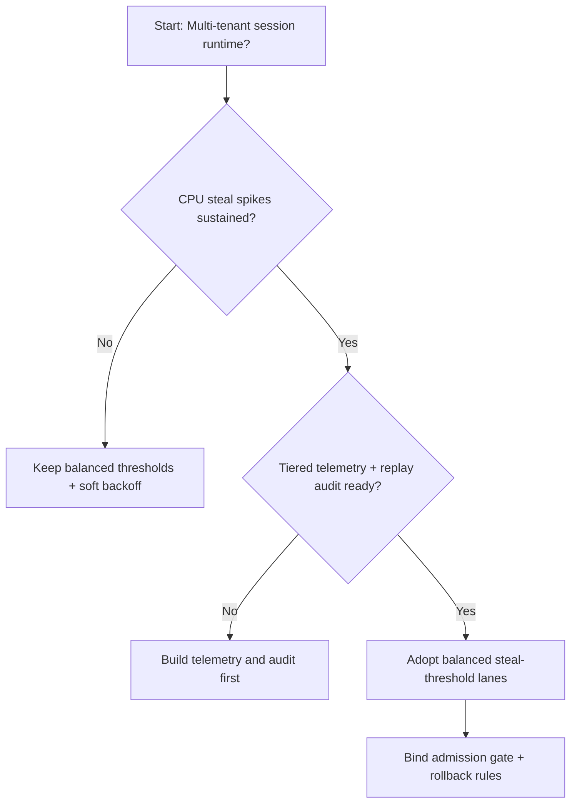
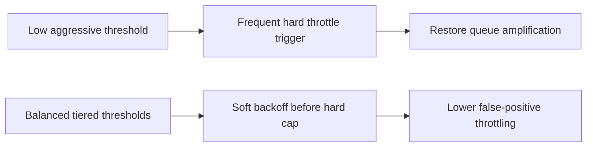
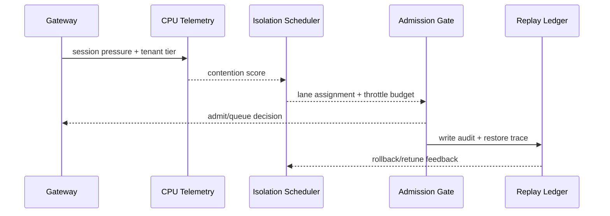

# Agent Session CPU Steal 阈值治理选型 FAQ（低阈值激进限流策略 vs 平衡阈值分级策略）

## 1) 核心结论（先给负责人）
- **多租户 Agent Session 生产默认应选“平衡阈值分级策略”**，不建议长期采用过低阈值的激进限流。
- **低阈值策略在恢复高峰更容易把正常抖动误判为 steal 异常，触发过度降速和排队放大**。
- **CPU steal 阈值治理必须与租户配额、准入门禁、回放审计联动**，否则会出现稳定性与资源利用率对冲。

## 2) Q1 / Q2 / Q3（术语先通俗解释）
- **低阈值激进限流策略**：CPU steal 一旦轻微抬升就触发强限流，保护保守但容易误伤。
- **平衡阈值分级策略**：按租户等级设置阈值区间，先软退避再硬限流，减少误判。

### Q1：为什么低阈值策略会误伤恢复链路？
第一性原理：steal 指标受瞬时抖动影响大，阈值太低会把短暂波动当持续拥塞，过早触发硬限流，导致恢复队列堆积。

### Q2：什么时候可以短期使用低阈值策略？
高合规强保护场景、且吞吐目标较低、可接受恢复时延上升时，可以短期启用。

### Q3：最小安全闭环是什么？
阈值分级 -> 软退避/硬限流双门槛 -> 准入与回退门禁 -> 回放审计 -> 参数再校准。

## 3) Mermaid（决策树 / 路径对比 / 时序）
### 3.1 选型决策树

### 3.2 路径对比图

### 3.3 运行时序图

## 4) 选型决策矩阵
| 维度 | 低阈值激进限流策略 | 平衡阈值分级策略 |
|---|---|---|
| 实现复杂度 | 低 | 中 |
| 峰值恢复稳定性 | 中-低 | 高 |
| 尾延迟可控性 | 低-中 | 高 |
| 误判率控制 | 低 | 高 |
| 生产默认建议 | 仅短期保守场景 | 长期默认 |

## 5) 数据证据与可复算算例（含 n/分母/来源）
> 本节百分比为 `synthetic_assumed` 假设算例（hypothetical），用于机制比较；生产机制认证保持 `not_measured`。  
> 合同字段见：`workshops/azure-agent-infra/evidence/cycle-455-benchmark.json` 的 `percentage_contract`。

- 指标 A（低阈值策略恢复失败率）  
  - 定义：`n_low_threshold_fail / n_runtime_requests_observed`  
  - 值：`322/2400 = 13.4%`（`synthetic_assumed`）  
  - 路径：`percentage_contract.low_threshold_failure_rate`
- 指标 B（平衡阈值策略恢复失败率）  
  - 定义：`n_balanced_threshold_fail / n_runtime_requests_observed`  
  - 值：`133/2400 = 5.5%`（`synthetic_assumed`）  
  - 路径：`percentage_contract.balanced_threshold_failure_rate`
- 指标 C（恢复成功率提升，百分点）  
  - 定义：`(n_resume_success_balanced_threshold - n_resume_success_low_threshold) / n_runtime_requests_observed`  
  - 值：`(2240-2047)/2400 = 8.0` 个百分点（`synthetic_assumed`）  
  - 路径：`percentage_contract.threshold_recovery_gain_pts`

## 6) 生产 Checklist（上线前必须打勾）
- [ ] CPU steal 阈值策略具备版本、灰度和回滚路径
- [ ] 租户配额、准入门禁和回退阈值在网关层可观测可审计
- [ ] 恢复失败率、尾延迟和回放审计具备租户维度追踪
- [ ] 指标全部标注 `synthetic_assumed`、分母与单位；生产机制认证保持 `not_measured`
