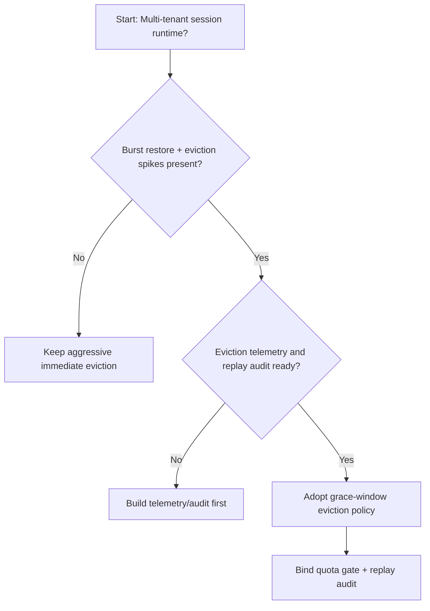
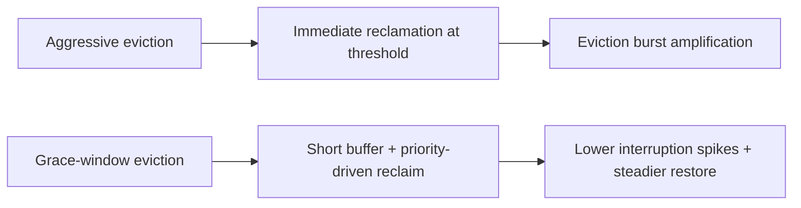
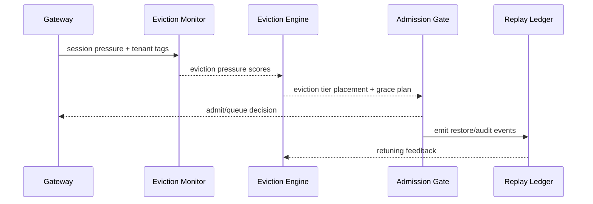

# Agent Session Eviction Grace-window Selection FAQ (Aggressive Immediate Eviction vs Grace-window Eviction)

## 1) Core conclusions (for decision-makers first)
- **For multi-tenant session production, default to a grace-window eviction policy**, not long-term aggressive immediate eviction.
- **Aggressive eviction is more likely to amplify session interruption and resume-failure spikes** under long sessions and burst restore peaks.
- **Eviction-window policy must couple tenant quota, gateway admission, and replay audit**, or capacity recovery and service continuity will conflict.

## 2) Q1 / Q2 / Q3 (plain-language definitions first)
- **Aggressive immediate eviction**: reclaim session state as soon as pressure crosses threshold; fast reclaim, high interruption risk.
- **Grace-window eviction**: provide a short buffer window before reclaiming by priority; smoother recovery behavior.

### Q1: Why is aggressive eviction more fragile at peak?
First principles: when request concurrency and restore concurrency increase together, immediate reclaim causes clustered interruptions and amplifies queue/rebuild pressure.

### Q2: When is aggressive eviction still acceptable?
Transitional phases with single tenant, short sessions, interruption tolerance, and simple restore paths.

### Q3: What is the minimum safe loop?
Tenant classification -> eviction-window policy -> burst-budget gate -> replay audit -> eviction rollback retuning.

## 3) Mermaid (decision tree / path comparison / sequence)
### 3.1 Selection decision tree

### 3.2 Path comparison

### 3.3 Runtime sequence

## 4) Decision matrix
| Dimension | Aggressive immediate eviction | Grace-window eviction |
|---|---|---|
| Implementation complexity | Low | Medium |
| Peak restore stability | Medium-Low | High |
| Interruption-jitter control | Low-Medium | High |
| Multi-tenant sustainability | Medium | High |
| Default production fit | Transitional only | Long-term default |

## 5) Evidence contract + recomputable examples (n/denominator/source)
> Percentages in this section are `synthetic_assumed` hypothetical examples for mechanism comparison; production mechanism validation remains `not_measured`.  
> Contract fields: `workshops/azure-agent-infra/evidence/cycle-452-benchmark.json` -> `percentage_contract`.

- Metric A (aggressive-eviction resume-failure rate)  
  - Formula: `n_aggressive_eviction_fail / n_runtime_requests_observed`  
  - Value: `322/2400 = 13.4%` (`synthetic_assumed`)  
  - Path: `percentage_contract.aggressive_eviction_failure_rate`
- Metric B (grace-window resume-failure rate)  
  - Formula: `n_grace_window_fail / n_runtime_requests_observed`  
  - Value: `133/2400 = 5.5%` (`synthetic_assumed`)  
  - Path: `percentage_contract.grace_window_failure_rate`
- Metric C (resume success gain, percentage points)  
  - Formula: `(n_resume_success_grace - n_resume_success_aggressive) / n_runtime_requests_observed`  
  - Value: `(2240-2047)/2400 = 8.0 percentage points` (`synthetic_assumed`)  
  - Path: `percentage_contract.eviction_recovery_gain_pts`

## 6) Production checklist
- [ ] Eviction-window policy is versioned with rollout and rollback paths
- [ ] Tenant quota and burst-budget admission gates are enforced at gateway level
- [ ] Resume failures, resume success, and replay audit are traceable
- [ ] Metrics are tagged `synthetic_assumed` with denominator/unit; production validation remains `not_measured`

