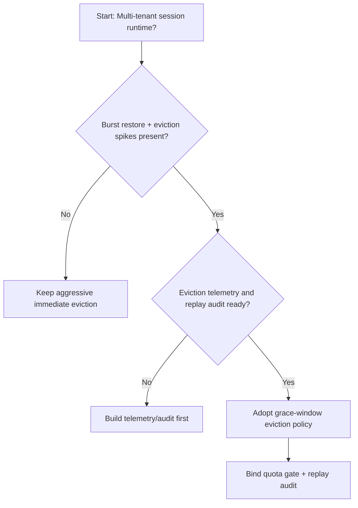
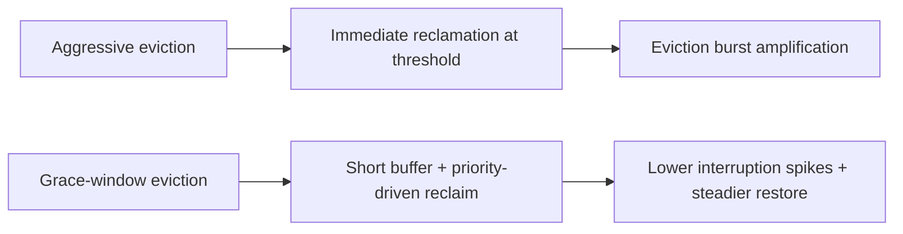
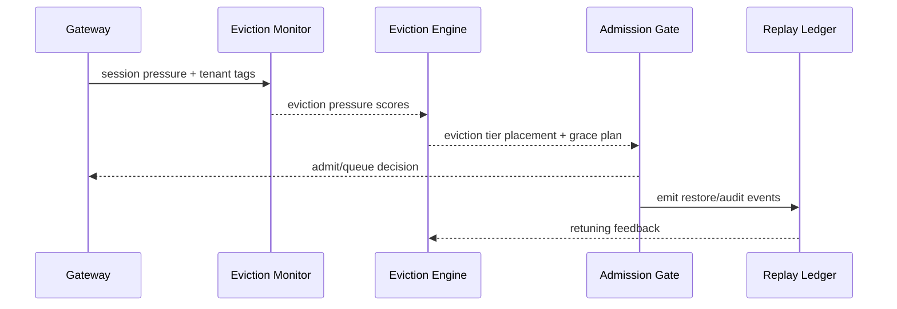

# Agent Session 驱逐宽限窗口选型 FAQ（激进立即驱逐 vs 宽限窗口驱逐）

## 1) 核心结论（先给负责人）
- **多租户 Session 生产默认应选“宽限窗口驱逐策略”**，不建议长期激进立即驱逐。
- **激进驱逐在长会话和突发恢复高峰下更易放大会话中断与恢复失败率**。
- **驱逐窗口策略必须与租户配额、网关准入、回放审计联动**，否则会出现容量回收与业务连续性冲突。

## 2) Q1 / Q2 / Q3（术语先通俗解释）
- **激进立即驱逐**：资源压力一到阈值就立即回收会话状态，回收快但中断风险高。
- **宽限窗口驱逐**：先给会话短暂缓冲窗口，再按优先级驱逐，恢复更平稳。

### Q1：为什么激进驱逐在峰值期更脆弱？
第一性原理：并发请求与恢复并发同时上升时，立即回收会触发集中中断，放大排队与重建压力。

### Q2：什么时候可接受激进驱逐？
单租户、短会话、可容忍中断且恢复路径简单的过渡阶段。

### Q3：最小安全闭环是什么？
租户分级 -> 驱逐窗口策略 -> 峰值预算门禁 -> 回放审计 -> 驱逐参数回滚校准。

## 3) Mermaid（决策树 / 路径对比 / 时序）
### 3.1 选型决策树

### 3.2 路径对比图

### 3.3 运行时序图

## 4) 选型决策矩阵
| 维度 | 激进立即驱逐 | 宽限窗口驱逐 |
|---|---|---|
| 实现复杂度 | 低 | 中 |
| 峰值恢复稳定性 | 中-低 | 高 |
| 中断抖动控制 | 低-中 | 高 |
| 多租户可持续性 | 中 | 高 |
| 生产默认建议 | 过渡方案 | 长期默认 |

## 5) 数据证据与可复算算例（含 n/分母/来源）
> 本节百分比为 `synthetic_assumed` 假设算例（hypothetical），用于机制比较；生产机制认证保持 `not_measured`。  
> 合同字段见：`workshops/azure-agent-infra/evidence/cycle-452-benchmark.json` 的 `percentage_contract`。

- 指标 A（激进驱逐恢复失败率）  
  - 定义：`n_aggressive_eviction_fail / n_runtime_requests_observed`  
  - 值：`322/2400 = 13.4%`（`synthetic_assumed`）  
  - 路径：`percentage_contract.aggressive_eviction_failure_rate`
- 指标 B（宽限窗口恢复失败率）  
  - 定义：`n_grace_window_fail / n_runtime_requests_observed`  
  - 值：`133/2400 = 5.5%`（`synthetic_assumed`）  
  - 路径：`percentage_contract.grace_window_failure_rate`
- 指标 C（恢复成功率提升，百分点）  
  - 定义：`(n_resume_success_grace - n_resume_success_aggressive) / n_runtime_requests_observed`  
  - 值：`(2240-2047)/2400 = 8.0` 个百分点（`synthetic_assumed`）  
  - 路径：`percentage_contract.eviction_recovery_gain_pts`

## 6) 生产 Checklist（上线前必须打勾）
- [ ] 驱逐窗口策略含版本、灰度与回滚路径
- [ ] 租户配额与峰值预算门禁在网关层生效
- [ ] 恢复失败率、恢复成功率与回放审计可追溯
- [ ] 指标口径标注 `synthetic_assumed`、分母与单位；生产机制认证保持 `not_measured`

