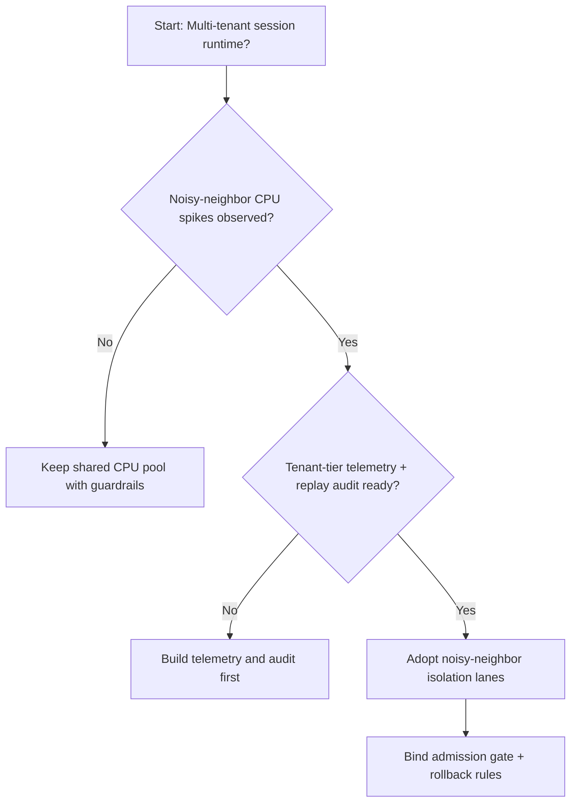
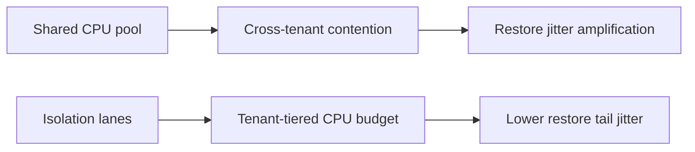
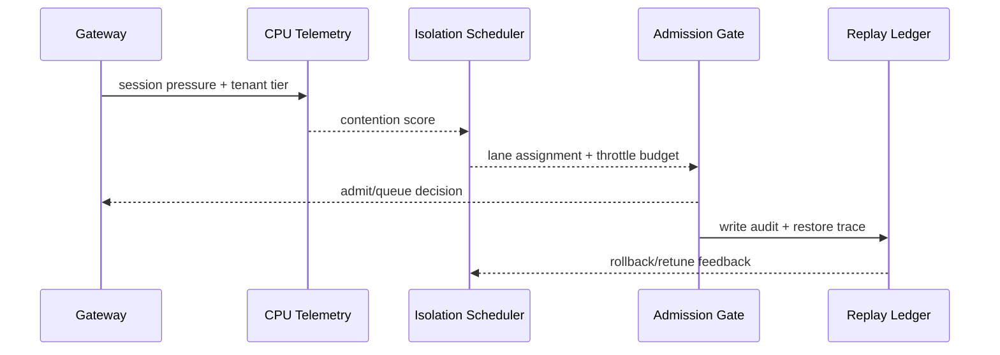

# Agent Session Noisy-neighbor CPU Isolation Selection FAQ (Shared CPU Pool Policy vs Isolation-lane Policy)

## 1) Core conclusions (for decision-makers first)
- **For multi-tenant Agent Session production, default to noisy-neighbor CPU isolation lanes**, not long-term shared CPU pools with unrestricted burst.
- **Shared CPU pools are more likely to trigger noisy-neighbor behavior at restore peaks**, where one tenant consumes burst budget and degrades others.
- **Isolation lanes must be coupled with tenant quotas, admission gates, and replay audit**, otherwise reliability and cost controls conflict.

## 2) Q1 / Q2 / Q3 (plain-language definitions first)
- **Shared CPU pool policy**: tenants compete for the same CPU credit pool; simple to run, but contention spreads quickly.
- **Isolation-lane policy**: reserve CPU lanes by tenant tier/workload class to contain noisy-neighbor spillover.

### Q1: Why does a shared pool amplify noisy-neighbor effects?
First principles: when execution concurrency and restore concurrency rise together, burst-heavy tenants consume credits first, forcing other tenants into queue spikes and tail-latency inflation.

### Q2: When is a shared pool still acceptable?
Short transitional phases with single-tenant or homogeneous workloads, where restore jitter can be tolerated.

### Q3: What is the minimum safe control loop?
Tenant classification -> CPU isolation lanes -> admission/rollback gates -> replay audit -> parameter retuning.

## 3) Mermaid (decision tree / path comparison / sequence)
### 3.1 Selection decision tree

### 3.2 Path comparison

### 3.3 Runtime sequence

## 4) Decision matrix
| Dimension | Shared CPU pool policy | Isolation-lane policy |
|---|---|---|
| Implementation complexity | Low | Medium |
| Peak restore stability | Medium-Low | High |
| Tail-latency control | Low-Medium | High |
| Multi-tenant isolation boundary | Low | High |
| Default production fit | Transitional only | Long-term default |

## 5) Evidence contract + recomputable examples (n/denominator/source)
> Percentages in this section are `synthetic_assumed` hypothetical examples for mechanism comparison; production mechanism validation remains `not_measured`.  
> Contract fields: `workshops/azure-agent-infra/evidence/cycle-454-benchmark.json` -> `percentage_contract`.

- Metric A (shared-pool resume-failure rate)  
  - Formula: `n_shared_pool_fail / n_runtime_requests_observed`  
  - Value: `322/2400 = 13.4%` (`synthetic_assumed`)  
  - Path: `percentage_contract.shared_pool_failure_rate`
- Metric B (isolation-lane resume-failure rate)  
  - Formula: `n_isolation_lane_fail / n_runtime_requests_observed`  
  - Value: `133/2400 = 5.5%` (`synthetic_assumed`)  
  - Path: `percentage_contract.isolation_lane_failure_rate`
- Metric C (resume success gain, percentage points)  
  - Formula: `(n_resume_success_isolation_lane - n_resume_success_shared_pool) / n_runtime_requests_observed`  
  - Value: `(2240-2047)/2400 = 8.0 percentage points` (`synthetic_assumed`)  
  - Path: `percentage_contract.isolation_recovery_gain_pts`

## 6) Production checklist
- [ ] CPU isolation-lane policy is versioned with rollout and rollback paths
- [ ] Tenant quotas, admission gates, and rollback thresholds are observable and auditable at gateway level
- [ ] Resume failures, tail latency, and replay audit are traceable per tenant tier
- [ ] Metrics are tagged `synthetic_assumed` with denominator/unit; production validation remains `not_measured`
