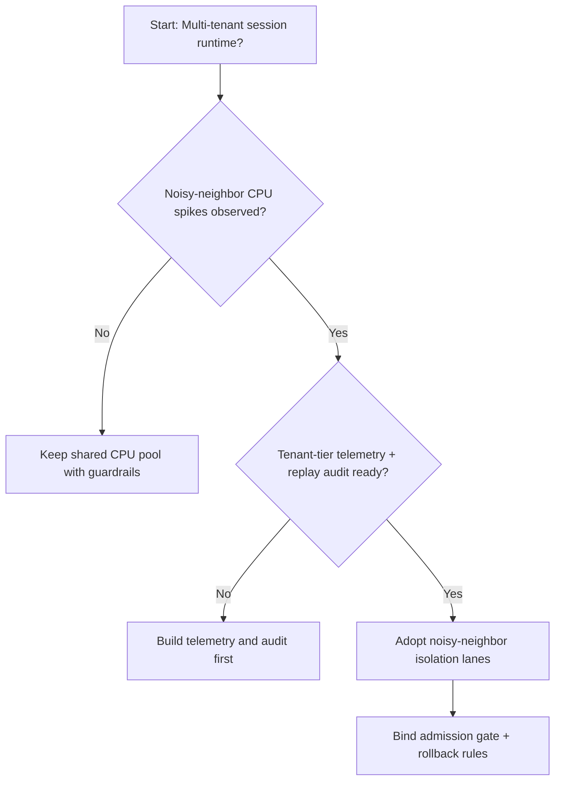
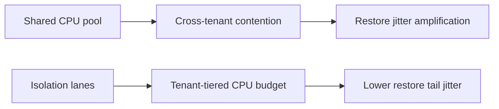
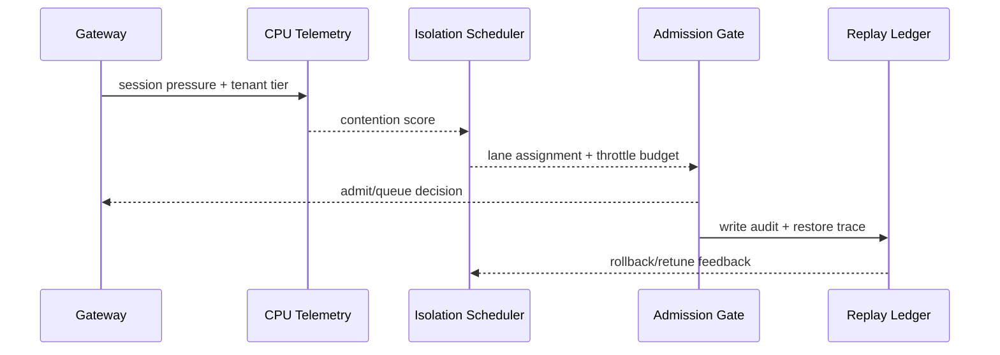

# Agent Session 噪声邻居 CPU 隔离选型 FAQ（共享 CPU 池策略 vs 隔离车道策略）

## 1) 核心结论（先给负责人）
- **多租户 Agent Session 生产默认应选“噪声邻居 CPU 隔离车道策略”**，不建议长期共享 CPU 池放任突发。
- **共享 CPU 池在恢复高峰期更易出现“一个租户打满、其他租户抖动”的噪声邻居效应**。
- **隔离车道策略必须与租户配额、准入门禁、回放审计联动**，否则会出现恢复稳定性与成本回收互相拉扯。

## 2) Q1 / Q2 / Q3（术语先通俗解释）
- **共享 CPU 池策略**：所有租户共同争抢同一 CPU Credit 池，短时看似弹性大，但彼此影响强。
- **隔离车道策略**：按租户等级或工作负载类型划分 CPU 车道，避免高噪声租户拖慢全局恢复。

### Q1：为什么共享 CPU 池会触发噪声邻居？
第一性原理：当恢复并发与执行并发同时上升，抢占式争用会让高突发租户先吃掉 CPU 配额，低突发租户被迫排队，尾延迟放大。

### Q2：什么时候还能用共享 CPU 池？
单租户或同质负载、短会话、且能容忍恢复抖动的过渡阶段可以短期使用。

### Q3：最小安全闭环是什么？
租户分级 -> CPU 隔离车道 -> 准入/回退门禁 -> 回放审计 -> 参数回滚与再校准。

## 3) Mermaid（决策树 / 路径对比 / 时序）
### 3.1 选型决策树

### 3.2 路径对比图

### 3.3 运行时序图

## 4) 选型决策矩阵
| 维度 | 共享 CPU 池策略 | 隔离车道策略 |
|---|---|---|
| 实现复杂度 | 低 | 中 |
| 峰值恢复稳定性 | 中-低 | 高 |
| 尾延迟可控性 | 低-中 | 高 |
| 多租户隔离边界 | 低 | 高 |
| 生产默认建议 | 仅过渡期 | 长期默认 |

## 5) 数据证据与可复算算例（含 n/分母/来源）
> 本节百分比为 `synthetic_assumed` 假设算例（hypothetical），用于机制比较；生产机制认证保持 `not_measured`。  
> 合同字段见：`workshops/azure-agent-infra/evidence/cycle-454-benchmark.json` 的 `percentage_contract`。

- 指标 A（共享 CPU 池恢复失败率）  
  - 定义：`n_shared_pool_fail / n_runtime_requests_observed`  
  - 值：`322/2400 = 13.4%`（`synthetic_assumed`）  
  - 路径：`percentage_contract.shared_pool_failure_rate`
- 指标 B（隔离车道恢复失败率）  
  - 定义：`n_isolation_lane_fail / n_runtime_requests_observed`  
  - 值：`133/2400 = 5.5%`（`synthetic_assumed`）  
  - 路径：`percentage_contract.isolation_lane_failure_rate`
- 指标 C（恢复成功率提升，百分点）  
  - 定义：`(n_resume_success_isolation_lane - n_resume_success_shared_pool) / n_runtime_requests_observed`  
  - 值：`(2240-2047)/2400 = 8.0` 个百分点（`synthetic_assumed`）  
  - 路径：`percentage_contract.isolation_recovery_gain_pts`

## 6) 生产 Checklist（上线前必须打勾）
- [ ] CPU 隔离车道策略具备版本、灰度和回滚路径
- [ ] 租户配额、准入门禁和回退阈值在网关层可观测可审计
- [ ] 恢复失败率、尾延迟和回放审计具备租户维度追踪
- [ ] 指标全部标注 `synthetic_assumed`、分母与单位；生产机制认证保持 `not_measured`
