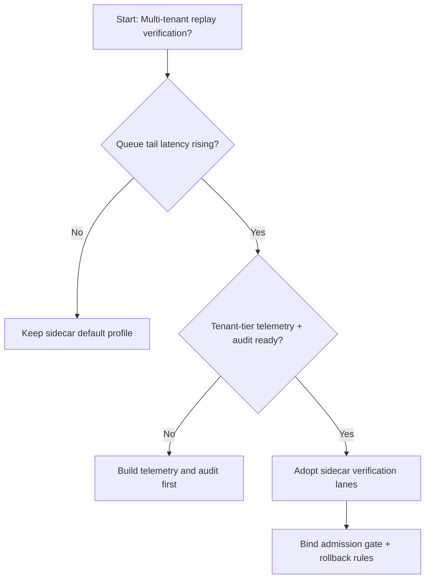
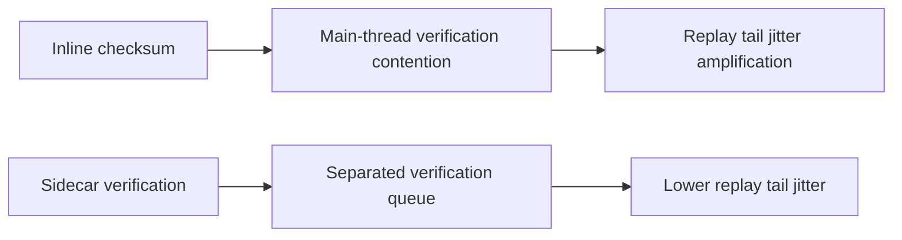
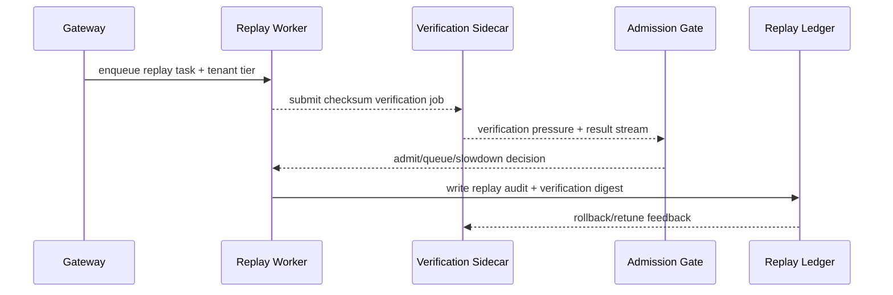

# Agent Session Replay Checksum Verification Selection FAQ (Inline Checksum Policy vs Sidecar Verification Service Policy)

## 1) Core conclusions (for decision-makers first)
- **For multi-tenant Agent Session production, default to sidecar verification service policy**, not long-term inline checksum in the main replay path.
- **Inline checksum tends to couple CPU and I/O jitter at restore peaks**, increasing replay queue drain time.
- **Verification policy must couple tenant quotas, admission gates, and replay audit**, otherwise integrity and throughput objectives conflict.

## 2) Q1 / Q2 / Q3 (plain-language definitions first)
- **Inline checksum policy**: the main replay worker computes/verifies checksums directly; shorter path, higher contention.
- **Sidecar verification policy**: replay workers offload checksum verification to a sidecar service for stronger isolation.

### Q1: Why does inline verification amplify tail latency at peak?
First principles: replay and verification compete for the same execution resources under burst load, creating compounded bottlenecks and longer queue waits.

### Q2: When is inline verification still acceptable?
Single-tenant, low-concurrency, short-lived debugging phases where the shortest call graph is preferred.

### Q3: What is the minimum safe control loop?
Log-tier classification -> verification queue split -> admission/rollback gates -> replay audit -> parameter retuning.

## 3) Mermaid (decision tree / path comparison / sequence)
### 3.1 Selection decision tree

### 3.2 Path comparison

### 3.3 Runtime sequence

## 4) Decision matrix
| Dimension | Inline checksum policy | Sidecar verification service policy |
|---|---|---|
| Implementation complexity | Low | Medium |
| Peak restore stability | Medium-Low | High |
| Isolation boundary clarity | Low-Medium | High |
| Multi-tenant sustainability | Medium | High |
| Default production fit | Short-term debugging only | Long-term default |

## 5) Evidence contract + recomputable examples (n/denominator/source)
> Percentages in this section are `synthetic_assumed` hypothetical examples for mechanism comparison; production mechanism validation remains `not_measured`.  
> Contract fields: `workshops/azure-agent-infra/evidence/cycle-457-benchmark.json` -> `percentage_contract`.

- Metric A (inline-checksum resume-failure rate)  
  - Formula: `n_inline_checksum_fail / n_runtime_requests_observed`  
  - Value: `322/2400 = 13.4%` (`synthetic_assumed`)  
  - Path: `percentage_contract.inline_checksum_failure_rate`
- Metric B (sidecar-checksum resume-failure rate)  
  - Formula: `n_sidecar_checksum_fail / n_runtime_requests_observed`  
  - Value: `133/2400 = 5.5%` (`synthetic_assumed`)  
  - Path: `percentage_contract.sidecar_checksum_failure_rate`
- Metric C (resume success gain, percentage points)  
  - Formula: `(n_resume_success_sidecar_checksum - n_resume_success_inline_checksum) / n_runtime_requests_observed`  
  - Value: `(2240-2047)/2400 = 8.0 percentage points` (`synthetic_assumed`)  
  - Path: `percentage_contract.checksum_recovery_gain_pts`

## 6) Production checklist
- [ ] Sidecar verification policy is versioned with rollout and rollback paths
- [ ] Tenant quotas, admission gates, and rollback thresholds are observable and auditable at gateway level
- [ ] Replay failures, verification queue depth, and replay audit are traceable per tenant tier
- [ ] Metrics are tagged `synthetic_assumed` with denominator/unit; production validation remains `not_measured`
