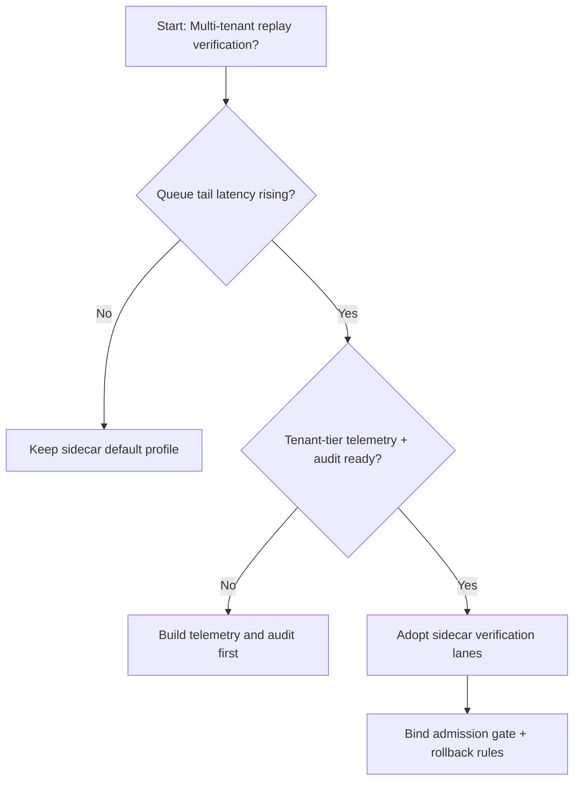
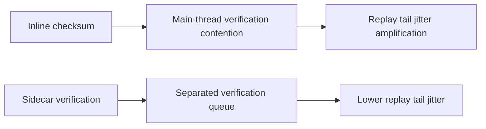
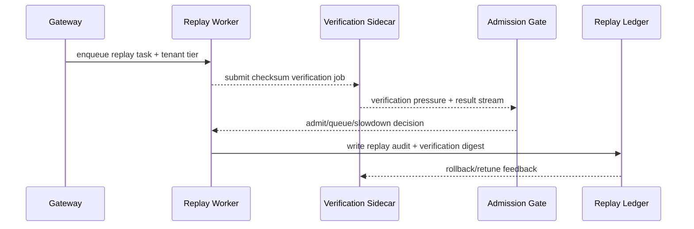

# Agent Session 回放校验链路选型 FAQ（内联 Checksum 策略 vs Sidecar 校验服务策略）

## 1) 核心结论（先给负责人）
- **多租户 Agent Session 生产默认应选“Sidecar 校验服务策略”**，不建议长期把校验逻辑内联在主回放路径。
- **内联 Checksum 在恢复高峰更容易把 CPU 与 I/O 抖动耦合，拖慢回放队列排空**。
- **校验策略必须与租户配额、准入门禁、回放审计联动**，否则会出现完整性与吞吐目标对冲。

## 2) Q1 / Q2 / Q3（术语先通俗解释）
- **内联 Checksum 策略**：主回放线程直接计算并验证校验值，链路短但争用高。
- **Sidecar 校验服务策略**：回放线程把校验任务投递给旁路服务，主链路更轻、隔离更强。

### Q1：为什么内联校验会在峰值期放大尾延迟？
第一性原理：回放与校验同时抢占同一执行资源，会在高并发阶段形成复合瓶颈，导致主队列等待放大。

### Q2：什么时候可短期采用内联校验？
单租户、低并发、且调试阶段希望最短调用链时可短期采用。

### Q3：最小安全闭环是什么？
日志分级 -> 校验队列分流 -> 准入/回退门禁 -> 回放审计 -> 参数再校准。

## 3) Mermaid（决策树 / 路径对比 / 时序）
### 3.1 选型决策树

### 3.2 路径对比图

### 3.3 运行时序图

## 4) 选型决策矩阵
| 维度 | 内联 Checksum 策略 | Sidecar 校验服务策略 |
|---|---|---|
| 实现复杂度 | 低 | 中 |
| 峰值恢复稳定性 | 中-低 | 高 |
| 隔离边界清晰度 | 低-中 | 高 |
| 多租户可持续性 | 中 | 高 |
| 生产默认建议 | 仅短期调试场景 | 长期默认 |

## 5) 数据证据与可复算算例（含 n/分母/来源）
> 本节百分比为 `synthetic_assumed` 假设算例（hypothetical），用于机制比较；生产机制认证保持 `not_measured`。  
> 合同字段见：`workshops/azure-agent-infra/evidence/cycle-457-benchmark.json` 的 `percentage_contract`。

- 指标 A（内联 Checksum 恢复失败率）  
  - 定义：`n_inline_checksum_fail / n_runtime_requests_observed`  
  - 值：`322/2400 = 13.4%`（`synthetic_assumed`）  
  - 路径：`percentage_contract.inline_checksum_failure_rate`
- 指标 B（Sidecar 校验恢复失败率）  
  - 定义：`n_sidecar_checksum_fail / n_runtime_requests_observed`  
  - 值：`133/2400 = 5.5%`（`synthetic_assumed`）  
  - 路径：`percentage_contract.sidecar_checksum_failure_rate`
- 指标 C（恢复成功率提升，百分点）  
  - 定义：`(n_resume_success_sidecar_checksum - n_resume_success_inline_checksum) / n_runtime_requests_observed`  
  - 值：`(2240-2047)/2400 = 8.0` 个百分点（`synthetic_assumed`）  
  - 路径：`percentage_contract.checksum_recovery_gain_pts`

## 6) 生产 Checklist（上线前必须打勾）
- [ ] Sidecar 校验策略具备版本、灰度和回滚路径
- [ ] 租户配额、准入门禁和回退阈值在网关层可观测可审计
- [ ] 回放失败率、校验队列长度与回放审计具备租户维度追踪
- [ ] 指标全部标注 `synthetic_assumed`、分母与单位；生产机制认证保持 `not_measured`
