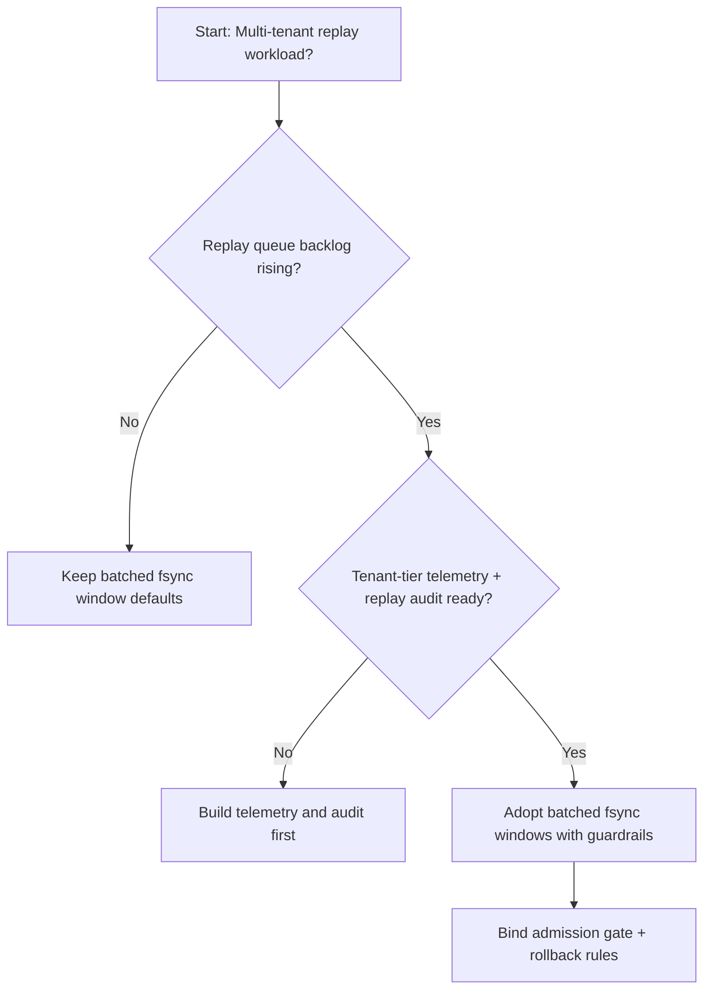
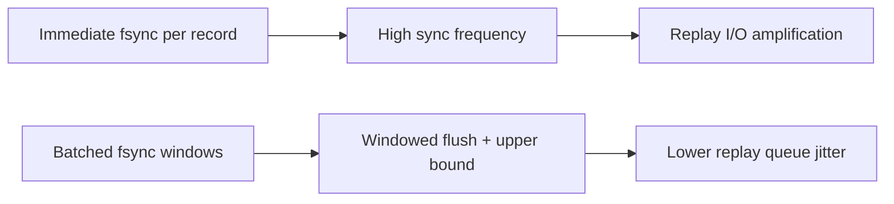
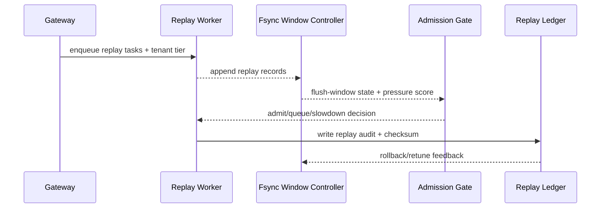

# Agent Session Replay Fsync Batching Governance Selection FAQ (Immediate Fsync Policy vs Batched Fsync Window Policy)

## 1) Core conclusions (for decision-makers first)
- **For multi-tenant Agent Session production, default to batched fsync window policy**, not long-term immediate fsync-per-record.
- **Immediate fsync tends to amplify disk-sync jitter at restore peaks**, causing replay queue buildup.
- **Fsync batching must couple tenant quotas, admission gates, and replay audit**, otherwise consistency, throughput, and cost goals conflict.

## 2) Q1 / Q2 / Q3 (plain-language definitions first)
- **Immediate fsync policy**: force a disk sync for every replay record; simple and conservative, but expensive under load.
- **Batched fsync window policy**: aggregate replay records in short windows, then flush with bounded batch size.

### Q1: Why does immediate fsync slow down replay recovery?
First principles: replay phases produce dense writes; syncing each record independently turns every append into a storage barrier, increasing I/O amplification and queue latency.

### Q2: When is immediate fsync still acceptable?
Short high-compliance phases with lower throughput targets and explicit tolerance for longer recovery latency.

### Q3: What is the minimum safe control loop?
Log-tier classification -> fsync window + cap -> admission/rollback gates -> replay audit -> parameter retuning.

## 3) Mermaid (decision tree / path comparison / sequence)
### 3.1 Selection decision tree

### 3.2 Path comparison

### 3.3 Runtime sequence

## 4) Decision matrix
| Dimension | Immediate fsync policy | Batched fsync window policy |
|---|---|---|
| Implementation complexity | Low | Medium |
| Peak restore stability | Medium-Low | High |
| I/O amplification control | Low | High |
| Multi-tenant sustainability | Medium | High |
| Default production fit | Short-term conservative only | Long-term default |

## 5) Evidence contract + recomputable examples (n/denominator/source)
> Percentages in this section are `synthetic_assumed` hypothetical examples for mechanism comparison; production mechanism validation remains `not_measured`.  
> Contract fields: `workshops/azure-agent-infra/evidence/cycle-456-benchmark.json` -> `percentage_contract`.

- Metric A (immediate-fsync resume-failure rate)  
  - Formula: `n_immediate_fsync_fail / n_runtime_requests_observed`  
  - Value: `322/2400 = 13.4%` (`synthetic_assumed`)  
  - Path: `percentage_contract.immediate_fsync_failure_rate`
- Metric B (batched-fsync resume-failure rate)  
  - Formula: `n_batched_fsync_fail / n_runtime_requests_observed`  
  - Value: `133/2400 = 5.5%` (`synthetic_assumed`)  
  - Path: `percentage_contract.batched_fsync_failure_rate`
- Metric C (resume success gain, percentage points)  
  - Formula: `(n_resume_success_batched_fsync - n_resume_success_immediate_fsync) / n_runtime_requests_observed`  
  - Value: `(2240-2047)/2400 = 8.0 percentage points` (`synthetic_assumed`)  
  - Path: `percentage_contract.fsync_recovery_gain_pts`

## 6) Production checklist
- [ ] Fsync batching window policy is versioned with rollout and rollback paths
- [ ] Tenant quotas, admission gates, and rollback thresholds are observable and auditable at gateway level
- [ ] Resume failures, replay queue depth, and replay audit are traceable per tenant tier
- [ ] Metrics are tagged `synthetic_assumed` with denominator/unit; production validation remains `not_measured`
