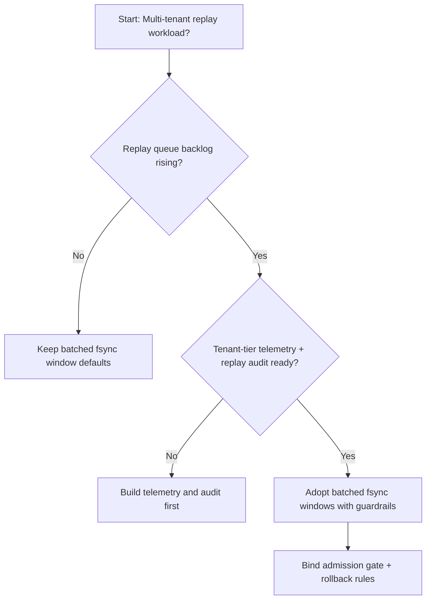
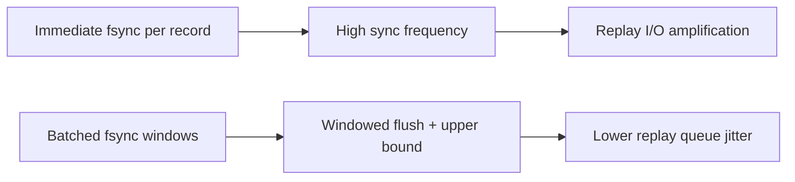
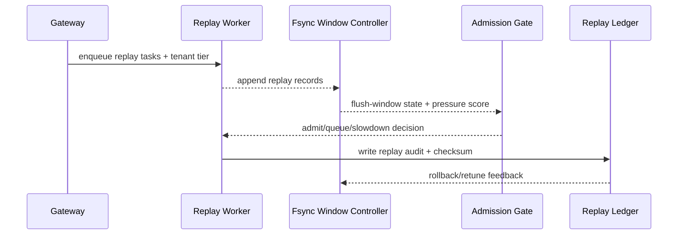

# Agent Session 回放日志 Fsync 批处理治理选型 FAQ（逐条即时 Fsync 策略 vs 分批窗口 Fsync 策略）

## 1) 核心结论（先给负责人）
- **多租户 Agent Session 生产默认应选“分批窗口 Fsync 策略”**，不建议长期逐条即时 Fsync。
- **逐条即时 Fsync 在恢复高峰更容易放大磁盘同步抖动，造成回放队列堆积**。
- **Fsync 批处理策略必须与租户配额、准入门禁、回放审计联动**，否则会出现一致性、吞吐和成本互相拉扯。

## 2) Q1 / Q2 / Q3（术语先通俗解释）
- **逐条即时 Fsync 策略**：每条回放日志都立刻落盘同步，安全感高，但 I/O 放大明显。
- **分批窗口 Fsync 策略**：在短时间窗口内聚合日志批量同步，降低同步开销并平滑恢复。

### Q1：为什么逐条即时 Fsync 容易拖慢恢复？
第一性原理：回放期间写入密度高，逐条同步会把每条日志都变成一次独立磁盘刷写，触发高频 I/O 抖动并拉长队列。

### Q2：什么时候可短期使用逐条即时 Fsync？
极高合规、吞吐目标较低、且能接受恢复时延上升的阶段可以短期启用。

### Q3：最小安全闭环是什么？
日志分级 -> 批处理窗口与上限 -> 准入/回退门禁 -> 回放审计 -> 参数再校准。

## 3) Mermaid（决策树 / 路径对比 / 时序）
### 3.1 选型决策树

### 3.2 路径对比图

### 3.3 运行时序图

## 4) 选型决策矩阵
| 维度 | 逐条即时 Fsync 策略 | 分批窗口 Fsync 策略 |
|---|---|---|
| 实现复杂度 | 低 | 中 |
| 峰值恢复稳定性 | 中-低 | 高 |
| I/O 放大控制 | 低 | 高 |
| 多租户可持续性 | 中 | 高 |
| 生产默认建议 | 仅短期保守场景 | 长期默认 |

## 5) 数据证据与可复算算例（含 n/分母/来源）
> 本节百分比为 `synthetic_assumed` 假设算例（hypothetical），用于机制比较；生产机制认证保持 `not_measured`。  
> 合同字段见：`workshops/azure-agent-infra/evidence/cycle-456-benchmark.json` 的 `percentage_contract`。

- 指标 A（逐条即时 Fsync 恢复失败率）  
  - 定义：`n_immediate_fsync_fail / n_runtime_requests_observed`  
  - 值：`322/2400 = 13.4%`（`synthetic_assumed`）  
  - 路径：`percentage_contract.immediate_fsync_failure_rate`
- 指标 B（分批窗口 Fsync 恢复失败率）  
  - 定义：`n_batched_fsync_fail / n_runtime_requests_observed`  
  - 值：`133/2400 = 5.5%`（`synthetic_assumed`）  
  - 路径：`percentage_contract.batched_fsync_failure_rate`
- 指标 C（恢复成功率提升，百分点）  
  - 定义：`(n_resume_success_batched_fsync - n_resume_success_immediate_fsync) / n_runtime_requests_observed`  
  - 值：`(2240-2047)/2400 = 8.0` 个百分点（`synthetic_assumed`）  
  - 路径：`percentage_contract.fsync_recovery_gain_pts`

## 6) 生产 Checklist（上线前必须打勾）
- [ ] Fsync 批处理窗口策略具备版本、灰度和回滚路径
- [ ] 租户配额、准入门禁和回退阈值在网关层可观测可审计
- [ ] 恢复失败率、回放队列长度与回放审计具备租户维度追踪
- [ ] 指标全部标注 `synthetic_assumed`、分母与单位；生产机制认证保持 `not_measured`
