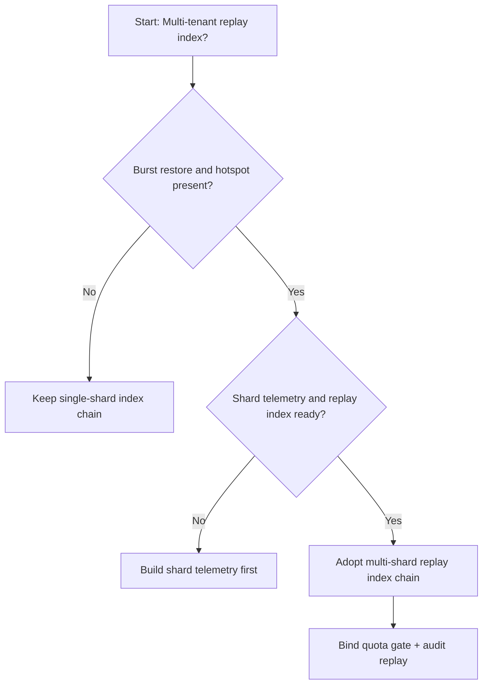
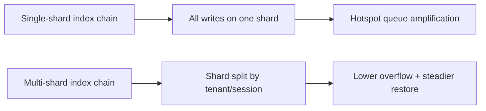
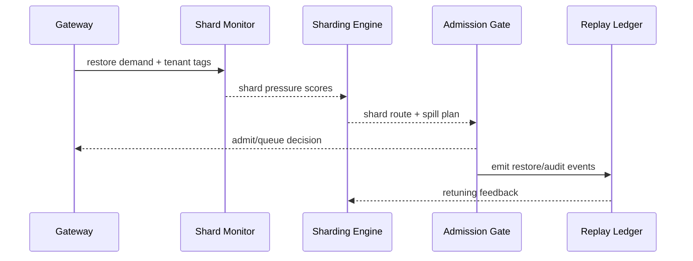

# Agent Session Replay-index Sharding Selection FAQ (Single-shard Index Chain vs Multi-shard Index Chain)

## 1) Core conclusions (for decision-makers first)
- **For multi-tenant session production, default to a multi-shard replay-index chain**, not a long-lived single-shard chain.
- **Single-shard chains are prone to hotspot buildup under long sessions and restore bursts**, increasing queueing and resume failures.
- **Sharding policy must couple tenant isolation, gateway quota, and replay audit**, or index congestion and governance policy will drift apart.

## 2) Q1 / Q2 / Q3 (plain-language definitions first)
- **Single-shard index chain**: all replay index writes land in one logical shard; simple but hotspot-prone.
- **Multi-shard index chain**: replay indexes are partitioned by tenant/session domain for lower contention and higher restore parallelism.

### Q1: Why is single-shard more fragile at peak?
First principles: both write and restore pressure target one index path; when state growth and restore concurrency increase together, hotspots and queue depth co-amplify.

### Q2: When is single-shard still acceptable?
Short transitional phases with single tenant, low concurrency, short sessions, and rare restores.

### Q3: What is the minimum safe loop?
Tenant domain split -> sharding policy -> burst-budget admission gate -> replay audit -> shard rollback retuning.

## 3) Mermaid (decision tree / path comparison / sequence)
### 3.1 Selection decision tree

### 3.2 Path comparison

### 3.3 Runtime sequence

## 4) Decision matrix
| Dimension | Single-shard index chain | Multi-shard index chain |
|---|---|---|
| Implementation complexity | Low | Medium |
| Peak restore stability | Medium-Low | High |
| Hotspot overflow control | Low-Medium | High |
| Multi-tenant sustainability | Medium | High |
| Default production fit | Transitional only | Long-term default |

## 5) Evidence contract + recomputable examples (n/denominator/source)
> Percentages in this section are `synthetic_assumed` hypothetical examples for mechanism comparison; production mechanism validation remains `not_measured`.  
> Contract fields: `workshops/azure-agent-infra/evidence/cycle-449-benchmark.json` -> `percentage_contract`.

- Metric A (single-shard overflow rate)  
  - Formula: `n_single_shard_overflow / n_runtime_requests_observed`  
  - Value: `322/2400 = 13.4%` (`synthetic_assumed`)  
  - Path: `percentage_contract.single_shard_overflow_rate`
- Metric B (multi-shard overflow rate)  
  - Formula: `n_multi_shard_overflow / n_runtime_requests_observed`  
  - Value: `133/2400 = 5.5%` (`synthetic_assumed`)  
  - Path: `percentage_contract.multi_shard_overflow_rate`
- Metric C (resume success gain, percentage points)  
  - Formula: `(n_resume_success_sharded - n_resume_success_single) / n_runtime_requests_observed`  
  - Value: `(2240-2047)/2400 = 8.0 percentage points` (`synthetic_assumed`)  
  - Path: `percentage_contract.sharded_recovery_gain_pts`

## 6) Production checklist
- [ ] Sharding policy is versioned with rollout and rollback paths
- [ ] Tenant quota and burst-budget admission gates are enforced at gateway level
- [ ] Resume failures, resume success, and replay audit are traceable
- [ ] Metrics are tagged `synthetic_assumed` with denominator/unit; production mechanism validation remains `not_measured`

