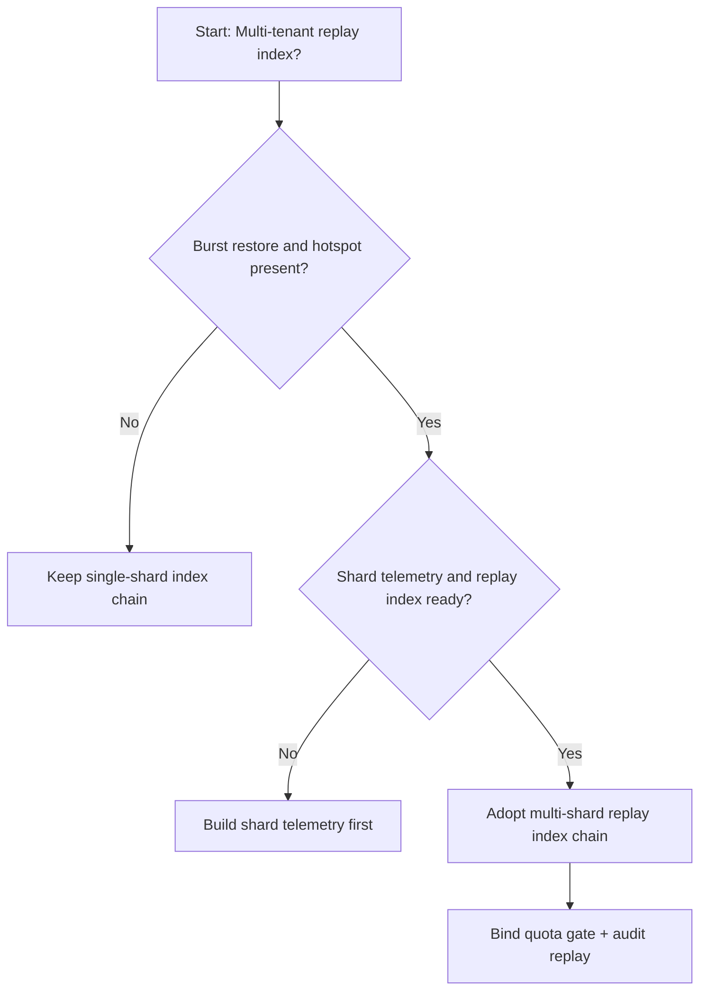
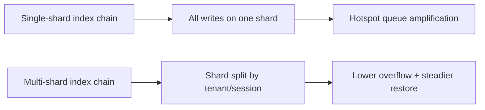
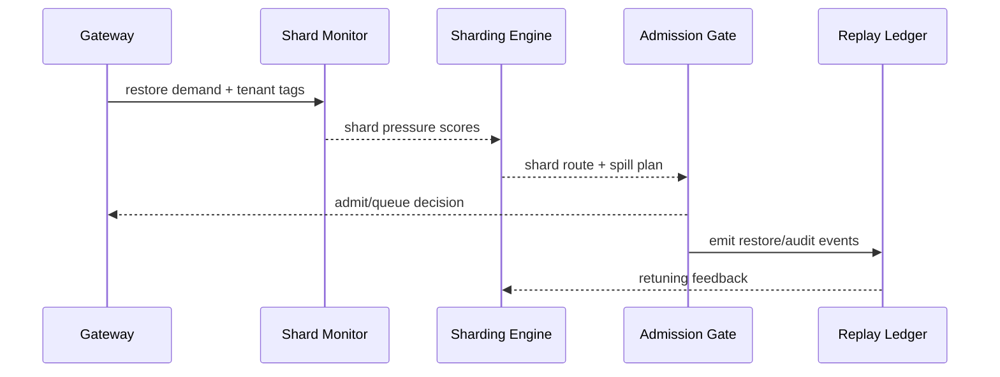

# Agent Session 回放索引分片选型 FAQ（单分片索引链 vs 多分片索引链）

## 1) 核心结论（先给负责人）
- **多租户 Session 生产默认应选“多分片回放索引链”**，不建议长期单分片索引链。
- **单分片链在长会话和并发恢复高峰下容易形成热点，触发恢复排队与失败率抬升**。
- **分片策略必须与租户隔离、网关配额、审计回放联动**，否则会出现索引层拥塞与治理口径不一致。

## 2) Q1 / Q2 / Q3（术语先通俗解释）
- **单分片索引链**：所有会话回放索引写入一个逻辑分片，结构简单但热点风险高。
- **多分片索引链**：按租户/会话域拆分多个索引分片，降低热点并提升恢复并行度。

### Q1：为什么单分片在峰值更脆弱？
第一性原理：写入与读取都集中到同一索引路径，状态增长与恢复并发同步上升时，热点与排队会共同放大。

### Q2：什么时候可接受单分片？
单租户、低并发、短会话且恢复频次低的过渡阶段可接受。

### Q3：最小安全闭环是什么？
租户分域 -> 索引分片策略 -> 峰值预算门禁 -> 回放审计 -> 分片参数回滚校准。

## 3) Mermaid（决策树 / 路径对比 / 时序）
### 3.1 选型决策树

### 3.2 路径对比图

### 3.3 运行时序图

## 4) 选型决策矩阵
| 维度 | 单分片索引链 | 多分片索引链 |
|---|---|---|
| 实现复杂度 | 低 | 中 |
| 峰值恢复稳定性 | 中-低 | 高 |
| 热点溢出控制 | 低-中 | 高 |
| 多租户可持续性 | 中 | 高 |
| 生产默认建议 | 过渡方案 | 长期默认 |

## 5) 数据证据与可复算算例（含 n/分母/来源）
> 本节百分比为 `synthetic_assumed` 假设算例（hypothetical），用于机制比较；生产机制认证保持 `not_measured`。  
> 合同字段见：`workshops/azure-agent-infra/evidence/cycle-449-benchmark.json` 的 `percentage_contract`。

- 指标 A（单分片溢出率）  
  - 定义：`n_single_shard_overflow / n_runtime_requests_observed`  
  - 值：`322/2400 = 13.4%`（`synthetic_assumed`）  
  - 路径：`percentage_contract.single_shard_overflow_rate`
- 指标 B（多分片溢出率）  
  - 定义：`n_multi_shard_overflow / n_runtime_requests_observed`  
  - 值：`133/2400 = 5.5%`（`synthetic_assumed`）  
  - 路径：`percentage_contract.multi_shard_overflow_rate`
- 指标 C（恢复成功率提升，百分点）  
  - 定义：`(n_resume_success_sharded - n_resume_success_single) / n_runtime_requests_observed`  
  - 值：`(2240-2047)/2400 = 8.0` 个百分点（`synthetic_assumed`）  
  - 路径：`percentage_contract.sharded_recovery_gain_pts`

## 6) 生产 Checklist（上线前必须打勾）
- [ ] 分片策略含版本、灰度与回滚路径
- [ ] 租户配额与峰值预算门禁在网关层生效
- [ ] 恢复失败率、恢复成功率与回放审计可追溯
- [ ] 指标口径标注 `synthetic_assumed`、分母与单位；生产机制认证保持 `not_measured`

