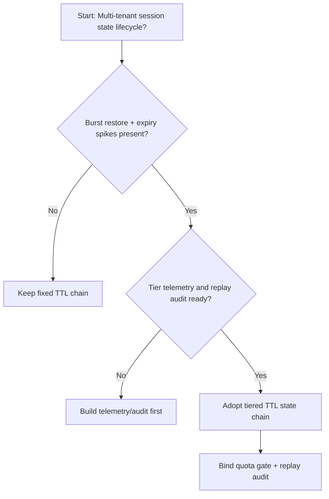
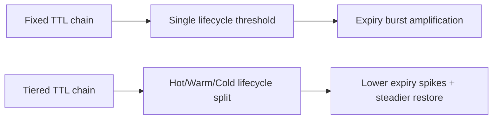
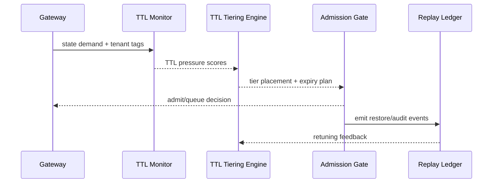

# Agent Session State TTL Tiering Selection FAQ (Fixed TTL Chain vs Tiered TTL Chain)

## 1) Core conclusions (for decision-makers first)
- **For multi-tenant session production, default to a tiered session-state TTL chain (Hot+Warm+Cold)** rather than a long-running fixed TTL single-tier chain.
- **Fixed TTL chains are more likely to trigger expiry jitter and resume-failure spikes** under long sessions and burst restore windows.
- **TTL policy must couple tenant quota, gateway admission, and replay audit**, or governance policy and runtime recovery will drift apart.

## 2) Q1 / Q2 / Q3 (plain-language definitions first)
- **Fixed TTL chain**: all state uses the same lifecycle threshold; simple but inflexible.
- **Tiered TTL chain**: hot state uses short TTL while historical state uses longer TTL in tiered storage.

### Q1: Why is fixed TTL more fragile at peak?
First principles: when state writes and restore concurrency rise together, a uniform TTL causes clustered expiry events and amplifies queue/rebuild pressure.

### Q2: When is fixed TTL still acceptable?
Short transitional phases with single tenant, short sessions, and low restore frequency.

### Q3: What is the minimum safe loop?
Tenant classification -> TTL tiering policy -> burst-budget gate -> replay audit -> TTL rollback retuning.

## 3) Mermaid (decision tree / path comparison / sequence)
### 3.1 Selection decision tree

### 3.2 Path comparison

### 3.3 Runtime sequence

## 4) Decision matrix
| Dimension | Fixed TTL chain | Tiered TTL chain |
|---|---|---|
| Implementation complexity | Low | Medium |
| Peak restore stability | Medium-Low | High |
| Expiry-jitter control | Low-Medium | High |
| Multi-tenant sustainability | Medium | High |
| Default production fit | Transitional only | Long-term default |

## 5) Evidence contract + recomputable examples (n/denominator/source)
> Percentages in this section are `synthetic_assumed` hypothetical examples for mechanism comparison; production mechanism validation remains `not_measured`.  
> Contract fields: `workshops/azure-agent-infra/evidence/cycle-450-benchmark.json` -> `percentage_contract`.

- Metric A (fixed TTL expiry-failure rate)  
  - Formula: `n_fixed_ttl_expiry_fail / n_runtime_requests_observed`  
  - Value: `322/2400 = 13.4%` (`synthetic_assumed`)  
  - Path: `percentage_contract.fixed_ttl_expiry_rate`
- Metric B (tiered TTL expiry-failure rate)  
  - Formula: `n_tiered_ttl_expiry_fail / n_runtime_requests_observed`  
  - Value: `133/2400 = 5.5%` (`synthetic_assumed`)  
  - Path: `percentage_contract.tiered_ttl_expiry_rate`
- Metric C (resume success gain, percentage points)  
  - Formula: `(n_resume_success_tiered_ttl - n_resume_success_fixed_ttl) / n_runtime_requests_observed`  
  - Value: `(2240-2047)/2400 = 8.0 percentage points` (`synthetic_assumed`)  
  - Path: `percentage_contract.ttl_recovery_gain_pts`

## 6) Production checklist
- [ ] TTL tiering policy is versioned with rollout and rollback paths
- [ ] Tenant quota and burst-budget admission gates are enforced at gateway level
- [ ] Resume failures, resume success, and replay audit are traceable
- [ ] Metrics are tagged `synthetic_assumed` with denominator/unit; production validation remains `not_measured`

