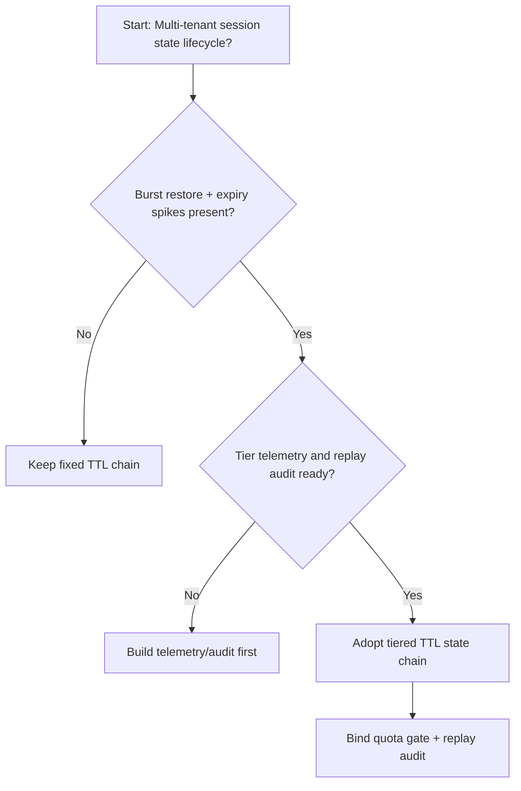
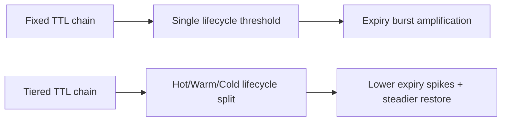
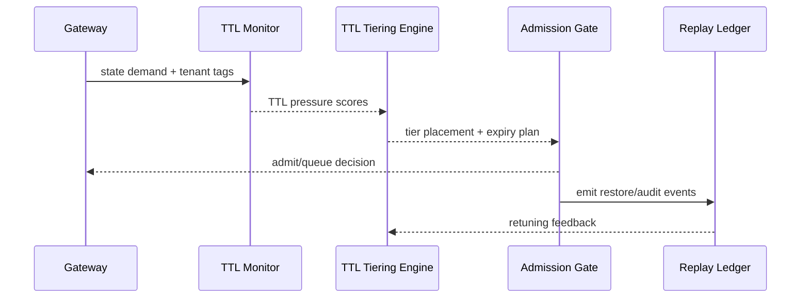

# Agent Session 会话状态 TTL 分层选型 FAQ（固定 TTL 链 vs 分层 TTL 链）

## 1) 核心结论（先给负责人）
- **多租户 Session 生产默认应选“会话状态 TTL 分层链（Hot+Warm+Cold）”**，不建议长期固定 TTL 单层链。
- **固定 TTL 链在长会话与突发恢复场景下更易出现过期抖动与恢复失败率抬升**。
- **TTL 策略必须与租户配额、网关准入、回放审计联动**，否则会出现“策略有效但恢复不可用”的治理断层。

## 2) Q1 / Q2 / Q3（术语先通俗解释）
- **固定 TTL 链**：所有状态采用同一生命周期阈值，配置简单但弹性不足。
- **分层 TTL 链**：热点状态短 TTL，历史状态长 TTL 并分层下沉，兼顾恢复与成本。

### Q1：为什么固定 TTL 在峰值期更脆弱？
第一性原理：状态写入与恢复并发同时上升时，统一 TTL 触发集中过期，会放大队列与重建压力。

### Q2：什么时候还能接受固定 TTL？
单租户、短会话、低恢复频次的过渡阶段可接受。

### Q3：最小安全闭环是什么？
租户分级 -> TTL 分层策略 -> 峰值预算门禁 -> 恢复回放审计 -> TTL 参数回滚校准。

## 3) Mermaid（决策树 / 路径对比 / 时序）
### 3.1 选型决策树

### 3.2 路径对比图

### 3.3 运行时序图

## 4) 选型决策矩阵
| 维度 | 固定 TTL 链 | 分层 TTL 链 |
|---|---|---|
| 实现复杂度 | 低 | 中 |
| 峰值恢复稳定性 | 中-低 | 高 |
| 过期抖动控制 | 低-中 | 高 |
| 多租户可持续性 | 中 | 高 |
| 生产默认建议 | 过渡方案 | 长期默认 |

## 5) 数据证据与可复算算例（含 n/分母/来源）
> 本节百分比为 `synthetic_assumed` 假设算例（hypothetical），用于机制比较；生产机制认证保持 `not_measured`。  
> 合同字段见：`workshops/azure-agent-infra/evidence/cycle-450-benchmark.json` 的 `percentage_contract`。

- 指标 A（固定 TTL 过期失败率）  
  - 定义：`n_fixed_ttl_expiry_fail / n_runtime_requests_observed`  
  - 值：`322/2400 = 13.4%`（`synthetic_assumed`）  
  - 路径：`percentage_contract.fixed_ttl_expiry_rate`
- 指标 B（分层 TTL 过期失败率）  
  - 定义：`n_tiered_ttl_expiry_fail / n_runtime_requests_observed`  
  - 值：`133/2400 = 5.5%`（`synthetic_assumed`）  
  - 路径：`percentage_contract.tiered_ttl_expiry_rate`
- 指标 C（恢复成功率提升，百分点）  
  - 定义：`(n_resume_success_tiered_ttl - n_resume_success_fixed_ttl) / n_runtime_requests_observed`  
  - 值：`(2240-2047)/2400 = 8.0` 个百分点（`synthetic_assumed`）  
  - 路径：`percentage_contract.ttl_recovery_gain_pts`

## 6) 生产 Checklist（上线前必须打勾）
- [ ] TTL 分层策略含版本、灰度与回滚路径
- [ ] 租户配额与峰值预算门禁在网关层生效
- [ ] 恢复失败率、恢复成功率与回放审计可追溯
- [ ] 指标口径标注 `synthetic_assumed`、分母与单位；生产机制认证保持 `not_measured`

