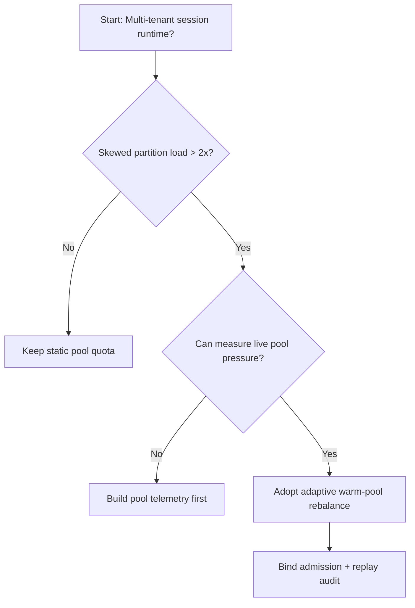
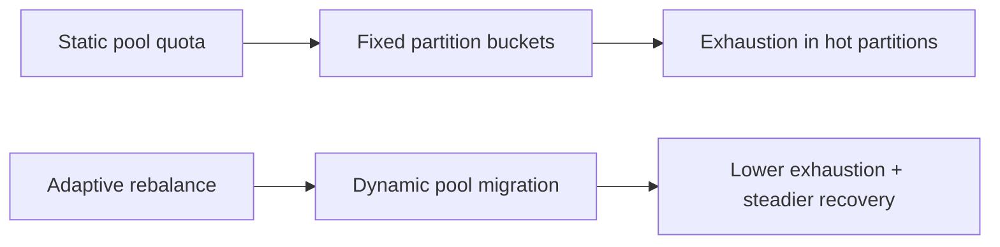
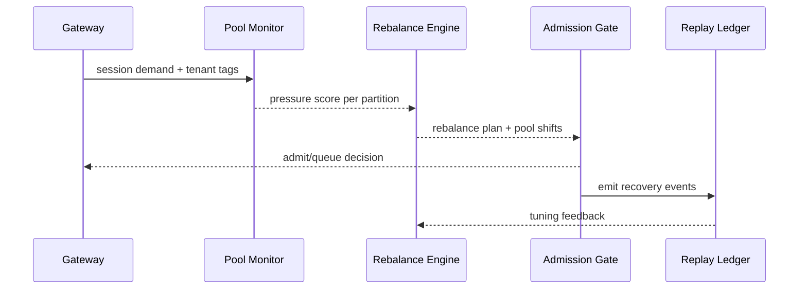

# Agent Session Warm-pool Rebalance Selection FAQ (Static Pool Quota vs Adaptive Rebalance)

## 1) Core conclusions (for decision-makers first)
- **For high-concurrency agent sessions, default to adaptive warm-pool rebalance with admission coupling**, not static pool quotas.
- **Static quotas create asymmetric exhaustion under uneven tenant load**, causing recovery failures and tail-latency instability.
- **Rebalance policy must bind tenant priority, pool pressure, replay audit, and rollback versions**, or peak-time oscillations will persist.

## 2) Q1 / Q2 / Q3 (plain-language definitions first)
- **Static warm-pool quota**: pre-warmed instances are fixed by partition; simple but insensitive to live skew.
- **Adaptive rebalance**: dynamically shifts warm capacity toward partitions under higher live pressure.

### Q1: Why does static quota create “resource exists but unavailable” failures?
First principles: demand location shifts over time; fixed buckets cannot follow demand centroid movement.

### Q2: When is static quota still acceptable?
Stable tenant distribution, smooth traffic, and tolerance for occasional queue spikes.

### Q3: What is the minimum safe loop?
Partition telemetry -> pool-pressure evaluation -> rebalance decision -> admission coupling -> replay audit retuning.

## 3) Mermaid (decision tree / path comparison / sequence)
### 3.1 Selection decision tree

### 3.2 Path comparison

### 3.3 Runtime sequence

## 4) Decision matrix
| Dimension | Static pool quota | Adaptive rebalance |
|---|---|---|
| Implementation complexity | Low | Medium |
| Peak stability | Low-Medium | High |
| Exhaustion control | Low-Medium | High |
| Multi-tenant sustainability | Medium | High |
| Recommended production default | Transitional | Long-term default |

## 5) Quant evidence and reproducible examples (with n/denominator/source)
> Percentages in this section are `synthetic_assumed` hypothetical examples for mechanism comparison; production mechanism certification remains `not_measured`.  
> Contract fields are in `workshops/azure-agent-infra/evidence/cycle-447-benchmark.json` under `percentage_contract`.

- Metric A (static-quota exhaustion rate)  
  - Definition: `n_static_pool_exhaust / n_runtime_requests_observed`  
  - Value: `322/2400 = 13.4%` (`synthetic_assumed`)  
  - Path: `percentage_contract.static_pool_exhaust_rate`
- Metric B (adaptive-rebalance exhaustion rate)  
  - Definition: `n_rebalance_pool_exhaust / n_runtime_requests_observed`  
  - Value: `133/2400 = 5.5%` (`synthetic_assumed`)  
  - Path: `percentage_contract.adaptive_rebalance_exhaust_rate`
- Metric C (recovery-success uplift, percentage points)  
  - Definition: `(n_recovery_success_rebalance - n_recovery_success_static) / n_runtime_requests_observed`  
  - Value: `(2240-2047)/2400 = 8.0` percentage points (`synthetic_assumed`)  
  - Path: `percentage_contract.rebalance_recovery_gain_pts`

### Daily-hot source references (with fetch timestamps)
- APIM / AI Gateway overview (Microsoft Learn): `fetched_at_utc=2026-11-09T16:02:21Z`, `source_label=measured`
- Azure API Management changelog (Unified model API / MCP / A2A): `fetched_at_utc=2026-11-09T16:02:21Z`, `source_label=measured`
- Azure Container Apps Dynamic Sessions: `fetched_at_utc=2026-11-09T16:02:21Z`, `source_label=measured`
- Firecracker / Kata / Wasmtime / E2B releases: `fetched_at_utc=2026-11-09T16:02:21Z`, `source_label=measured`

## 6) Production validation checklist
- [ ] Rebalance policy (thresholds/shift-step/rollback) supports versioning and canary
- [ ] Admission gate and pool migration execute coherently to avoid control-plane drift
- [ ] Exhaustion rate, queue latency, recovery-success rate, and audit chain are traceable
- [ ] Every metric explicitly labels `synthetic_assumed` / `not_measured` with denominator, unit, and source path
