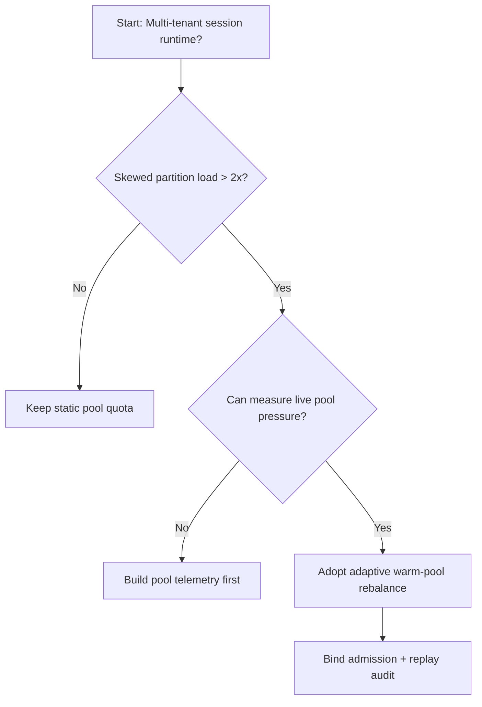
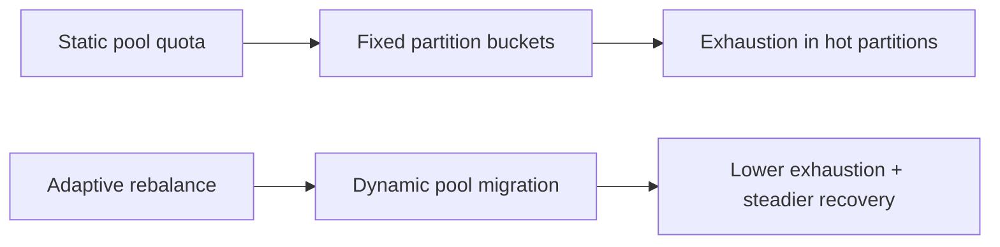
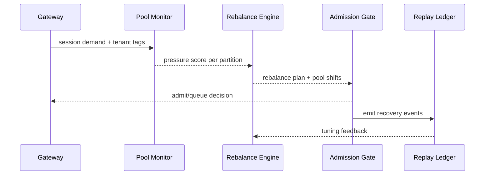

# Agent Session 热池重平衡选型 FAQ（静态热池配额 vs 自适应重平衡）

## 1) 核心结论（先给负责人）
- **高并发 Agent Session 生产默认优先“自适应热池重平衡 + 准入联动”**，不建议长期静态热池配额。
- **静态配额在租户负载不均时容易出现一侧池耗尽、另一侧闲置**，导致恢复失败和尾延迟抖动。
- **重平衡策略必须绑定租户优先级、容量水位、回放审计与回滚版本**，否则容易在峰值期反复振荡。

## 2) Q1 / Q2 / Q3（术语先通俗解释）
- **静态热池配额**：预热实例按固定比例分配给各分区，简单但不随实时负载调整。
- **自适应重平衡**：根据实时负载把可用热池实例动态迁移到压力更高分区。

### Q1：为什么静态配额在生产常见“有资源却不可用”？
第一性原理：资源位置和需求位置不一致，固定分桶无法跟随请求重心迁移。

### Q2：什么时候静态配额仍可接受？
租户分布稳定、流量平滑且业务接受偶发排队时，可短期采用。

### Q3：最小安全闭环是什么？
流量分区观测 -> 池水位评估 -> 重平衡决策 -> 准入联动 -> 回放审计复盘。

## 3) Mermaid（决策树 / 路径对比 / 时序）
### 3.1 选型决策树

### 3.2 路径对比图

### 3.3 运行时序图

## 4) 选型决策矩阵
| 维度 | 静态热池配额 | 自适应重平衡 |
|---|---|---|
| 实现复杂度 | 低 | 中 |
| 峰值稳定性 | 中-低 | 高 |
| 池耗尽控制 | 低-中 | 高 |
| 多租户可持续性 | 中 | 高 |
| 生产默认建议 | 过渡方案 | 长期默认 |

## 5) 数据证据与可复算算例（含 n/分母/来源）
> 本节百分比为 `synthetic_assumed` 假设算例（hypothetical），用于机制比较；生产机制认证保持 `not_measured`。  
> 合同字段见：`workshops/azure-agent-infra/evidence/cycle-447-benchmark.json` 的 `percentage_contract`。

- 指标 A（静态配额耗尽率）  
  - 定义：`n_static_pool_exhaust / n_runtime_requests_observed`  
  - 值：`322/2400 = 13.4%`（`synthetic_assumed`）  
  - 路径：`percentage_contract.static_pool_exhaust_rate`
- 指标 B（自适应重平衡耗尽率）  
  - 定义：`n_rebalance_pool_exhaust / n_runtime_requests_observed`  
  - 值：`133/2400 = 5.5%`（`synthetic_assumed`）  
  - 路径：`percentage_contract.adaptive_rebalance_exhaust_rate`
- 指标 C（恢复成功率提升，百分点）  
  - 定义：`(n_recovery_success_rebalance - n_recovery_success_static) / n_runtime_requests_observed`  
  - 值：`(2240-2047)/2400 = 8.0` 个百分点（`synthetic_assumed`）  
  - 路径：`percentage_contract.rebalance_recovery_gain_pts`

### 当日热点来源（抓取时间）
- APIM / AI Gateway 概览（Microsoft Learn）：`fetched_at_utc=2026-11-09T16:02:21Z`，`source_label=measured`
- Azure API Management changelog（Unified model API / MCP / A2A）：`fetched_at_utc=2026-11-09T16:02:21Z`，`source_label=measured`
- Azure Container Apps Dynamic Sessions：`fetched_at_utc=2026-11-09T16:02:21Z`，`source_label=measured`
- Firecracker / Kata / Wasmtime / E2B releases：`fetched_at_utc=2026-11-09T16:02:21Z`，`source_label=measured`

## 6) 生产核验 Checklist（上线前必须打勾）
- [ ] 热池重平衡策略（阈值/迁移步长/回滚）具备版本与灰度
- [ ] 准入门与热池迁移一致执行，避免“迁移成功但入口未收敛”
- [ ] 耗尽率、排队时延、恢复成功率与审计链可追溯
- [ ] 指标全部标注 `synthetic_assumed` / `not_measured` 与分母、单位、source_path
