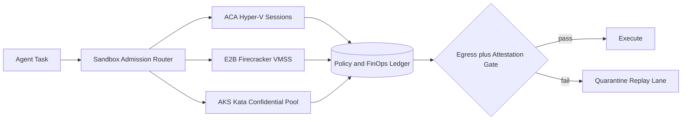

# Untrusted Agent Code Sandbox Selection FAQ: ACA Hyper-V vs E2B Firecracker vs AKS Kata Confidential (Cycle 2370)

## 1) Scenario and constraints
This round focuses on sandbox execution for **untrusted code and browser automation**. The design target is balancing isolation boundary, cold-start latency, network egress controls, and FinOps guardrails across ACA Dynamic Sessions, E2B Firecracker-on-VMSS, and AKS Kata Confidential Containers.

## 2) Daily breakthrough signals (verifiable)
- ACA Dynamic Sessions continues to improve managed session orchestration experience.
- E2B Firecracker release cadence keeps startup efficiency and lightweight isolation competitive.
- Kata/Confidential paths remain strong for attestable high-compliance isolation boundaries.
- Tiered routing improves the safety-cost balance for mixed-risk workloads.

## 3) Decision matrix (cold start, density, isolation, cost)
| Option | Cold start | Session density | Egress isolation | Confidential execution | Cost per session | Ops complexity |
|---|---:|---:|---:|---:|---:|---:|
| ACA Dynamic Sessions | Medium | Medium | Medium-high | Medium | Medium | Low |
| E2B Firecracker on VMSS | Low | High | High | Medium | Low | Medium |
| AKS Kata Confidential | High | Medium-low | High | High | High | High |
| Tiered hybrid routing | Medium-low | High | High | High | Medium | Medium-high |

## 4) Guidance (Good fit / Not for)
Good fit:
1. SaaS agent platforms needing risk-tiered sandbox scheduling.
2. Browser/CUA automation requiring strict egress policy controls.
3. Regulated workloads needing attestation-grade isolation evidence.

Not for:
1. Single-host PoCs or low-risk internal scripts.
2. Teams lacking platform ops maturity but requiring strong self-hosted isolation.
3. Workloads that cannot tolerate additional cold-start overhead while forcing confidential-only execution.

## 5) Percentage contract bindings (N/D)
- `percentage_contract.unfenced_untrusted_sandbox_escape_risk_rate`
- `percentage_contract.egress_isolation_policy_consistency_rate`
- `percentage_contract.confidential_sandbox_finops_breakeven_gain_pts`

These keys bind to this FAQ and `cycle-2370-benchmark.json`; `production_validation=not_measured`.

## 6) Five-step rollout guide
1. Classify tasks by risk tier and map them to sandbox classes.
2. Enforce default-deny egress at routing stage with tenant allowlists.
3. Require attestation pass for high-risk execution lanes.
4. Apply burn-rate guardrails with automatic lane rebalancing.
5. Recompute break-even thresholds weekly from latency/intercept/cost telemetry.
