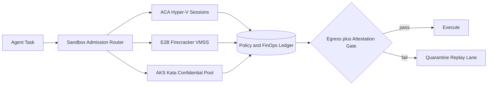

# 不可信 Agent 代码沙箱执行选型 FAQ：ACA Hyper-V vs E2B Firecracker vs AKS Kata Confidential（Cycle 2370）

## 1) 场景与约束
本轮聚焦“不可信代码/浏览器自动化执行”沙箱：目标是同时满足**隔离边界、冷启动、网络出站隔离、以及 FinOps 成本上限**。比较路径为 ACA Dynamic Sessions（Hyper-V）、E2B Firecracker on VMSS、AKS Kata Confidential Containers。

## 2) 当日能力突破信号（可验证）
- ACA Dynamic Sessions 在会话编排和隔离执行上更偏平台托管体验。  
- E2B Firecracker 版本迭代持续强化轻量隔离与启动效率。  
- Kata/Confidential 路径在强隔离与证明链方面更适配高合规工作负载。  
- 组合式路由可在成本与安全之间实现分层调度。

## 3) 决策矩阵（冷启动/密度/隔离/成本）
| 方案 | 冷启动 | 会话密度 | 出站隔离 | 机密执行 | 单会话成本 | 运维复杂度 |
|---|---:|---:|---:|---:|---:|---:|
| ACA Dynamic Sessions | 中 | 中 | 中高 | 中 | 中 | 低 |
| E2B Firecracker on VMSS | 低 | 高 | 高 | 中 | 低 | 中 |
| AKS Kata Confidential | 高 | 中低 | 高 | 高 | 高 | 高 |
| 分层混合路由 | 中低 | 高 | 高 | 高 | 中 | 中高 |

## 4) 方案建议（Good fit / Not for）
Good fit：
1. SaaS Agent 平台需要按任务风险分层调度沙箱。  
2. Browser/CUA 自动化任务需要强 egress policy 与审计。  
3. 金融/政企场景要求机密执行与证明链保真。  

Not for：
1. 单机 PoC 或低风险内部脚本。  
2. 无 GPU/容器运维能力但要求自托管强隔离。  
3. 无法接受额外冷启动开销却强制全量机密执行。

## 5) 百分比契约绑定（N/D）
- `percentage_contract.unfenced_untrusted_sandbox_escape_risk_rate`
- `percentage_contract.egress_isolation_policy_consistency_rate`
- `percentage_contract.confidential_sandbox_finops_breakeven_gain_pts`

以上键绑定本 FAQ 与 `cycle-2370-benchmark.json`，`production_validation=not_measured`。

## 6) 五步落地指南
1. 建立任务分级（低/中/高风险）并映射到三类沙箱。  
2. 出站策略前置到路由层，默认 deny，再按租户白名单放行。  
3. 高风险任务强制 attestation 通过后执行。  
4. 实时追踪 burn-rate，超过阈值自动切换低成本路径。  
5. 每周复盘冷启动与拦截率，重算 break-even 决策线。  
