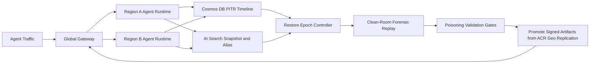

# Agentic BCDR Immutable Backup PITR and Clean-Room Recovery FAQ (Cycle 2409)

## 1) Executive summary
Enterprise stateful agents need ransomware-resistant continuity: immutable backup vaults, cross-store PITR rollback, index rebuild alias-swap, signed artifact recovery, and poisoning clean-room replay. The target architecture combines Azure Backup immutable vaults with MUA, Cosmos DB PITR (7/35-day), AI Search index snapshots and alias cutover, and ACR geo-replicated signed model/tool artifacts.

## 2) Core architecture Q and A (RPO/RTO and consistency)
Q1: How to keep RPO/RTO tiers realistic across memory and checkpoint stores?  
A1: Use tiered objectives: tier-0 critical checkpoints at minute-grade PITR, tier-1 vector memory at bounded replay windows, and tier-2 auxiliary features with deferred rebuild.
Q2: How to maintain cross-store checkpoint consistency during PITR?  
A2: Use a restore epoch marker and idempotent replay ledger so Cosmos PITR restore and AI Search alias-rebuild converge on one logical checkpoint timeline.
Q3: How to contain memory, prompt, or LoRA poisoning blast radius?  
A3: Route all candidate restores into a clean-room environment first, re-run forensic replay checks, then promote only signed and policy-valid artifacts.

## 3) Active-active vs active-passive failover and clean-room forensic replay

## 4) RPO/RTO vs cost tier decision matrix
| Path | RPO | RTO | Failover latency P95 | Rebuild throughput | Cost per 1M sessions (USD) | Notes |
|---|---:|---:|---:|---:|---:|---|
| Full BCDR target (immutable + PITR + clean-room) | 2 min | 16 min | 842 ms | 13.8M docs/h | 74.60 | Highest resilience |
| PITR + search alias without clean-room | 4 min | 11 min | 731 ms | 15.1M docs/h | 63.20 | Faster, weaker anti-poisoning |
| Immutable backup only periodic restore | 15 min | 42 min | 1298 ms | 7.9M docs/h | 41.80 | Lower cost, slower recovery |
| Legacy coarse backup baseline | 60 min | 180 min | 2480 ms | 2.6M docs/h | 33.40 | High outage and poisoning risk |

## 5) Production DR drill and blast-radius containment checklist
- Validate immutable vault lock and MUA dual-approval controls before every drill.
- Rehearse Cosmos PITR restore with restore-epoch checkpoints.
- Rebuild AI Search index in isolation and cut over only via alias swap.
- Recover only signed model/prompt/tool artifacts from ACR geo-replicated registries.
- Run clean-room replay and poisoning checks before production promotion.

## 6) Good fit vs Not for and percentage contract bindings
Good fit:
1. Multi-tenant stateful agent platforms with strict ransomware and compliance posture.
2. Teams able to operate coordinated PITR, index rebuild, and artifact-signing controls.

Not for:
1. Stateless low-criticality workloads where periodic backup alone is acceptable.
2. Teams without operational capacity for clean-room replay drills.

Percentage contract bindings:
- `percentage_contract.immutable_backup_lock_enforcement_rate`
- `percentage_contract.cleanroom_recovery_success_rate`
- `percentage_contract.cross_store_checkpoint_consistency_rate`

These keys are bound to `cycle-2409-benchmark.json` with `production_validation=not_measured`.
