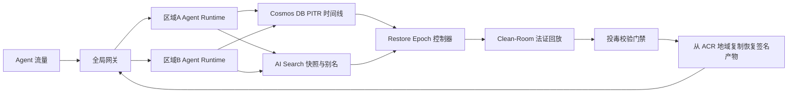

# Agentic BCDR 不可变备份 PITR 与 Clean-Room 恢复 FAQ（Cycle 2409）

## 1) 执行摘要
面向有状态企业 Agent，需要具备抗勒索与抗投毒连续性：不可变备份金库、跨存储 PITR 回滚、索引重建别名切换、签名产物恢复、clean-room 法证回放。目标方案组合 Azure Backup Immutable Vault + MUA、Cosmos DB PITR（7/35 天）、AI Search 快照与 Alias 切换、ACR 地域复制签名模型/工具产物。

## 2) 核心架构问答（RPO/RTO 与一致性）
Q1：如何设定跨存储的 RPO/RTO 分层目标？  
A1：采用分层目标：tier-0 检查点分钟级 PITR、tier-1 向量记忆受控回放窗口、tier-2 辅助数据延后重建。
Q2：PITR 过程中如何保证跨存储检查点一致性？  
A2：引入 restore epoch 标记与幂等回放账本，使 Cosmos PITR 与 AI Search alias 重建收敛到同一逻辑检查点时间线。
Q3：如何控制记忆/提示词/LoRA 投毒爆炸半径？  
A3：所有候选恢复先进入 clean-room，执行法证回放与投毒校验，通过后才允许签名产物晋升生产。

## 3) 主动-主动 vs 主备切换与 clean-room 法证回放

## 4) RPO/RTO 与成本分层决策矩阵
| 路径 | RPO | RTO | 故障切换时延 P95 | 重建吞吐 | 每百万会话成本（USD） | 说明 |
|---|---:|---:|---:|---:|---:|---|
| 全链路 BCDR 目标（不可变+PITR+clean-room） | 2 分钟 | 16 分钟 | 842 ms | 13.8M docs/h | 74.60 | 韧性最高 |
| PITR+索引别名切换（无 clean-room） | 4 分钟 | 11 分钟 | 731 ms | 15.1M docs/h | 63.20 | 更快但抗投毒较弱 |
| 仅不可变备份周期恢复 | 15 分钟 | 42 分钟 | 1298 ms | 7.9M docs/h | 41.80 | 成本低恢复慢 |
| 传统粗粒度备份基线 | 60 分钟 | 180 分钟 | 2480 ms | 2.6M docs/h | 33.40 | 停机与投毒风险高 |

## 5) 生产 DR 演练与爆炸半径控制清单
- 每次演练前校验 immutable vault lock 与 MUA 双人审批。
- 演练 Cosmos PITR 恢复并写入 restore epoch 检查点。
- 在隔离环境重建 AI Search 索引，仅通过 alias swap 切流。
- 仅从 ACR 地域复制仓恢复已签名模型/提示词/工具产物。
- 生产晋升前完成 clean-room 回放与投毒校验。

## 6) Good fit vs Not for 与百分比合约绑定
Good fit：
1. 对勒索与合规要求严格的多租户有状态 Agent 平台。
2. 能运维 PITR、索引重建和签名产物治理链路的团队。

Not for：
1. 无状态低关键业务，仅需周期备份的场景。
2. 无法执行 clean-room 演练与法证回放的团队。

百分比合约绑定：
- `percentage_contract.immutable_backup_lock_enforcement_rate`
- `percentage_contract.cleanroom_recovery_success_rate`
- `percentage_contract.cross_store_checkpoint_consistency_rate`

以上键绑定 `cycle-2409-benchmark.json`，并标注 `production_validation=not_measured`。
